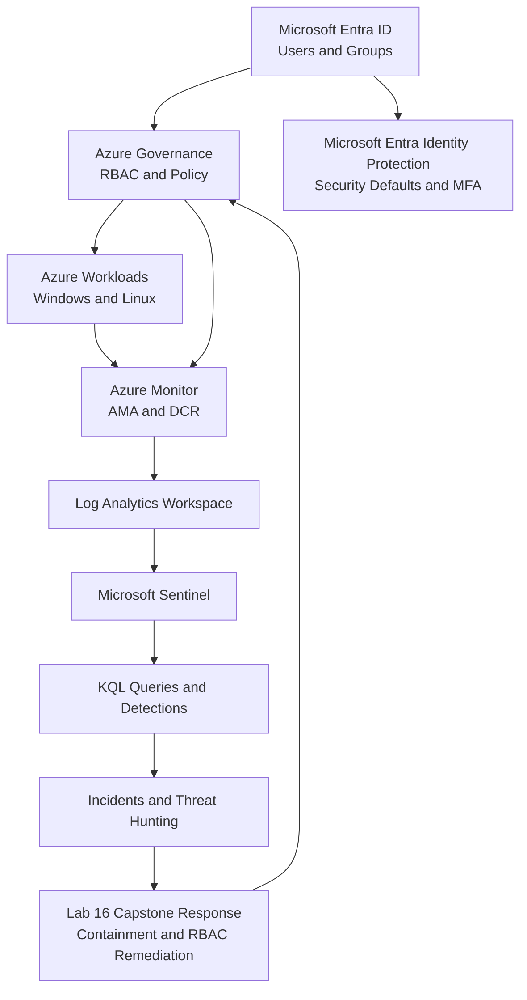

# Azure Security Operations Lab — Microsoft Blue Team Expansion

## Overview

This repository documents the evolution of a hands-on Microsoft infrastructure and blue-team lab built to connect **cloud administration, Windows Server, networking, identity, telemetry, SIEM, incident response, and XDR** in one continuous environment.

The project originally started as a structured **25-day Azure security learning path**. The first four phases moved from Azure governance and Microsoft Entra ID into virtual machines, networking, Azure Monitor, Log Analytics, Microsoft Sentinel, KQL, detection engineering, incident triage, threat hunting, Conditional Access validation, and Azure Policy. That original path culminated in **Lab 16 — Mini SOC Capstone**, where those individual skills were combined into one end-to-end investigation involving excessive Azure RBAC, Azure Run Command, Windows privilege escalation, process discovery, scheduled-task persistence, telemetry troubleshooting, a new Sentinel detection, containment, least-privilege remediation, and incident closure.

Lab 16 also made the next learning gap much clearer. Detecting an event is only one part of security operations. To investigate and remediate confidently, an analyst also needs to understand the infrastructure underneath the telemetry: **Windows services, Active Directory, DNS, DHCP, Group Policy, SMB and NTFS permissions, storage, routing, firewalls, WinRM, PowerShell remoting, virtualization, and migration workflows**. The repository therefore no longer ends with a cleanup lab. It now continues as a **six-phase Microsoft infrastructure and blue-team portfolio**.

The expanded roadmap has two deliberate goals:

* **Phase 5 — Windows Server, Infrastructure and Hybrid Operations:** build the server-administration, network-administration, troubleshooting, virtualization, storage, and migration skills that complement the cloud-first work already completed.
* **Phase 6 — Microsoft XDR and Defender Ecosystem:** extend the same investigation methodology into Defender for Endpoint, Advanced Hunting, identity, email, cloud-app, and cross-domain incident correlation, then finish with a unified Microsoft XDR + Sentinel capstone.

The project is also aligned with my Microsoft certification path. **AZ-900 is completed**, while the next major targets are **AZ-104** to deepen Azure administration and infrastructure knowledge and **SC-200** to strengthen Microsoft security operations, Sentinel, Defender XDR, hunting, detection, and incident-response skills. The labs are intentionally designed so certification study is reinforced by configuration, failure analysis, troubleshooting, and documented evidence rather than memorization alone.

This repository is not intended to be a collection of portal screenshots. Each lab follows the same practical cycle:

> Configure → Understand → Test → Validate → Troubleshoot → Document

As the project grows, the objective remains the same: understand **why** a system behaves the way it does, prove it with telemetry or operational evidence, fix what is wrong, and explain the result clearly enough to reproduce it or discuss it in a technical interview.

## Why I Built This Project

I created this project to bridge the gap between certification study and the kind of hands-on reasoning required in real infrastructure and security work.

My professional background includes systems analysis, project management, SAP ERP implementation, process automation, software development, data analysis, and technical troubleshooting. After completing my cybersecurity studies and earning the **Microsoft Certified: Azure Fundamentals (AZ-900)** certification, I wanted a practical environment where I could turn security concepts into repeatable technical work instead of treating certifications, cloud administration, networking, and cybersecurity as separate subjects.

The first version of the project was intentionally cloud-first. Azure provided a controlled environment where I could build identity, RBAC, governance, networking, virtual machines, telemetry collection, Sentinel detections, KQL investigations, and incident-response workflows. By Lab 16, however, the capstone showed that many security questions ultimately become infrastructure questions. An alert may tell me that a privileged action occurred, but a complete investigation may still require me to understand the Windows service involved, the authentication path, DNS behavior, local or domain permissions, network reachability, remote administration, storage access, policy inheritance, or the difference between a control-plane action and what happened inside the operating system.

That realization changed the roadmap. Instead of immediately adding more SIEM content, the next phase is designed to strengthen the skills that are most transferable to **Windows Server administration, network administration, infrastructure support, cloud administration, and security operations**. The goal is to be able to troubleshoot scenarios such as:

* a server that becomes unreachable after a configuration change;
* a user who cannot access an SMB share despite appearing to have permission;
* a DNS or Group Policy problem that looks like an authentication issue;
* a service that fails remotely but works locally;
* a domain client that cannot locate or authenticate to the correct infrastructure;
* a network path blocked by routing, firewall, DNS, or host configuration;
* a migration that requires inventory, readiness analysis, testing, cutover, validation, and rollback planning.

These are not separate from blue-team work. They are the systems and dependencies that produce the logs, identities, network connections, process activity, and failure modes that defenders investigate. Building this infrastructure knowledge should make later security analysis faster and more accurate because I can reason about the underlying platform instead of treating every alert as an isolated SIEM event.

The final expansion into **Microsoft Defender XDR** follows the same principle. After strengthening Windows Server and network operations, the project will return to security operations with richer endpoint and identity context. The goal is to compare and combine what I already learned in Sentinel with device timelines, process trees, Advanced Hunting, endpoint response actions, identity signals, email evidence, and cross-domain incident correlation.

This roadmap therefore supports several related career directions rather than only one job title: **Network Technical Analyst, Windows/Infrastructure Analyst, Cloud Administrator, SOC Analyst, Security Analyst, and eventually Cloud Security / Microsoft security engineering roles**. It also supports my certification progression: AZ-900 established the fundamentals, AZ-104 strengthens administration and infrastructure, and SC-200 deepens the security-operations and XDR side of the same environment.

The project is designed to help me develop and demonstrate experience with:

* Microsoft Azure administration and governance
* Microsoft Entra ID and least-privilege access
* Windows Server administration and troubleshooting
* Active Directory Domain Services
* DNS, DHCP, Group Policy, and authentication dependencies
* Windows networking, firewalling, and remote administration
* File services, NTFS/SMB permissions, storage, and backup concepts
* PowerShell and WinRM administration
* Virtualization and infrastructure lifecycle concepts
* Azure and hybrid migration workflows
* Azure Monitor Agent, Data Collection Rules, and telemetry pipelines
* Microsoft Sentinel and KQL
* Detection engineering and threat hunting
* Incident triage, correlation, containment, and remediation
* Microsoft Defender XDR and Advanced Hunting
* Technical documentation, root-cause analysis, and repeatable troubleshooting

The long-term value of the repository is not the number of labs completed. It is the progression from **building infrastructure → operating it → observing it → detecting suspicious behavior → investigating it → correcting both the incident and the underlying control weakness**.

## Repository Evolution

After Lab 16, I decided to **continue in the same GitHub repository rather than split the work into a second project**. The next phases depend directly on what has already been built: the Entra identities, Azure RBAC model, virtual networks, Windows VM, Log Analytics workspace, AMA/DCR telemetry pipeline, Sentinel rules, KQL library, incident records, governance controls, and lessons learned all become inputs to the Windows Server and XDR phases.

Keeping the work together also makes the progression easier to evaluate. A reader can follow the project from Azure fundamentals to infrastructure operations and then see how those same systems are monitored and investigated through Sentinel and Defender. A separate repository would make the Windows Server labs look disconnected from the cloud and security work even though the purpose of Phase 5 is specifically to strengthen the infrastructure underneath the existing security environment.

The original cleanup-only Lab 17 is therefore no longer the endpoint. **Cleanup, deallocation, cost review, screenshot sanitization, and evidence maintenance remain ongoing operational practices**, but the learning roadmap now continues through two additional phases:

* **Phase 5 — Windows Server, Infrastructure and Hybrid Operations (Labs 17–25):** Windows Server administration, AD DS, DNS, DHCP, Group Policy, file services, storage, network troubleshooting, PowerShell remoting, virtualization, infrastructure migration, and a multi-layer operations capstone.
* **Phase 6 — Microsoft XDR and Defender Ecosystem (Labs 26–32):** Defender XDR, Defender for Endpoint, endpoint investigation and response, Advanced Hunting, Defender for Identity, email and cloud-app investigation where licensing permits, and a final XDR + Sentinel capstone.

The expanded project intentionally alternates between **administration** and **security**. Phase 5 builds the systems knowledge needed to understand Windows and network failures in depth; Phase 6 then uses that stronger foundation to investigate attacks and suspicious behavior across endpoint, identity, cloud, and Microsoft 365 signals.

This keeps the repository as one evolving Microsoft blue-team portfolio instead of fragmenting the architecture, evidence, KQL, incident records, troubleshooting history, and learning progression across separate projects.

## Project Objectives

The main objectives of this project are to:

1. Build a structured Azure lab environment using consistent naming and tagging standards.
2. Implement cost monitoring before deploying billable resources.
3. Create users, groups, managers, and administrative structures in Microsoft Entra ID.
4. Apply Azure RBAC following the principle of least privilege.
5. Use Azure Policy to audit and enforce governance requirements.
6. Deploy and secure Azure networking and virtual machines.
7. Collect Windows, Linux, Azure, and identity telemetry.
8. Centralize security logs in a Log Analytics workspace.
9. Enable Microsoft Sentinel as the cloud-native SIEM.
10. Develop and document reusable KQL queries.
11. Create analytics rules and security detections.
12. Generate controlled security events and validate detections end to end.
13. Investigate incidents using a repeatable triage, correlation, containment, and remediation process.
14. Perform threat hunting across collected telemetry.
15. Troubleshoot telemetry pipelines, configuration failures, permissions, and operational dependencies rather than documenting only successful outcomes.
16. Build practical Windows Server administration skills across services, local security, Event Viewer, Task Scheduler, PowerShell, WinRM, and server lifecycle operations.
17. Build practical Active Directory, DNS, DHCP, Group Policy, file-service, storage, and authentication troubleshooting skills.
18. Strengthen network-administration skills through addressing, routing, firewalling, name resolution, packet-flow reasoning, connectivity testing, and remote-management scenarios.
19. Practice virtualization, server lifecycle, infrastructure migration, cutover validation, and rollback planning.
20. Expand the investigation workflow into Microsoft Defender XDR and related Defender technologies where licensing permits.
21. Correlate endpoint, identity, cloud, network-adjacent, email, and Sentinel evidence into one investigation workflow.
22. Align hands-on work with the knowledge areas relevant to AZ-104 and SC-200 while treating certifications as validation of skills rather than substitutes for practice.
23. Document technical decisions, failures, troubleshooting steps, root causes, and lessons learned.
24. Produce a public portfolio without exposing credentials, personal information, or sensitive Azure identifiers.

## Learning Path

The project now progresses through **six main phases**. The sequence is intentionally cumulative: each phase reuses the environment, evidence, and lessons from the previous one so that new skills are learned in context rather than as isolated product exercises. The first four phases establish Azure, governance, telemetry, Sentinel, detection, and investigation. Phase 5 adds the Windows Server and network-administration depth needed to understand the systems behind the alerts. Phase 6 then applies that stronger infrastructure knowledge to Microsoft Defender XDR and cross-domain response.

### Phase 1 Identity and Governance

This phase establishes the administrative foundation of the environment.

Topics include:

* Azure subscriptions and resource groups
* Cost Management and budgets
* Naming and tagging standards
* Microsoft Entra ID users and groups
* Manager relationships
* Administrative Units
* Azure RBAC
* Least privilege
* Azure Policy
* Activity Log auditing

### Phase 2 Infrastructure and Monitoring

This phase creates the workloads and telemetry sources used throughout the project.

Topics include:

* Azure Virtual Networks
* Subnets
* Network Security Groups
* Windows and Linux virtual machines
* Secure virtual machine administration
* Log Analytics workspaces
* Azure Monitor Agent
* Data Collection Rules
* Windows Security Events
* Linux Syslog
* Azure Activity Logs

### Phase 3 Security Operations

This phase introduces SIEM operations and security analysis.

Topics include:

* Microsoft Sentinel
* Data connectors
* KQL fundamentals
* Authentication analysis
* Azure administrative activity
* Security analytics rules
* Detection engineering
* Incident generation
* Incident triage
* Entity investigation
* Threat hunting

### Phase 4 Governance Validation and Azure/Sentinel Capstone

This phase combines the original Azure and Sentinel project components into a complete security operations workflow.

Topics include:

* Conditional Access
* Azure Policy compliance
* Governance validation
* Mini SOC investigation
* Incident documentation
* Architecture documentation
* Cost review
* Resource cleanup
* Portfolio preparation

### Phase 5 Hybrid Windows Server and Network Security

This phase extends the cloud-first lab into a local and hybrid environment so the project can cover the Windows and network layers that a Microsoft blue-team analyst may investigate outside Azure-only workflows.

Planned topics include:

* Windows Server administration and hardening
* Active Directory Domain Services
* DNS and Group Policy
* Local authentication and authorization
* SMB, RDP, WinRM, Kerberos, and LDAP telemetry
* Network segmentation and server/user/management boundaries
* Endpoint and authentication logging
* Lateral-movement and administrative-activity investigation
* Sending relevant local telemetry into the existing monitoring and SIEM workflow

### Phase 6 Microsoft XDR Expansion

After the local Windows and network phase, the project will expand into Microsoft XDR so the same investigation methodology can be applied across multiple Microsoft security signals.

Planned coverage includes, where licensing permits:

* Microsoft Defender XDR
* Microsoft Defender for Endpoint
* Microsoft Defender for Identity
* Microsoft 365 and email-related security signals
* Cross-domain incident correlation
* XDR investigation and response
* Correlation between Defender XDR and Microsoft Sentinel

---

## Architecture

The following diagram represents the security operations flow implemented through Lab 16. Microsoft Sentinel ingestion, cross-source KQL investigations, scheduled analytics rules, alert and incident generation, threat hunting, Microsoft Entra identity-control validation, Azure Policy remediation, cloud-to-endpoint correlation, telemetry-pipeline troubleshooting, scheduled-task persistence detection, containment, and least-privilege RBAC remediation have now been completed.

The [current-state architecture](architecture/azure-secops-current-architecture.md) documents only the components already validated.



The project separates resources into different Azure Resource Groups to support governance, lifecycle management, cost analysis, and future RBAC testing.

| Resource Group                    | Purpose                                      |
| --------------------------------- | -------------------------------------------- |
| `rg-secops-core-canadacentral`    | Core networking and shared resources         |
| `rg-secops-compute-canadacentral` | Windows and Linux virtual machines           |
| `rg-secops-monitorcanadacentral`  | Monitoring and security operations resources |

The primary deployment region is:

```text
Canada Central
```

---

## Lab Roadmap

| Lab | Topic                              | Primary Skills                               | Status    |
| --: | ---------------------------------- | -------------------------------------------- | --------- |
|  [00](labs/lab-00-baseline/README.md) | Azure Baseline and Cost Governance | Budgets, resource groups, tags, Activity Log | Completed |
|  [01](labs/lab01-entra-users-groups/README.md) | Entra ID Users Managers and Groups | Users, manager relationships, security groups, audit logs | Completed |
|  [02](labs/lab02-administrative-units/README.md) | Administrative Units and Entra Role Scope | Scoped administration, least privilege, licensing validation | Completed |
|  [03](labs/lab03-azure-rbac/README.md) | Azure RBAC | Resource-group roles, scopes, inheritance, least privilege | Completed |
|  [04](labs/lab-04-azure-policy/README.md) | Azure Policy | Audit, deny, tagging, compliance | Completed |
|  [05](labs/lab-05-vnet-nsg/README.md) | Virtual Network and NSG | VNet design, subnet segmentation, NSG rules | Completed |
|  [06](labs/lab-06-virtual-machines/README.md) | Windows and Linux Virtual Machines | Secure deployment, Bastion access, segmentation testing | Completed |
|  [07](labs/lab-07-vm-administration/README.md) | Virtual Machine Administration | VM lifecycle, managed disks, Run Command | Completed |
|  [08](labs/lab-08-log-analytics-ama-dcr/README-lab-08.md) | Log Analytics, AMA, and DCR | Log ingestion, DCR, XPath filtering, and KQL validation | Completed |
|  [09](labs/lab-09-microsoft-sentinel/README-lab-09.md) | Microsoft Sentinel | SIEM deployment, Azure Activity connector, Policy remediation, and KQL validation | Completed |
|  [10](labs/lab-10-kql/README-lab-10.md) | KQL Investigation Fundamentals | Windows authentication, rare-event hunting, Azure control-plane analysis, and unified timelines | Completed |
|  [11](labs/lab-11-detection-rule/README-lab-11.md) | Microsoft Sentinel Scheduled Analytics Rules | KQL detections, entity mapping, alert grouping, incident generation | Completed |
| [12](labs/lab-12-incident-triage/README-lab-12.md) | Microsoft Sentinel Incident Triage and Correlation | Windows event timelines, Azure control-plane correlation, classification, and closure | Completed |
| [13](labs/lab-13-threat-hunting/README-lab-13.md) | Microsoft Sentinel Threat Hunting | Hypothesis-driven hunting, process analysis, telemetry validation, and bookmarks | Completed |
| [14](labs/lab-14-conditional-access/README-lab-14.md) | Conditional Access, Security Defaults and MFA Validation | Conditional Access assessment, Security Defaults, MFA, sign-in investigation | Completed |
| [15](labs/lab-15-policy-compliance/README-lab-15.md) | Azure Policy Compliance, Remediation and Governance Assessment | Compliance assessment, remediation, policy scans, exemptions, technical-debt documentation | Completed |
| [16](labs/lab-16-mini-soc-capstone/README-lab-16.md) | Mini SOC Capstone — Excessive RBAC to Detected Persistence | Cross-source investigation, persistence detection, telemetry troubleshooting, containment, RBAC remediation | Completed |
| 17 | Hybrid Windows Server and Local Network Security Foundation | Windows Server, AD DS, DNS, Group Policy, network segmentation, endpoint and authentication telemetry | Planned |
| 18+ | Microsoft XDR Expansion | Defender XDR, endpoint/identity/email correlation, investigation and response | Planned |

---

## Repository Structure

```text
azure-security-operations-lab/
│
├── README.md
│
├── architecture/
│   ├── azure-secops-current-architecture.md
│   └── architecture-decisions.md
│
├── labs/
│   ├── lab-00-baseline/
│   │   ├── README-lab-00.md
│   │   └── screenshots/
│   ├── lab01-entra-users-groups/
│   │   ├── README-lab-01.md
│   │   └── screenshots/
│   ├── lab02-administrative-units/
│   │   ├── README-lab-02.md
│   │   └── screenshots/
│   ├── lab03-azure-rbac/
│   │   ├── README-lab-03.md
│   │   └── screenshots/
│   ├── lab-04-azure-policy/
│   │   ├── README-lab-04.md
│   │   └── screenshots/
│   ├── lab-05-vnet-nsg/
│   │   ├── README-lab-05.md
│   │   └── screenshots/
│   ├── lab-06-virtual-machines/
│   │   ├── README-lab-06.md
│   │   └── screenshots/
│   ├── lab-07-vm-administration/
│   │   ├── README-lab-07.md
│   │   └── screenshots/
│   ├── lab-08-log-analytics-ama-dcr/
│   │   ├── README-lab-08.md
│   │   └── screenshots/
│   ├── lab-09-microsoft-sentinel/
│   │   ├── README-lab-09.md
│   │   └── screenshots/
│   ├── lab-10-kql/
│   │   ├── README-lab-10.md
│   │   └── screenshots/
│   ├── lab-11-detection-rule/
│   │   ├── README-lab-11.md
│   │   └── screenshots/
│   ├── lab-12-incident-triage/
│   │   ├── README-lab-12.md
│   │   └── screenshots/
│   ├── lab-13-threat-hunting/
│   │   ├── README-lab-13.md
│   │   └── screenshots/
│   ├── lab-14-conditional-access/
│   │   ├── README-lab-14.md
│   │   └── screenshots/
│   ├── lab-15-policy-compliance/
│   │   ├── README-lab-15.md
│   │   └── screenshots/
│   └── lab-16-mini-soc-capstone/
│       ├── README-lab-16.md
│       └── screenshots/
│
├── kql/
│   ├── lab10/
│   │   ├── lab10-01-data-source-validation.kql
│   │   ├── lab10-02-windows-event-baseline.kql
│   │   ├── lab10-03-authentication-investigation.kql
│   │   ├── lab10-04-rare-windows-security-events.kql
│   │   ├── lab10-05-azure-control-plane-investigation.kql
│   │   ├── lab10-06-unified-security-timeline.kql
│   │   └── lab10-07-security-events-timechart.kql
│   ├── lab11/
│   │   ├── 01-multiple-failed-windows-logons.kql
│   │   ├── 02-local-user-account-created.kql
│   │   ├── 03-user-added-to-local-administrators.kql
│   │   └── 04-powershell-spawned-by-command-shell.kql
│   ├── lab12/
│   │   ├── 01-powershell-security-event-correlation.kql
│   │   ├── 02-powershell-azure-activity-correlation.kql
│   │   ├── 03-privileged-account-lifecycle.kql
│   │   ├── 04-privileged-account-actor-identification.kql
│   │   └── 05-privileged-account-azure-activity-correlation.kql
│   ├── lab13/
│   │   ├── 01-command-interpreter-execution.kql
│   │   ├── 02-process-parent-summary.kql
│   │   ├── 03-powershell-parent-process-pivot.kql
│   │   └── 04-controlled-validation-event.kql
│   ├── lab16/
│   │   ├── 01_local_admin_membership_change_4732.kql
│   │   ├── 02_4732_ingestion_delay_validation.kql
│   │   ├── 03_privilege_escalation_alert_validation.kql
│   │   ├── 04_alert_incident_association_check.kql
│   │   ├── 05_historical_security_incident_review.kql
│   │   ├── 06_azure_run_command_activity.kql
│   │   ├── 07_cross_source_privilege_escalation_timeline.kql
│   │   ├── 08_post_escalation_process_discovery_4688.kql
│   │   ├── 09_powershell_spawned_by_cmd_4688.kql
│   │   ├── 10_powershell_alert_validation.kql
│   │   ├── 11_scheduled_task_process_creation_4688.kql
│   │   ├── 12_scheduled_task_creation_4698.kql
│   │   ├── 13_4698_ingestion_delay_validation.kql
│   │   ├── 14_scheduled_task_alert_validation.kql
│   │   ├── 15_scheduled_task_incident_validation.kql
│   │   └── README.md
│   ├── ama-heartbeat-validation.kql
│   ├── windows-security-account-lifecycle.kql
│   ├── windows-security-account-lifecycle-summary.kql
│   ├── windows-system-dcr-validation.kql
│   ├── azure-activity-events.kql
│   └── azure-activity-summary.kql
│
├── detections/
│   └── DET-001 through DET-004
│
├── incidents/
│   ├── INC-001-powershell-run-command-investigation.md
│   └── INC-002-privileged-local-account-investigation.md
│
└── docs/
    ├── rbac-matrix.md
    ├── cost-tracking.md
    ├── naming-and-tagging-standards.md
    ├── evidence-register.md
    └── lessons-learned.md
```

Each lab directory contains its own README explaining:

* The objective of the lab
* The technical concepts involved
* The resources created
* The configuration decisions
* The validation process
* Troubleshooting performed
* Sanitized screenshots
* Key takeaways
* Skills practiced

---

## Lab Methodology

Each lab follows the same documentation process.

### 1. Configure

Deploy or configure the required Azure service.

### 2. Understand

Explain the technical reason for each configuration rather than documenting only the portal navigation.

### 3. Test

Perform a controlled test to verify the expected behavior.

Examples include:

* Attempting an unauthorized action
* Creating a noncompliant resource
* Modifying a resource tag
* Generating failed authentication events
* Triggering a detection rule

### 4. Validate

Confirm the result using Azure telemetry, logs, policy compliance, or access-control testing.

### 5. Troubleshoot

Document unexpected behavior, configuration errors, permission issues, and the steps used to resolve them.

### 6. Document

Capture sanitized evidence and record the technical outcome in the lab README.

---

## Cost Governance

Cost governance was implemented before deploying compute or monitoring resources.

The initial configuration includes:

* Monthly Azure budget: **US$175**
* Actual-cost alert at 50%
* Actual-cost alert at 75%
* Actual-cost alert at 90%
* Actual-cost alert at 100%
* Day 0 Cost Analysis baseline
* Expiration tags on lab resources
* Planned resource cleanup

Azure budgets provide cost visibility and notifications, but they do not automatically stop resources when a threshold is reached.

Resources such as virtual machines will be stopped, deallocated, or removed when they are not required.

---

## Naming and Tagging Standards

The project uses descriptive names to make resources easier to identify during administration and incident investigation.

General naming pattern:

```text
<resource-type>-<workload>-<environment>-<region>-<instance>
```

Example resource names:

```text
rg-secops-core-canadacentral
vm-winclient-lab-cac-001
vm-linux-lab-cac-001
vnet-secops-lab-cac-001
nsg-workstations-lab-001
law-secops-lab-cac-001
dcr-security-events-lab-cac-001
```

Baseline tags include:

| Tag           | Purpose                                                    |
| ------------- | ---------------------------------------------------------- |
| `Environment` | Identifies the resource as part of the lab                 |
| `Owner`       | Identifies the resource owner                              |
| `Project`     | Associates the resource with this project                  |
| `CostCenter`  | Supports cost classification                               |
| `Expiry`      | Identifies when the resource should be reviewed or removed |

---

## Security Operations Workflow

The final environment is designed to demonstrate the following workflow:

```text
Azure or identity activity
        ↓
Telemetry generation
        ↓
Azure Monitor Agent or data connector
        ↓
Log Analytics Workspace
        ↓
Microsoft Sentinel
        ↓
KQL query or analytics rule
        ↓
Alert
        ↓
Incident
        ↓
Triage and investigation
        ↓
Containment or remediation recommendation
        ↓
Incident documentation
```

This workflow represents the relationship between cloud administration, telemetry collection, SIEM monitoring, detection engineering, and incident response.

---

## KQL Coverage

The project includes reusable queries developed and validated throughout the completed labs, with additional investigation and hunting queries planned for later phases. Current and planned coverage includes:

* Azure administrative activity
* Resource creation and modification
* Authentication activity
* Successful and failed logons
* Windows Security Events
* Linux Syslog
* Suspicious account behavior
* Repeated authentication failures
* Privileged operations
* Security incident investigation
* Threat hunting

Example Azure Activity query:

```kusto
AzureActivity
| where TimeGenerated > ago(24h)
| project
    TimeGenerated,
    Caller,
    OperationNameValue,
    ActivityStatusValue,
    ResourceGroup
| order by TimeGenerated desc
```

Reusable queries are stored in the `kql/` directory and referenced by the relevant lab documentation.

---

## Detection Engineering

Lab 11 introduced the detection-engineering phase by converting validated Windows Security patterns into four Microsoft Sentinel scheduled analytics rules. The implemented detections cover repeated failed logons, local account creation, membership in the local Administrators group, and PowerShell launched by Command Prompt.

The rule-development process documents more than the final KQL query. Each detection includes:

* Detection objective
* Threat scenario
* Required data source
* KQL query
* Query time range
* Trigger threshold
* Entity mappings
* Expected false positives
* Validation procedure
* Investigation steps
* Recommended response
* MITRE ATT&CK mapping when applicable

This approach demonstrates the full lifecycle of a security detection rather than only showing a successful alert.

Lab 16 extended that lifecycle into a capstone scenario. A scheduled-task persistence technique was first observed through Event `4688`, then validated locally through Event `4698`. When `4698` was missing from Sentinel, the troubleshooting process traced the gap to the Data Collection Rule, repaired the XPath coverage, revalidated ingestion, and only then created the new high-severity `LAB16 - Scheduled Task Persistence Created` analytics rule. The rule was validated through the full chain from raw event to `SecurityAlert` and automatic `SecurityIncident`.

---

## Incident Investigation

Incident documentation follows a consistent investigation structure:

1. Incident summary
2. Alert source
3. Detection logic
4. Affected user or host
5. Timeline of events
6. Evidence reviewed
7. KQL queries used
8. True-positive or false-positive assessment
9. Scope and impact
10. Containment recommendations
11. Remediation recommendations
12. Lessons learned

The goal is to demonstrate a repeatable analytical process that can be explained during a technical interview.

---

## Skills Demonstrated

This project is designed to demonstrate practical experience with:

### Microsoft Azure

* Azure Resource Manager
* Resource Groups
* Azure Cost Management
* Azure Virtual Networks
* Network Security Groups
* Azure Virtual Machines
* Azure Monitor
* Log Analytics
* Azure Activity Log

### Identity and Governance

* Microsoft Entra ID
* Users and security groups
* Administrative Units
* Azure RBAC
* Least privilege
* Azure Policy
* Conditional Access assessment
* Security Defaults
* Multifactor Authentication (MFA)
* Microsoft Authenticator
* Sign-in log investigation
* Resource tagging
* Policy compliance
* Compliance remediation
* On-demand policy evaluation
* Policy exemptions
* Governance technical-debt assessment

### Security Operations

* Microsoft Sentinel
* Kusto Query Language
* Security monitoring
* Alert triage
* Incident investigation
* Threat hunting
* Detection engineering
* Cross-source Azure and Windows correlation
* Telemetry-pipeline troubleshooting with AMA and DCR
* Scheduled-task persistence detection
* Incident containment and least-privilege RBAC remediation
* Detection-to-alert-to-incident validation
* Security reporting
* Evidence preservation

### Professional Practices

* Technical documentation
* Cost awareness
* Structured troubleshooting
* Security-focused decision-making
* Privacy-conscious portfolio development

---

## Certifications and Career Alignment

This project is intentionally aligned with a certification path, but the certifications are not treated as isolated study goals. Each certification objective is reinforced through labs that require configuration, troubleshooting, validation, and documentation.

### Microsoft Certified: Azure Fundamentals (AZ-900) — Completed

AZ-900 provided the initial Azure foundation for the project, including cloud concepts, core Azure services, governance, identity, pricing, and shared-responsibility concepts. The completed Azure/Sentinel phases then turned those fundamentals into hands-on administration and security work.

### AZ-104 — Azure Administrator — Next Infrastructure Focus

AZ-104 is a natural fit for the expanded Phase 5 because it strengthens the administrative side of the environment that the original security-focused path only touched partially.

Relevant project areas include:

* Azure subscriptions and resource groups
* Microsoft Entra ID and RBAC
* Azure Policy and governance
* Virtual machines and managed disks
* Virtual networking and Network Security Groups
* Storage concepts
* Monitoring and operational troubleshooting
* Hybrid administration and migration thinking

The Windows Server and infrastructure labs add an important complement to AZ-104: understanding what happens **inside** the server and across local infrastructure, not only how Azure manages the resource from the control plane.

### SC-200 — Security Operations Analyst — Primary Blue-Team Focus

SC-200 remains the main security-operations certification alignment for the project. Labs 8–16 already cover many core workflows, and Phase 6 will deepen them through the Defender ecosystem.

Relevant project areas include:

* Microsoft Sentinel
* Log Analytics and KQL
* Analytics rules and detection engineering
* SecurityAlert and SecurityIncident investigation
* Threat hunting
* Incident triage and evidence correlation
* Microsoft Defender XDR
* Defender for Endpoint investigation and response
* Advanced Hunting
* Identity and cross-domain investigation
* Containment, remediation, and post-response validation

### Why combine AZ-104 and SC-200?

The project deliberately develops both sides because infrastructure and security operations overlap. AZ-104-oriented administration helps answer **how the platform is built, configured, connected, and operated**. SC-200-oriented security operations helps answer **what happened, whether it is suspicious, what evidence supports the conclusion, and how to respond**.

Phase 5 is designed to close the Windows Server and network-administration gap between those two perspectives. Phase 6 then uses that stronger infrastructure foundation to make XDR investigations more meaningful.

### Future Microsoft Security Specialization

After the infrastructure and XDR phases, additional Microsoft security certifications can be evaluated based on the skills actually developed and the roles being targeted at that time. The priority is to avoid collecting certifications without corresponding hands-on evidence. The repository should make it possible to demonstrate not only that an exam objective was studied, but that the underlying technology was configured, broken, investigated, repaired, and documented.

## Security and Privacy

This project uses only resources created in my own authorized Azure environment.

No production systems, third-party systems, or unauthorized targets are used.

Before evidence is published, screenshots and documentation are reviewed to remove:

* Personal email addresses
* Subscription IDs
* Tenant IDs
* Billing identifiers
* Access tokens
* Passwords
* API keys
* Secrets
* Private IP information when unnecessary
* Other tenant-sensitive identifiers

Resource names, sanitized logs, KQL queries, policy names, configuration decisions, and controlled test results may remain visible when they provide useful technical evidence.

No credentials or secrets should ever be committed to this repository.

---

## Current Progress

The project is being developed one lab at a time.

### Completed

* Lab 00 — Azure Baseline and Cost Governance
* Azure monthly budget and alerts
* Resource group baseline
* Naming and tagging standards
* Day 0 cost baseline
* Azure Activity Log validation
* Screenshot sanitization
* Initial portfolio structure
* Lab 01 — Microsoft Entra ID Users, Managers and Groups
* Five cloud-only lab users with job and department information
* Grace Manager configured as manager of Alice Analyst and Bob Analyst
* `SG-SecOps-Analysts` with Grace as owner and Alice and Bob as members
* `SG-SecOps-Readers` with Victor Viewer as a member
* Empty `SG-Cloud-Admins` group reserved for future least-privilege testing
* Microsoft Entra user and group-management audit logs validated
* Twelve sanitized evidence screenshots documented in the Lab 01 README
* Dynamic membership documented but not executed because the tenant uses Microsoft Entra ID Free

* Lab 02 — Administrative Units and Microsoft Entra Role Scope
* `AU-Security-Lab` administrative unit created with assigned membership
* Alice Analyst, Bob Analyst, and Grace Manager added as direct members
* Restricted management kept disabled for the lab
* Scoped `User Administrator` assignment to Ian IT evaluated but not executed because Microsoft Entra ID P1 or P2 is required
* Least privilege preserved without activating a trial or assigning a broader tenant-wide role
* Three sanitized evidence screenshots documented in the Lab 02 README

* Lab 03 — Azure RBAC: Subscription vs Resource Permissions
* `SG-SecOps-Readers` assigned the Reader role at the compute resource-group scope
* `SG-SecOps-Analysts` assigned the Virtual Machine Contributor role at the same scope
* Direct resource-group assignments compared with inherited subscription permissions
* Least privilege applied through group-based access and resource-group scoping
* Differences between Reader, Virtual Machine Contributor, Contributor, Owner, and User Access Administrator documented
* Four sanitized evidence screenshots documented in the Lab 03 README
* End-user permission testing deferred until virtual machines are deployed in a later lab

* Lab 04 — Azure Policy: Audit, Deny, and Compliance
* Custom policy definition created to audit resource groups missing the `Environment` tag
* Audit assignment applied at subscription scope and non-compliant resources identified
* Built-in deny policy assigned to require the `Environment` tag on new resource groups
* Requests without the required tag blocked while `Environment=Lab` passed validation
* Compliance dashboard reviewed with three of five resource groups compliant
* Eight sanitized evidence screenshots documented in the Lab 04 README

* Lab 05 — Virtual Network Segmentation and Network Security Groups
* `vnet-secops-cc-01` created with the `10.20.0.0/16` address space
* Server and management workloads separated into `snet-servers` (`10.20.1.0/24`) and `snet-management` (`10.20.2.0/24`)
* `nsg-secops-servers` configured to allow RDP and SSH from the management subnet and deny other management-subnet inbound traffic
* Network Security Group associated only with the server subnet
* Five sanitized evidence screenshots documented in the Lab 05 README
* Effective connectivity testing deferred until virtual machines and network interfaces are deployed

* Lab 06 — Windows and Linux Virtual Machines
* Windows Server 2022 and Ubuntu Server 24.04 LTS deployed into the server and management subnets
* Trusted Launch, Secure Boot, vTPM, managed disks, SSH key authentication, and automatic shutdown configured
* Windows RDP and Linux SSH administration validated through Azure Bastion Developer without public inbound rules
* Subnet segmentation tested from Linux: TCP/3389 reached the Windows server while TCP/445, TCP/80, and TCP/22 were not reachable during testing
* Compute provider registration, subscription quota restrictions, Microsoft support escalation, regional allocation failure, and VM resizing documented
* Both virtual machines confirmed as stopped and deallocated after validation
* Twenty sanitized evidence screenshots documented in the Lab 06 README

* Lab 07 — Virtual Machine Administration and Managed Disks
* Windows and Linux VM lifecycle managed and validated with Azure CLI
* Difference between stopped and deallocated states tested and documented
* 4 GiB Standard SSD managed disk attached, formatted as `ext4`, and mounted persistently on Linux using its UUID
* Disk persistence confirmed after restart despite the Linux device name changing
* Linux and Windows guest diagnostics executed remotely with Azure Run Command
* Windows RDP listener, Secure Boot, and vTPM validated
* Both virtual machines deallocated after testing for cost control
* Ten sanitized evidence screenshots documented in the Lab 07 README

* Lab 08 — Log Analytics, Azure Monitor Agent, Data Collection Rules, and KQL
* Log Analytics workspace configured with 30-day retention and cost review
* Windows VM onboarded through AMA and a scoped Data Collection Rule
* Selected Security and System events collected through narrow XPath filters
* DCR provisioning, VM association, AMA health, and data ingestion validated
* Controlled account-lifecycle and System Warning events investigated with KQL
* Four reusable KQL queries stored in the root `kql/` directory
* Windows VM deallocated after testing for cost control
* Nineteen sanitized evidence screenshots documented in the Lab 08 README

* Lab 09 — Microsoft Sentinel and Azure Activity Connector
* Existing Log Analytics workspace onboarded to Microsoft Sentinel
* Primary SIEM workspace connected to the Microsoft Defender portal
* Azure Activity solution installed from Content Hub
* Subscription Activity Logs routed through an Azure Policy-managed diagnostic setting
* Policy remediation completed and assignment validated at 100% compliance
* Controlled resource-tag activity ingested into the `AzureActivity` table
* Two reusable Azure Activity queries stored in the root `kql/` directory
* Thirteen sanitized evidence screenshots documented in the Lab 09 README

* Lab 10 — KQL Investigation Fundamentals
* Data freshness validated across `Event`, `Heartbeat`, and `AzureActivity`
* Windows authentication investigated with controlled `4624` and `4625` events
* Account names parsed from event-specific `RenderedDescription` layouts
* Rare Windows Security events prioritized and mapped to readable activities
* Azure control-plane operations summarized into analyst-friendly actions
* Windows and Azure activity normalized into a unified security timeline
* Seven reusable, commented KQL query files stored in the root `kql/` directory
* Ten sanitized evidence screenshots documented in the Lab 10 README

* Lab 11 — Microsoft Sentinel Scheduled Analytics Rules
* Four scheduled analytics rules created and validated from Windows Security Events `4625`, `4720`, `4732`, and `4688`
* Controlled events generated safely on the Windows VM through Azure VM Run Command
* Detection logic tested manually in Log Analytics before each rule was enabled
* Five-minute execution frequency and 15-minute lookback windows validated
* Account and Host entities mapped using account names, computer names, and SIDs where appropriate
* Alert thresholds, event grouping, suppression, MITRE ATT&CK mappings, and custom details configured
* Sentinel incidents investigated through their timelines, alerts, entities, and supporting event evidence
* KQL parsing, rule-window timing, account-name limitations, and PowerShell telemetry gaps troubleshot and documented
* Four reusable detection queries stored in `kql/lab11/` and seventeen sanitized evidence screenshots stored in the Lab 11 directory

* Lab 12 — Microsoft Sentinel Incident Triage and Correlation
* Two Sentinel incidents investigated from initial triage through classification and closure
* Incident ownership, Active status, investigation tasks, analyst comments, and closure reasons documented
* PowerShell execution correlated across Windows Security Events `4624`, `4672`, and `4688`
* Local-account creation and privileged-group membership reconstructed with Events `4720`, `4732`, and `4733`
* Windows Security evidence correlated with Azure `Run Command` operations in the `AzureActivity` table
* Endpoint execution under `LOCAL SYSTEM` connected to the authorized Azure identity that initiated each controlled action
* Alerts classified as **Benign Positive — Suspicious but expected** only after host, identity, operation, and timestamp validation
* Five reusable investigation queries stored in `kql/lab12/`
* Two formal incident records stored in `incidents/` and twenty sanitized evidence screenshots stored in the Lab 12 directory

* Lab 13 — Microsoft Sentinel Threat Hunting
* Hypothesis-driven hunt performed across Windows process-creation telemetry using Security Event `4688`
* PowerShell and CMD executions investigated through account, host, parent-process, and command-line context
* Parent-child process pivots used to distinguish expected activity from potentially suspicious execution paths
* Missing process command-line telemetry identified as an investigation visibility gap
* Windows process-creation command-line auditing enabled and validated with the controlled `LAB13-HUNT-TEST` execution
* Custom hunting query linked to a Microsoft Sentinel Hunt and executed against collected telemetry
* Controlled evidence preserved with a Sentinel Bookmark and Host and Account entity mappings
* Hunt closed with the hypothesis **Invalidated** after no evidence of malicious command execution was identified
* Four reusable hunting and validation queries stored in `kql/lab13/` and nineteen curated sanitized evidence screenshots stored in the Lab 13 directory

* Lab 14 — Microsoft Entra ID Conditional Access, Security Defaults and MFA Validation
* Conditional Access capabilities assessed and Microsoft Entra ID Premium licensing requirements validated
* Custom Conditional Access policy creation and Named Locations configuration confirmed unavailable with the current tenant licensing
* Existing Security Defaults configuration reviewed and confirmed enabled
* Microsoft Entra sign-in logs investigated to validate authentication requirements and access-control evaluation
* Alice Analyst used as a controlled lab identity with no initial usable authentication methods
* Microsoft Authenticator registration triggered and completed through the Security Defaults workflow
* Authentication-method state validated before and after enrollment
* Interrupted and successful Azure Portal sign-ins compared to reconstruct the MFA registration and authentication sequence
* Security Defaults confirmed to require multifactor authentication with a successful enforcement result
* Authentication Details and Basic Info used to verify that the MFA requirement was satisfied by the authentication claim in the token
* Registration timeout troubleshooting documented and successfully resolved through a new authentication session
* Seventeen sanitized evidence screenshots documented in the Lab 14 README

* Lab 15 — Azure Policy Compliance, Remediation and Governance Assessment
* Azure Policy compliance baseline reviewed with 71% overall resource compliance and two non-compliant resource groups
* Audit and Deny assignments investigated to distinguish existing configuration drift from preventive enforcement
* Controlled test resource `rg-policy-audit-test-canadacentral` remediated by applying `Environment=Lab`
* On-demand Azure Policy evaluation triggered after the configuration change
* Overall resource compliance improved from 71% to 86%, reducing non-compliant resources from two to one
* Audit assignment improved from 67% to 83% compliance, with the controlled test resource becoming compliant
* Legacy `rg-az900-learning` resource intentionally retained as documented governance technical debt
* Deny assignment reviewed and confirmed at 83% compliance with the same remaining legacy governance gap
* Activity Log used to validate both the tag update and Policy Insights rescan operations
* Azure Policy exemption workflow reviewed, but no exemption created because no valid business or technical justification existed
* Eleven sanitized evidence screenshots documented in the Lab 15 README

* Lab 16 — Mini SOC Capstone: From Excessive Azure RBAC to Detected Persistence and Validated Containment
* Identity, Azure RBAC, Windows Security telemetry, Azure Activity, Log Analytics, Sentinel detections, incident handling, and remediation combined into one end-to-end scenario
* `SG-SecOps-Analysts` excessive `Virtual Machine Contributor` access used in a controlled simulation to invoke Azure Run Command against `vm-win-cac-01`
* Existing `lab11-persist` account deliberately re-added to local `Administrators`, generating a fresh Event `4732` after a clean-baseline reset
* Windows endpoint evidence correlated with `AzureActivity` to distinguish the local `LOCAL SYSTEM` execution context from the initiating cloud identity
* Post-escalation discovery reconstructed through Event `4688`, including `cmd.exe`, `powershell.exe`, `net.exe`, `net1.exe`, and `whoami.exe` process activity
* Benign scheduled-task persistence created with `SystemHealthCheck`, producing process evidence in `4688` and local scheduled-task creation evidence in `4698`
* Missing `4698` visibility traced to the Data Collection Rule, XPath coverage corrected, and ingestion revalidated before building the new detection
* New high-severity `LAB16 - Scheduled Task Persistence Created` analytics rule mapped to `T1053.005` and validated through `SecurityAlert` and automatic `SecurityIncident` creation
* Containment removed both the scheduled task and the controlled local administrative membership
* Root authorization path remediated by reducing `SG-SecOps-Analysts` from `Virtual Machine Contributor` to `Reader`; the same Run Command action then failed with `AuthorizationFailed`
* Incident investigation and remediation documented and closed as **Benign Positive — Suspicious but expected**, because the detections were accurate while the activity was intentionally generated in the lab
* Fifteen reusable KQL files stored in `kql/lab16/` and forty-five curated sanitized evidence screenshots documented in the Lab 16 README

### Next — Project Extension

Lab 16 completes the original Azure/Sentinel capstone, but it no longer marks the end of the repository. Rather than finishing with a cleanup-only Lab 17 or opening a separate GitHub project, the same repository will continue so the architecture and investigation story remain connected.

* **Lab 17 and the next phase:** build a local/hybrid Windows Server and network-security foundation, including Active Directory Domain Services, DNS, Group Policy, authentication telemetry, endpoint logging, and local network segmentation.
* **Following phase:** expand into Microsoft XDR and related Defender technologies so incidents can be investigated across endpoint, identity, email, cloud, and Sentinel data where licensing permits.
* Resource cleanup and cost validation remain ongoing operational tasks rather than the final objective of the project.

---

## Expected Project Deliverables

As the project evolves, this repository is intended to contain:

* Complete documentation for the original Azure/Sentinel sequence and the extended hybrid/XDR labs
* Azure security architecture diagram
* Identity and RBAC matrix
* Azure Policy assignments and validation results
* Network security documentation
* Log Analytics and data collection configuration
* Microsoft Sentinel deployment evidence
* Reusable KQL queries
* Detection engineering documentation
* Incident investigation report
* Threat-hunting queries
* Cost analysis and cleanup report
* Lessons learned
* Mini SOC capstone
* Windows Server and local/hybrid network security documentation
* Microsoft XDR detection and investigation labs

---

## Key Principle

The purpose of this project is not simply to show that Azure resources were created.

The purpose is to demonstrate that I can:

* Explain why a security control is required
* Configure the control
* Test whether it works
* Analyze the resulting telemetry
* Identify failures or misconfigurations
* Document the outcome clearly
* Connect technical implementation to security operations

---

## Disclaimer

This repository is intended for education, certification preparation, and professional portfolio development.

All activities are performed in an authorized personal lab environment. The configurations are designed for learning and may require additional controls, architecture review, availability planning, and organizational approval before being used in a production environment.
