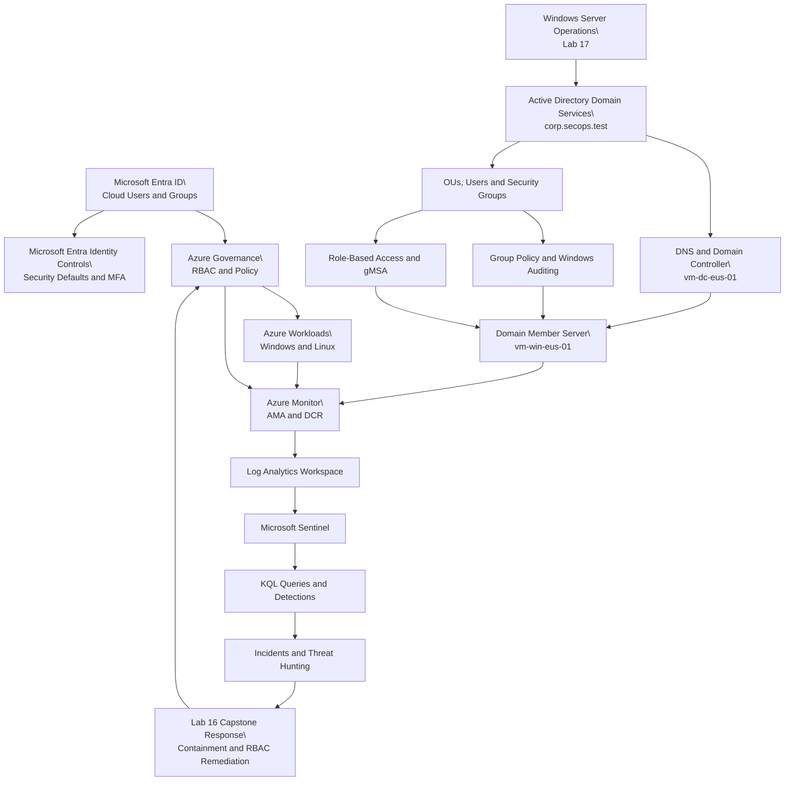

# Azure Security Operations Lab — Microsoft Blue Team Expansion

## Overview

This repository documents the evolution of a hands-on Microsoft infrastructure and blue-team lab built to connect **cloud administration, Windows Server, networking, identity, telemetry, SIEM, incident response, and XDR** in one continuous environment.

The project originally started as a structured **25-day Azure security learning path**. The first four phases moved from Azure governance and Microsoft Entra ID into virtual machines, networking, Azure Monitor, Log Analytics, Microsoft Sentinel, KQL, detection engineering, incident triage, threat hunting, Conditional Access validation, and Azure Policy. That original path culminated in **Lab 16 — Mini SOC Capstone**, where those individual skills were combined into one end-to-end investigation involving excessive Azure RBAC, Azure Run Command, Windows privilege escalation, process discovery, scheduled-task persistence, telemetry troubleshooting, a new Sentinel detection, containment, least-privilege remediation, and incident closure.

Lab 16 also made the next learning gap much clearer. Detecting an event is only one part of security operations. To investigate and remediate confidently, an analyst also needs to understand the infrastructure underneath the telemetry: **Windows services, Active Directory, DNS, DHCP, Group Policy, SMB and NTFS permissions, storage, routing, firewalls, WinRM, PowerShell remoting, virtualization, and migration workflows**.

That extension is now actively underway. **Lab 17** established the Windows Server administration foundation through services, Event Viewer, Task Scheduler, firewalling, storage, WinRM, patching, PowerShell, and operational health checks. **Lab 18** then introduced a dedicated Active Directory environment with AD DS, DNS, domain membership, Organizational Units, domain users and security groups, Group Policy, Windows security telemetry, role-based administration, least privilege, and a Group Managed Service Account. The repository therefore now continues as a **six-phase Microsoft infrastructure and blue-team portfolio** rather than ending with the original Azure/Sentinel capstone.

The expanded roadmap has two deliberate goals:

- **Phase 5 — Windows Server, Infrastructure and Hybrid Operations:** build the server-administration, network-administration, troubleshooting, virtualization, storage, and migration skills that complement the cloud-first work already completed.
- **Phase 6 — Microsoft XDR and Defender Ecosystem:** extend the same investigation methodology into Defender for Endpoint, Advanced Hunting, identity, email, cloud-app, and cross-domain incident correlation, then finish with a unified Microsoft XDR + Sentinel capstone.

The project is also aligned with my Microsoft certification path. **AZ-900 is completed**, while the next major targets are **AZ-104** to deepen Azure administration and infrastructure knowledge and **SC-200** to strengthen Microsoft security operations, Sentinel, Defender XDR, hunting, detection, and incident-response skills. The labs are intentionally designed so certification study is reinforced by configuration, failure analysis, troubleshooting, and documented evidence rather than memorization alone.

This repository is not intended to be a collection of portal screenshots. Each lab follows the same practical cycle:

> *Configure → Understand → Test → Validate → Troubleshoot → Document*

As the project grows, the objective remains the same: understand **why** a system behaves the way it does, prove it with telemetry or operational evidence, fix what is wrong, and explain the result clearly enough to reproduce it or discuss it in a technical interview.

## Table of Contents

- [Overview](#overview)
- [Why I Built This Project](#why-i-built-this-project)
- [Repository Evolution](#repository-evolution)
- [Project Objectives](#project-objectives)
- [Learning Path](#learning-path)
- [Architecture](#architecture)
- [Lab Roadmap](#lab-roadmap)
- [Repository Structure](#repository-structure)
- [Lab Methodology](#lab-methodology)
- [Cost Governance](#cost-governance)
- [Naming and Tagging Standards](#naming-and-tagging-standards)
- [Security Operations Workflow](#security-operations-workflow)
- [KQL Coverage](#kql-coverage)
- [Detection Engineering](#detection-engineering)
- [Incident Investigation](#incident-investigation)
- [Skills Demonstrated](#skills-demonstrated)
- [Certifications and Career Alignment](#certifications-and-career-alignment)
- [Security and Privacy](#security-and-privacy)
- [Current Progress](#current-progress)
- [Expected Project Deliverables](#expected-project-deliverables)
- [Key Principle](#key-principle)
- [Disclaimer](#disclaimer)

## Why I Built This Project

I created this project to bridge the gap between certification study and the kind of hands-on reasoning required in real infrastructure and security work.

My professional background includes systems analysis, project management, SAP ERP implementation, process automation, software development, data analysis, and technical troubleshooting. After completing my cybersecurity studies and earning the **Microsoft Certified: Azure Fundamentals (AZ-900)** certification, I wanted a practical environment where I could turn security concepts into repeatable technical work instead of treating certifications, cloud administration, networking, and cybersecurity as separate subjects.

The first version of the project was intentionally cloud-first. Azure provided a controlled environment where I could build identity, RBAC, governance, networking, virtual machines, telemetry collection, Sentinel detections, KQL investigations, and incident-response workflows. By Lab 16, however, the capstone showed that many security questions ultimately become infrastructure questions. An alert may tell me that a privileged action occurred, but a complete investigation may still require me to understand the Windows service involved, the authentication path, DNS behavior, local or domain permissions, network reachability, remote administration, storage access, policy inheritance, or the difference between a control-plane action and what happened inside the operating system.

That realization changed the roadmap. Instead of immediately adding more SIEM content, the next phase is designed to strengthen the skills that are most transferable to **Windows Server administration, network administration, infrastructure support, cloud administration, and security operations**. The goal is to be able to troubleshoot scenarios such as:

- a server that becomes unreachable after a configuration change;
- a user who cannot access an SMB share despite appearing to have permission;
- a DNS or Group Policy problem that looks like an authentication issue;
- a service that fails remotely but works locally;
- a domain client that cannot locate or authenticate to the correct infrastructure;
- a network path blocked by routing, firewall, DNS, or host configuration;
- a migration that requires inventory, readiness analysis, testing, cutover, validation, and rollback planning.

These are not separate from blue-team work. They are the systems and dependencies that produce the logs, identities, network connections, process activity, and failure modes that defenders investigate. Building this infrastructure knowledge should make later security analysis faster and more accurate because I can reason about the underlying platform instead of treating every alert as an isolated SIEM event.

The final expansion into **Microsoft Defender XDR** follows the same principle. After strengthening Windows Server and network operations, the project will return to security operations with richer endpoint and identity context. The goal is to compare and combine what I already learned in Sentinel with device timelines, process trees, Advanced Hunting, endpoint response actions, identity signals, email evidence, and cross-domain incident correlation.

This roadmap therefore supports several related career directions rather than only one job title: **Network Technical Analyst, Windows/Infrastructure Analyst, Cloud Administrator, SOC Analyst, Security Analyst, and eventually Cloud Security / Microsoft security engineering roles**. It also supports my certification progression: AZ-900 established the fundamentals, AZ-104 strengthens administration and infrastructure, and SC-200 deepens the security-operations and XDR side of the same environment.

The project is designed to help me develop and demonstrate experience with:

- Microsoft Azure administration and governance
- Microsoft Entra ID and least-privilege access
- Windows Server administration and troubleshooting
- Active Directory Domain Services
- DNS, DHCP, Group Policy, and authentication dependencies
- Windows networking, firewalling, and remote administration
- File services, NTFS/SMB permissions, storage, and backup concepts
- PowerShell and WinRM administration
- Virtualization and infrastructure lifecycle concepts
- Azure and hybrid migration workflows
- Azure Monitor Agent, Data Collection Rules, and telemetry pipelines
- Microsoft Sentinel and KQL
- Detection engineering and threat hunting
- Incident triage, correlation, containment, and remediation
- Microsoft Defender XDR and Advanced Hunting
- Technical documentation, root-cause analysis, and repeatable troubleshooting

The long-term value of the repository is not the number of labs completed. It is the progression from **building infrastructure → operating it → observing it → detecting suspicious behavior → investigating it → correcting both the incident and the underlying control weakness**.

## Repository Evolution

After Lab 16, I decided to **continue in the same GitHub repository rather than split the work into a second project**. The next phases depend directly on what has already been built: the Entra identities, Azure RBAC model, virtual networks, Windows VM, Log Analytics workspace, AMA/DCR telemetry pipeline, Sentinel rules, KQL library, incident records, governance controls, and lessons learned all become inputs to the Windows Server and XDR phases.

Keeping the work together also makes the progression easier to evaluate. A reader can follow the project from Azure fundamentals to infrastructure operations and then see how those same systems are monitored and investigated through Sentinel and Defender. A separate repository would make the Windows Server labs look disconnected from the cloud and security work even though the purpose of Phase 5 is specifically to strengthen the infrastructure underneath the existing security environment.

The original cleanup-only Lab 17 is therefore no longer the endpoint. **Cleanup, deallocation, cost review, screenshot sanitization, and evidence maintenance remain ongoing operational practices**, while the learning roadmap continues through two additional phases:

- **Phase 5 — Windows Server, Infrastructure and Hybrid Operations (Labs 17–25):** begins with Windows Server administration in Lab 17 and Active Directory security administration in Lab 18. Lab 19 will deliberately revisit the AD environment through native graphical tools so the same concepts are understood from both PowerShell and GUI administration perspectives. The remaining labs extend into DHCP, DNS and authentication troubleshooting, file services and permissions, WinRM and PowerShell remoting, network troubleshooting, storage and recovery, virtualization, migration planning, and a multi-layer infrastructure operations capstone.
- **Phase 6 — Microsoft XDR and Defender Ecosystem (Labs 26–32):** Defender XDR, Defender for Endpoint, endpoint investigation and response, Advanced Hunting, Defender for Identity, Microsoft 365/email and cloud-app investigation where licensing permits, cross-domain correlation, and a final XDR + Sentinel capstone.

The expanded project intentionally alternates between **administration** and **security**. Phase 5 builds the systems knowledge needed to understand Windows and network failures in depth; Phase 6 then uses that stronger foundation to investigate attacks and suspicious behavior across endpoint, identity, cloud, and Microsoft 365 signals.

This keeps the repository as one evolving Microsoft blue-team portfolio instead of fragmenting the architecture, evidence, KQL, incident records, troubleshooting history, and learning progression across separate projects.

## Project Objectives

The main objectives of this project are to:

1. Build a structured Azure lab environment using consistent naming and tagging standards.
2. Implement cost monitoring before deploying billable resources.
3. Create users, groups, managers, and administrative structures in Microsoft Entra ID.
4. Apply Azure RBAC following the principle of least privilege.
5. Use Azure Policy to audit and enforce governance requirements.
6. Deploy and secure Azure networking and virtual machines.
7. Collect Windows, Linux, Azure, and identity telemetry.
8. Centralize security logs in a Log Analytics workspace.
9. Enable Microsoft Sentinel as the cloud-native SIEM.
10. Develop and document reusable KQL queries.
11. Create analytics rules and security detections.
12. Generate controlled security events and validate detections end to end.
13. Investigate incidents using a repeatable triage, correlation, containment, and remediation process.
14. Perform threat hunting across collected telemetry.
15. Troubleshoot telemetry pipelines, configuration failures, permissions, and operational dependencies rather than documenting only successful outcomes.
16. Build practical Windows Server administration skills across services, local security, Event Viewer, Task Scheduler, PowerShell, WinRM, and server lifecycle operations.
17. Build practical Active Directory, DNS, DHCP, Group Policy, file-service, storage, and authentication troubleshooting skills.
18. Strengthen network-administration skills through addressing, routing, firewalling, name resolution, packet-flow reasoning, connectivity testing, and remote-management scenarios.
19. Practice virtualization, server lifecycle, infrastructure migration, cutover validation, and rollback planning.
20. Expand the investigation workflow into Microsoft Defender XDR and related Defender technologies where licensing permits.
21. Correlate endpoint, identity, cloud, network-adjacent, email, and Sentinel evidence into one investigation workflow.
22. Align hands-on work with the knowledge areas relevant to AZ-104 and SC-200 while treating certifications as validation of skills rather than substitutes for practice.
23. Document technical decisions, failures, troubleshooting steps, root causes, and lessons learned.
24. Produce a public portfolio without exposing credentials, personal information, or sensitive Azure identifiers.

## Learning Path

The project now progresses through **six main phases**. The sequence is intentionally cumulative: each phase reuses the environment, evidence, and lessons from the previous one so that new skills are learned in context rather than as isolated product exercises. The first four phases establish Azure, governance, telemetry, Sentinel, detection, and investigation. Phase 5 adds the Windows Server and network-administration depth needed to understand the systems behind the alerts. Phase 6 then applies that stronger infrastructure knowledge to Microsoft Defender XDR and cross-domain response.

### Phase 1 Identity and Governance

This phase establishes the administrative foundation of the environment.

Topics include:

- Azure subscriptions and resource groups
- Cost Management and budgets
- Naming and tagging standards
- Microsoft Entra ID users and groups
- Manager relationships
- Administrative Units
- Azure RBAC
- Least privilege
- Azure Policy
- Activity Log auditing

### Phase 2 Infrastructure and Monitoring

This phase creates the workloads and telemetry sources used throughout the project.

Topics include:

- Azure Virtual Networks
- Subnets
- Network Security Groups
- Windows and Linux virtual machines
- Secure virtual machine administration
- Log Analytics workspaces
- Azure Monitor Agent
- Data Collection Rules
- Windows Security Events
- Linux Syslog
- Azure Activity Logs

### Phase 3 Security Operations

This phase introduces SIEM operations and security analysis.

Topics include:

- Microsoft Sentinel
- Data connectors
- KQL fundamentals
- Authentication analysis
- Azure administrative activity
- Security analytics rules
- Detection engineering
- Incident generation
- Incident triage
- Entity investigation
- Threat hunting

### Phase 4 Governance Validation and Azure/Sentinel Capstone

This phase combines the original Azure and Sentinel project components into a complete security operations workflow.

Topics include:

- Conditional Access
- Azure Policy compliance
- Governance validation
- Mini SOC investigation
- Incident documentation
- Architecture documentation
- Cost review
- Resource cleanup
- Portfolio preparation

### Phase 5 — Windows Server, Infrastructure and Hybrid Operations

This phase extends the original cloud-first lab into deeper Windows Server and domain administration so the project can cover the infrastructure layers that generate the authentication, process, network, policy, and system telemetry investigated by security teams.

The phase now progresses through the following sequence:

- **Lab 17 — Windows Server Administration and Remote Operations:** Windows Server identity, services, Event Viewer, scheduled tasks, Windows Firewall, Azure NSG layering, storage, patching, WinRM, PowerShell, controlled failure/recovery, and operational health checks.
- **Lab 18 — Active Directory Domain Services, Security Administration and Automation:** AD DS, DNS, domain controller deployment, domain membership, OUs, domain users, security groups, Group Policy, PowerShell logging, process auditing, role-based local access, least privilege, KDS, gMSA, and final health checks.
- **Lab 19 — Active Directory and Windows Server Administration through GUI Tools:** Server Manager, Active Directory Users and Computers, Group Policy Management, DNS Manager, Computer Management, Event Viewer, graphical OU/user/group administration, privilege relationships, policy inheritance, and direct comparison with the PowerShell work completed in Lab 18.
- **Lab 20 — DNS, DHCP and Domain Infrastructure Services:** DHCP deployment and scopes, DNS forward and reverse lookup zones, dynamic registration, leases, reservations, domain name resolution, service dependencies, and controlled DNS/DHCP troubleshooting.
- **Lab 21 — Windows File Services, SMB and NTFS Authorization:** file-server roles, shares, NTFS permissions, share permissions, group-based authorization, inheritance, effective access, access-based troubleshooting, and least-privilege remediation.
- **Lab 22 — PowerShell Remoting, WinRM and Remote Administration:** WinRM listeners, PowerShell remoting, remote service and process administration, credential context, firewall dependencies, constrained administrative access, and troubleshooting remote-management failures.
- **Lab 23 — Windows and Azure Network Troubleshooting:** addressing, routing, DNS dependencies, Windows Firewall, Azure NSGs, TCP/UDP validation, packet-flow reasoning, name-resolution failures, and multi-layer connectivity troubleshooting.
- **Lab 24 — Storage, Backup, Recovery and Virtualization Operations:** Windows storage administration, volumes and disks, backup/recovery concepts, restore validation, VM lifecycle, snapshots/checkpoints where appropriate, operational readiness, and recovery testing.
- **Lab 25 — Infrastructure Migration and Hybrid Operations Capstone:** inventory, dependency discovery, readiness assessment, migration planning, controlled cutover, validation, rollback planning, server/network/identity troubleshooting, and a final multi-layer operations scenario.

The purpose of Phase 5 is not to separate infrastructure work from security operations. It is to strengthen the platform knowledge required to explain why authentication, policy, network, service, storage, and remote-administration events appear in security telemetry.

### Phase 6 — Microsoft XDR and Defender Ecosystem

After the infrastructure phase, the project returns to security operations with a stronger understanding of the Windows, identity, DNS, authentication, networking, and administrative layers underneath the telemetry.

The planned sequence is:

- **Lab 26 — Microsoft Defender XDR Foundation:** Defender XDR portal structure, incidents, alerts, assets, available data sources, investigation workflow, and integration points with the existing Sentinel environment.
- **Lab 27 — Microsoft Defender for Endpoint:** endpoint onboarding where licensing permits, device inventory, device timeline, process and logon evidence, alerts, investigation actions, and endpoint response concepts.
- **Lab 28 — Advanced Hunting and Endpoint Detection Engineering:** Advanced Hunting with KQL, endpoint event tables, process and authentication pivots, reusable hunting queries, and custom detection logic where supported.
- **Lab 29 — Microsoft Defender for Identity:** Active Directory identity signals, authentication behavior, suspicious identity activity, lateral-movement concepts, and correlation with the Phase 5 domain environment where licensing and deployment options permit.
- **Lab 30 — Microsoft 365, Email and Cloud-App Security Investigation:** email, collaboration, identity, and cloud-app evidence where licensing permits, with emphasis on investigation workflow rather than product breadth.
- **Lab 31 — Cross-Domain XDR and Sentinel Correlation:** correlate endpoint, identity, cloud, email, and Sentinel evidence into unified timelines, compare incident context between platforms, and validate response decisions across multiple data sources.
- **Lab 32 — Microsoft XDR + Sentinel Final Capstone:** combine detection, Advanced Hunting, incident triage, endpoint/identity investigation, containment, remediation, validation, reporting, and lessons learned in one final end-to-end Microsoft security-operations scenario.

The exact Defender features used in Labs 26–32 may be adjusted according to tenant licensing, available trial capabilities, and supported integrations. When a feature is unavailable, the lab will document the limitation and use the closest technically valid alternative rather than presenting an unverified configuration.

---

## Architecture

The following diagram represents the project state through **Lab 18**. The original Sentinel security-operations pipeline remains intact, while the environment now also includes a Windows Server administration layer and a dedicated Active Directory domain in East US. This allows later labs to correlate Azure control-plane activity, Windows host behavior, domain identity, Group Policy, DNS, authentication, endpoint telemetry, and Sentinel/XDR evidence in one continuous environment.

The [current-state architecture](architecture/azure-secops-current-architecture.md) should continue to document only components that have actually been built and validated.



The project separates resources into different Azure Resource Groups to support governance, lifecycle management, cost analysis, RBAC testing, and infrastructure lifecycle decisions.

| Resource Group                    | Purpose                                      |
| --------------------------------- | -------------------------------------------- |
| `rg-secops-core-canadacentral`    | Original core networking and shared resources |
| `rg-secops-compute-canadacentral` | Original Windows and Linux virtual machines   |
| `rg-secops-monitorcanadacentral`  | Monitoring and security operations resources  |
| `rg-secops-eastus`                | Phase 5 Windows Server, AD DS, DNS, domain-member, and infrastructure-administration resources |

The project now uses two Azure regions:

```text
Canada Central — original Azure/Sentinel environment
East US        — Phase 5 Windows Server and Active Directory environment
```

---

## Lab Roadmap

| Lab | Topic | Primary Skills | Status |
| --: | ----- | -------------- | ------ |
|  [00](labs/lab-00-baseline/README.md) | Azure Baseline and Cost Governance | Budgets, resource groups, tags, Activity Log | Completed |
|  [01](labs/lab01-entra-users-groups/README.md) | Entra ID Users Managers and Groups | Users, manager relationships, security groups, audit logs | Completed |
|  [02](labs/lab02-administrative-units/README.md) | Administrative Units and Entra Role Scope | Scoped administration, least privilege, licensing validation | Completed |
|  [03](labs/lab03-azure-rbac/README.md) | Azure RBAC | Resource-group roles, scopes, inheritance, least privilege | Completed |
|  [04](labs/lab-04-azure-policy/README.md) | Azure Policy | Audit, deny, tagging, compliance | Completed |
|  [05](labs/lab-05-vnet-nsg/README.md) | Virtual Network and NSG | VNet design, subnet segmentation, NSG rules | Completed |
|  [06](labs/lab-06-virtual-machines/README.md) | Windows and Linux Virtual Machines | Secure deployment, Bastion access, segmentation testing | Completed |
|  [07](labs/lab-07-vm-administration/README.md) | Virtual Machine Administration | VM lifecycle, managed disks, Run Command | Completed |
|  [08](labs/lab-08-log-analytics-ama-dcr/README-lab-08.md) | Log Analytics, AMA, and DCR | Log ingestion, DCR, XPath filtering, and KQL validation | Completed |
|  [09](labs/lab-09-microsoft-sentinel/README-lab-09.md) | Microsoft Sentinel | SIEM deployment, Azure Activity connector, Policy remediation, and KQL validation | Completed |
|  [10](labs/lab-10-kql/README-lab-10.md) | KQL Investigation Fundamentals | Windows authentication, rare-event hunting, Azure control-plane analysis, and unified timelines | Completed |
|  [11](labs/lab-11-detection-rule/README-lab-11.md) | Microsoft Sentinel Scheduled Analytics Rules | KQL detections, entity mapping, alert grouping, incident generation | Completed |
| [12](labs/lab-12-incident-triage/README-lab-12.md) | Microsoft Sentinel Incident Triage and Correlation | Windows event timelines, Azure control-plane correlation, classification, and closure | Completed |
| [13](labs/lab-13-threat-hunting/README-lab-13.md) | Microsoft Sentinel Threat Hunting | Hypothesis-driven hunting, process analysis, telemetry validation, and bookmarks | Completed |
| [14](labs/lab-14-conditional-access/README-lab-14.md) | Conditional Access, Security Defaults and MFA Validation | Conditional Access assessment, Security Defaults, MFA, sign-in investigation | Completed |
| [15](labs/lab-15-policy-compliance/README-lab-15.md) | Azure Policy Compliance, Remediation and Governance Assessment | Compliance assessment, remediation, policy scans, exemptions, technical-debt documentation | Completed |
| [16](labs/lab-16-mini-soc-capstone/README-lab-16.md) | Mini SOC Capstone — Excessive RBAC to Detected Persistence | Cross-source investigation, persistence detection, telemetry troubleshooting, containment, RBAC remediation | Completed |
| 17 | Windows Server Administration and Remote Operations | Services, Event Viewer, Task Scheduler, firewall, storage, patching, WinRM, PowerShell, health checks | Completed |
| 18 | Active Directory Domain Services, Security Administration and Automation | AD DS, DNS, domain join, OUs, users/groups, GPO, Windows auditing, least privilege, gMSA | Completed |
| 19 | Active Directory and Windows Server Administration through GUI Tools | Server Manager, ADUC, GPMC, DNS Manager, Event Viewer, GUI hierarchy and privilege administration | Next |
| 20 | DNS, DHCP and Domain Infrastructure Services | DHCP scopes, DNS zones, SRV records, reservations, domain service dependencies, troubleshooting | Planned |
| 21 | Windows File Services, SMB and NTFS Authorization | File Server, shares, NTFS/share permissions, inheritance, effective access, group-based authorization | Planned |
| 22 | PowerShell Remoting, WinRM and Remote Administration | PowerShell remoting, WinRM, remote services/processes, firewall dependencies, least-privilege administration | Planned |
| 23 | Windows and Azure Network Troubleshooting | TCP/IP, routing, DNS, NSGs, Windows Firewall, connectivity validation, packet-flow reasoning | Planned |
| 24 | Storage, Backup, Recovery and Virtualization Operations | Disks, volumes, backup, restore validation, VM lifecycle, recovery and operational readiness | Planned |
| 25 | Infrastructure Migration and Hybrid Operations Capstone | Inventory, dependencies, migration readiness, cutover, rollback, troubleshooting, operational validation | Planned |
| 26 | Microsoft Defender XDR Foundation | Defender XDR portal, data sources, incidents, alerts, XDR investigation model | Planned |
| 27 | Microsoft Defender for Endpoint | Endpoint onboarding, device inventory, alerts, device timeline, endpoint investigation and response | Planned |
| 28 | Advanced Hunting and Endpoint Detection Engineering | KQL for XDR, DeviceProcessEvents, DeviceLogonEvents, hunting, custom detection logic | Planned |
| 29 | Microsoft Defender for Identity | Identity sensors/signals, AD identity activity, lateral movement and credential-related investigation | Planned |
| 30 | Microsoft 365, Email and Cloud-App Security Investigation | Email, collaboration, cloud-app and identity evidence where licensing permits | Planned |
| 31 | Cross-Domain XDR and Sentinel Correlation | Endpoint, identity, cloud, email and Sentinel correlation, unified timelines and response | Planned |
| 32 | Microsoft XDR + Sentinel Final Capstone | End-to-end detection, hunting, investigation, containment, remediation, validation and reporting | Planned |

---

## Repository Structure

```text
azure-security-operations-lab/
├── README.md
├── architecture/
├── labs/
│   ├── lab-00-baseline/
│   ├── ...
│   ├── lab-16-mini-soc-capstone/
│   ├── lab-17-windows-server-administration/
│   ├── lab-18-active-directory-security-administration/
│   └── lab-19-active-directory-gui-administration/   # next
├── kql/
├── detections/
├── incidents/
└── docs/
```

Each completed lab contains its own documentation, screenshots, scripts or queries where relevant, validation evidence, troubleshooting notes, and technical takeaways. The root README intentionally stays at project level; implementation detail belongs inside the individual lab directories.

## Lab Methodology

Each lab follows the same documentation process.

### 1. Configure

Deploy or configure the required Azure service.

### 2. Understand

Explain the technical reason for each configuration rather than documenting only the portal navigation.

### 3. Test

Perform a controlled test to verify the expected behavior.

Examples include:

- Attempting an unauthorized action
- Creating a noncompliant resource
- Modifying a resource tag
- Generating failed authentication events
- Triggering a detection rule

### 4. Validate

Confirm the result using Azure telemetry, logs, policy compliance, or access-control testing.

### 5. Troubleshoot

Document unexpected behavior, configuration errors, permission issues, and the steps used to resolve them.

### 6. Document

Capture sanitized evidence and record the technical outcome in the lab README.

---

## Cost Governance

Cost governance was implemented before deploying compute or monitoring resources.

The initial configuration includes a **US$175 monthly budget**, actual-cost alerts at **50%, 75%, 90%, and 100%**, a Day 0 Cost Analysis baseline, expiration tags, and planned resource cleanup.

Azure budgets provide cost visibility and notifications, but they do not automatically stop resources when a threshold is reached.

Resources such as virtual machines will be stopped, deallocated, or removed when they are not required.

---

## Naming and Tagging Standards

The project uses descriptive names to make resources easier to identify during administration and incident investigation.

General naming pattern:

```text
\<resource-type>-\<workload>-\<environment>-\<region>-\<instance>
```

Example resource names:

```text
rg-secops-core-canadacentral

vm-winclient-lab-cac-001

vm-linux-lab-cac-001

vnet-secops-lab-cac-001

nsg-workstations-lab-001

law-secops-lab-cac-001

dcr-security-events-lab-cac-001
```

Baseline tags include:

| Tag           | Purpose                                                    |
| ------------- | ---------------------------------------------------------- |
| `Environment` | Identifies the resource as part of the lab                 |
| `Owner`       | Identifies the resource owner                              |
| `Project`     | Associates the resource with this project                  |
| `CostCenter`  | Supports cost classification                               |
| `Expiry`      | Identifies when the resource should be reviewed or removed |

---

## Security Operations Workflow

The final environment is designed to demonstrate the following workflow:

```text
Azure or identity activity

       ↓

Telemetry generation

       ↓

Azure Monitor Agent or data connector

       ↓

Log Analytics Workspace

       ↓

Microsoft Sentinel

       ↓

KQL query or analytics rule

       ↓

Alert

       ↓

Incident

       ↓

Triage and investigation

       ↓

Containment or remediation recommendation

       ↓

Incident documentation
```

This workflow represents the relationship between cloud administration, telemetry collection, SIEM monitoring, detection engineering, and incident response.

---

## KQL Coverage

Reusable KQL has been developed and validated across the security-operations labs. Current coverage includes:

- Azure administrative and resource activity
- Windows authentication and Security Events
- Account lifecycle and privileged operations
- Process creation and command-line activity
- Cross-source Azure/Windows correlation
- Detection validation
- Incident investigation
- Threat hunting
- Scheduled-task persistence

Queries are stored under `kql/` and referenced by the relevant lab documentation.

## Detection Engineering

Lab 11 introduced the detection-engineering workflow by converting validated Windows Security patterns into Microsoft Sentinel scheduled analytics rules. The implemented detections covered repeated failed logons, local account creation, local Administrators membership changes, and PowerShell launched by Command Prompt.

Each detection is documented with its objective, threat scenario, data source, KQL logic, threshold, entity mappings, validation procedure, investigation steps, expected false positives, response guidance, and MITRE ATT&CK mapping where applicable.

Lab 16 extended this lifecycle into an end-to-end persistence scenario. Scheduled-task activity was observed through Event `4688`, the missing `4698` telemetry was traced to Data Collection Rule coverage, the ingestion gap was corrected, and a new high-severity Sentinel rule was validated from raw event through `SecurityAlert` and `SecurityIncident`.

## Incident Investigation

Incident work follows a repeatable structure:

1. Incident summary and alert source
2. Detection logic and affected entities
3. Timeline and evidence review
4. KQL and cross-source correlation
5. True-positive or false-positive assessment
6. Scope and impact
7. Containment and remediation
8. Validation and lessons learned

The goal is to demonstrate an investigation process that can be reproduced and explained during a technical interview.

## Skills Demonstrated

This project is designed to demonstrate practical experience with:

### Microsoft Azure

- Azure Resource Manager
- Resource Groups
- Azure Cost Management
- Azure Virtual Networks
- Network Security Groups
- Azure Virtual Machines
- Azure Monitor
- Log Analytics
- Azure Activity Log

### Identity and Governance

- Microsoft Entra ID
- Users and security groups
- Administrative Units
- Azure RBAC
- Least privilege
- Azure Policy
- Conditional Access assessment
- Security Defaults
- Multifactor Authentication (MFA)
- Microsoft Authenticator
- Sign-in log investigation
- Resource tagging
- Policy compliance
- Compliance remediation
- On-demand policy evaluation
- Policy exemptions
- Governance technical-debt assessment

### Windows Server and Active Directory Infrastructure

- Windows Server administration and health validation
- Windows services, Event Viewer, Task Scheduler, patching, and storage
- Windows Defender Firewall and Azure NSG interaction
- WinRM and PowerShell-based remote administration
- Active Directory Domain Services
- Active Directory-integrated DNS
- Domain controller deployment and validation
- Domain join and secure-channel validation
- Organizational Units and object placement
- Domain users and global security groups
- Group-based role assignment and least privilege
- Group Policy creation, linking, inheritance, and validation
- PowerShell Script Block Logging and Module Logging
- Windows Security Event 4688 process creation auditing
- Group Managed Service Accounts and KDS
- Infrastructure health checks and configuration troubleshooting

### Security Operations

- Microsoft Sentinel
- Kusto Query Language
- Security monitoring
- Alert triage
- Incident investigation
- Threat hunting
- Detection engineering
- Cross-source Azure and Windows correlation
- Telemetry-pipeline troubleshooting with AMA and DCR
- Scheduled-task persistence detection
- Incident containment and least-privilege RBAC remediation
- Detection-to-alert-to-incident validation
- Security reporting
- Evidence preservation

### Professional Practices

- Technical documentation
- Cost awareness
- Structured troubleshooting
- Security-focused decision-making
- Privacy-conscious portfolio development

---

## Certifications and Career Alignment

This project is intentionally aligned with a certification path, but the certifications are not treated as isolated study goals. Each certification objective is reinforced through labs that require configuration, troubleshooting, validation, and documentation.

### Microsoft Certified: Azure Fundamentals (AZ-900) — Completed

AZ-900 provided the initial Azure foundation for the project, including cloud concepts, core Azure services, governance, identity, pricing, and shared-responsibility concepts. The completed Azure/Sentinel phases then turned those fundamentals into hands-on administration and security work.

### AZ-104 — Azure Administrator — Next Infrastructure Focus

AZ-104 is a natural fit for the expanded Phase 5 because it strengthens the administrative side of the environment that the original security-focused path only touched partially.

Relevant project areas include:

- Azure subscriptions and resource groups
- Microsoft Entra ID and RBAC
- Azure Policy and governance
- Virtual machines and managed disks
- Virtual networking and Network Security Groups
- Storage concepts
- Monitoring and operational troubleshooting
- Hybrid administration and migration thinking

The Windows Server and infrastructure labs add an important complement to AZ-104: understanding what happens **inside** the server and across local infrastructure, not only how Azure manages the resource from the control plane.

### SC-200 — Security Operations Analyst — Primary Blue-Team Focus

SC-200 remains the main security-operations certification alignment for the project. Labs 8–16 already cover many core workflows, and Phase 6 will deepen them through the Defender ecosystem.

Relevant project areas include:

- Microsoft Sentinel
- Log Analytics and KQL
- Analytics rules and detection engineering
- SecurityAlert and SecurityIncident investigation
- Threat hunting
- Incident triage and evidence correlation
- Microsoft Defender XDR
- Defender for Endpoint investigation and response
- Advanced Hunting
- Identity and cross-domain investigation
- Containment, remediation, and post-response validation

### Why combine AZ-104 and SC-200?

The project deliberately develops both sides because infrastructure and security operations overlap. AZ-104-oriented administration helps answer **how the platform is built, configured, connected, and operated**. SC-200-oriented security operations helps answer **what happened, whether it is suspicious, what evidence supports the conclusion, and how to respond**.

Phase 5 is actively closing the Windows Server and network-administration gap between those two perspectives. Labs 17 and 18 now provide concrete Windows Server and Active Directory evidence, while Labs 19–25 deepen administration, troubleshooting, storage, networking, file services, and migration skills. Phase 6 then uses that stronger infrastructure foundation to make XDR investigations more meaningful.

### Future Microsoft Security Specialization

After the infrastructure and XDR phases, additional Microsoft security certifications can be evaluated based on the skills actually developed and the roles being targeted at that time. The priority is to avoid collecting certifications without corresponding hands-on evidence. The repository should make it possible to demonstrate not only that an exam objective was studied, but that the underlying technology was configured, broken, investigated, repaired, and documented.

## Security and Privacy

This project uses only resources created in my own authorized Azure environment.

No production systems, third-party systems, or unauthorized targets are used.

Before evidence is published, screenshots and documentation are reviewed to remove:

- Personal email addresses
- Subscription IDs
- Tenant IDs
- Billing identifiers
- Access tokens
- Passwords
- API keys
- Secrets
- Private IP information when unnecessary
- Other tenant-sensitive identifiers

Resource names, sanitized logs, KQL queries, policy names, configuration decisions, and controlled test results may remain visible when they provide useful technical evidence.

No credentials or secrets should ever be committed to this repository.

---

## Current Progress

The original Azure/Sentinel learning path is complete through **Lab 16**, and the infrastructure expansion is now complete through **Lab 18**.

### Completed milestones

| Range | Focus | Outcome |
| ----- | ----- | ------- |
| Labs 00–04 | Identity and governance | Resource groups, cost governance, Entra ID, Administrative Units, RBAC, Azure Policy |
| Labs 05–09 | Infrastructure and monitoring | VNets, NSGs, Windows/Linux VMs, managed disks, AMA, DCR, Log Analytics, Sentinel |
| Labs 10–13 | Security operations | KQL investigations, scheduled analytics rules, incident triage, cross-source correlation, threat hunting |
| Labs 14–16 | Governance and SOC capstone | MFA/Security Defaults validation, Policy remediation, persistence detection, containment, RBAC remediation |
| Lab 17 | Windows Server administration | Services, Event Viewer, firewalling, storage, patching, WinRM, PowerShell, health checks |
| Lab 18 | Active Directory security administration | AD DS, DNS, domain join, OUs, users/groups, GPO, auditing, least privilege, gMSA, final health validation |

### Current environment

The project now has two connected learning tracks:

- **Canada Central:** original Azure/Sentinel environment used for governance, monitoring, KQL, detection engineering, threat hunting, and incident response.
- **East US:** Windows Server and Active Directory environment used for deeper infrastructure, identity, DNS, Group Policy, authorization, and remote-administration practice.

### Next — Lab 19

Lab 19 will revisit the Active Directory environment through **graphical administration tools**. The goal is to understand the same concepts implemented in Lab 18 from the GUI perspective and to demonstrate practical administration with:

- Server Manager
- Active Directory Users and Computers
- Group Policy Management
- DNS Manager
- Computer Management
- Event Viewer
- OU hierarchy and object placement
- User and group membership
- Privilege relationships
- Policy inheritance and effective configuration

The lab will also introduce additional directory objects where useful so that hierarchy, administration, and privilege boundaries can be demonstrated visually rather than only through PowerShell.

### Remaining roadmap

**Labs 20–25 — Infrastructure and Hybrid Operations**

DNS/DHCP → File Services and SMB/NTFS → WinRM/PowerShell Remoting → Network Troubleshooting → Storage/Backup/Virtualization → Migration and Hybrid Operations Capstone

**Labs 26–32 — Microsoft XDR and Defender**

Defender XDR → Defender for Endpoint → Advanced Hunting → Defender for Identity → Microsoft 365/Cloud-App Investigation → Cross-Domain Correlation → XDR + Sentinel Final Capstone

Resource cleanup, deallocation, cost review, screenshot sanitization, and evidence maintenance remain continuous operational practices throughout the project.

## Expected Project Deliverables

The repository is intended to provide a complete portfolio of:

- Azure governance, identity, networking, compute, and monitoring documentation
- Microsoft Sentinel deployment, KQL, analytics rules, hunting, and incident investigations
- Windows Server and Active Directory administration evidence
- DNS, Group Policy, authorization, file services, networking, storage, and remote-management labs
- Reusable PowerShell, KQL, health-check, and validation scripts
- Architecture and operational decision documentation
- Sanitized technical evidence and troubleshooting records
- Infrastructure and security capstones
- Microsoft Defender XDR investigation and response labs

## Key Principle

The purpose of this project is not simply to show that Azure resources were created.

The purpose is to demonstrate that I can:

- Explain why a security control is required
- Configure the control
- Test whether it works
- Analyze the resulting telemetry
- Identify failures or misconfigurations
- Document the outcome clearly
- Connect technical implementation to security operations

---

## Disclaimer

This repository is intended for education, certification preparation, and professional portfolio development.

All activities are performed in an authorized personal lab environment. The configurations are designed for learning and may require additional controls, architecture review, availability planning, and organizational approval before being used in a production environment.
