# Lab 19 — Windows Server Administration, GPO Validation, Telemetry, and Service Troubleshooting

**Project:** Azure Security Operations Lab  
**Environment:** Microsoft Azure / East US / isolated Windows domain  
**Validation date:** November 23, 2026  
**Status:** Completed — validated, documented, and cleaned up

## Executive summary

This lab extended the Azure Security Operations environment into hands-on Windows Server administration and troubleshooting. Using graphical tools (Server Manager, Active Directory Users and Computers, DNS Manager, Group Policy Management, Services, and Event Viewer) alongside PowerShell, I validated identity operations, DNS behavior, Group Policy application, security auditing, and Windows service dependencies. A deliberately invalid lab service provided a reproducible, low-risk failure for root-cause analysis (RCA).

The exercise emphasizes the full operational cycle: **inspect → change → validate → investigate → remediate → clean up**. All service-failure testing was performed against a temporary lab-only service, not a production Windows service.

## Architecture and boundaries

| Component | Configuration / purpose |
|---|---|
| Azure region | East US |
| Resource group | `rg-secops-eastus` |
| Virtual network | `vnet-secops-eus-01` (`10.40.0.0/16`) |
| Server subnet | `snet-servers` (`10.40.1.0/24`) |
| Domain controller | `vm-dc-eus-01`, `10.40.1.4` — AD DS, DNS |
| Member server | `vm-win-eus-01`, `10.40.1.5` — domain-joined Windows Server |
| AD domain | `corp.secops.test` (lab-only test domain) |
| Access | Azure Bastion Basic, provisioned during administration and deleted afterwards |
| Policy | `GPO-Servers-Security-Baseline`, linked to the `Servers` organizational unit |

**Data-handling note:** All hostnames, users, groups, and private network addresses in this README are part of the isolated training environment. Screenshots have been reviewed for public portfolio use, and account SID material has been redacted where present. Internal/private IP addresses are not internet-accessible endpoints. No credentials or public access tokens are included.

## 1. Remote access and Active Directory administration

Validated GUI access to the domain controller using Azure Bastion and Server Manager. In **Active Directory Users and Computers (ADUC)**, inspected domain organization and security groups, including `GG-IT-Support`, `GG-SecOps-Admins`, and `GG-SecOps-Analysts`. Added user `bob` to `GG-IT-Support`, alongside existing member `grace`, and corroborated membership using the Active Directory PowerShell module.

```powershell
Get-ADGroupMember -Identity 'GG-IT-Support' |
    Select-Object Name, SamAccountName, ObjectClass
```

**Observed:** `bob` and `grace` were both listed as users in `GG-IT-Support`.

**Figure 01 — Server manager and bastion**

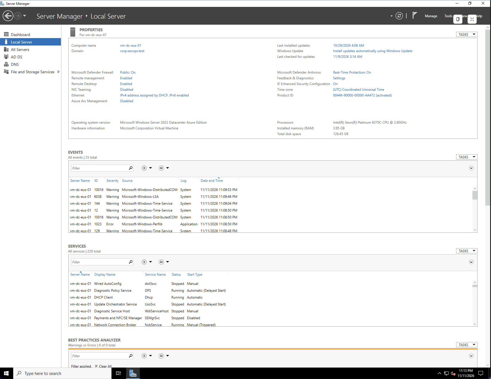

**Figure 02 — Ad organizational structure**

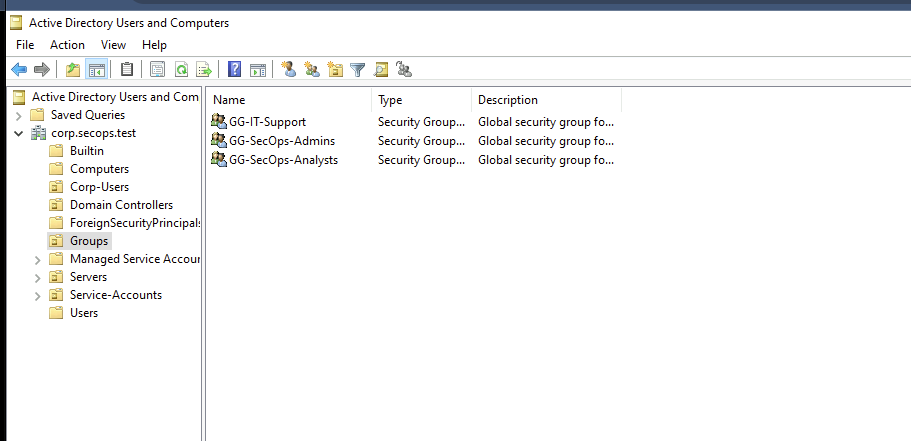

**Figure 03 — Group before**

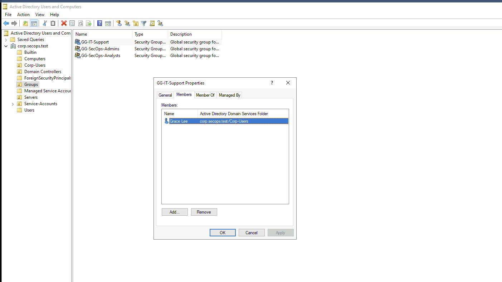

**Figure 04 — Group after**

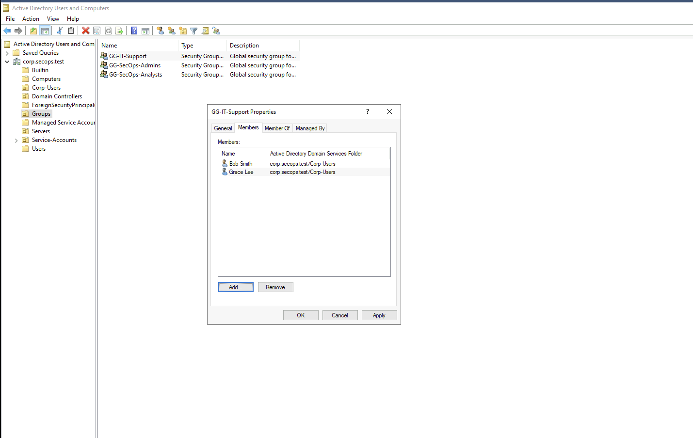

**Figure 05 — Powershell membership**

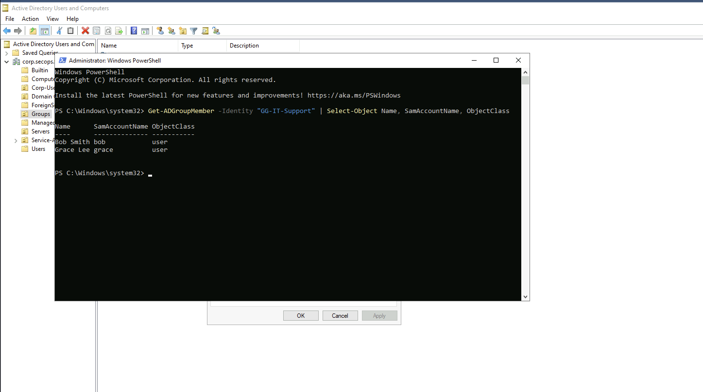

## 2. DNS inspection and change validation

Inspected the AD-integrated forward lookup zone `corp.secops.test` and confirmed the existing host records and LDAP DC locator SRV record. The tests explicitly queried the domain controller DNS server at `10.40.1.4`.

```powershell
Resolve-DnsName vm-dc-eus-01.corp.secops.test -Server 10.40.1.4 -Type A
Resolve-DnsName vm-win-eus-01.corp.secops.test -Server 10.40.1.4 -Type A
Resolve-DnsName _ldap._tcp.dc._msdcs.corp.secops.test -Server 10.40.1.4 -Type SRV

nslookup vm-dc-eus-01.corp.secops.test 10.40.1.4
nslookup vm-win-eus-01.corp.secops.test 10.40.1.4
nslookup -type=SRV _ldap._tcp.dc._msdcs.corp.secops.test 10.40.1.4
```

**Observed:** The DC resolved to `10.40.1.4`, the member server resolved to `10.40.1.5`, and the LDAP SRV record identified the DC on port `389`.

Performed a complete DNS record lifecycle with an intentionally temporary name:

1. Created `app-lab19.corp.secops.test` as an A record pointing to `10.40.1.100`.
2. Validated the new result with `Resolve-DnsName` and `nslookup`.
3. Updated the record to `10.40.1.110`, then queried again to verify the change.
4. Deleted the test record and verified that a direct DNS lookup returned a **name does not exist** error.

This validates record management and the response of the DNS server; it does not demonstrate that an application was deployed at either test address. A DNS client cache query returning no result is not, by itself, proof of cache invalidation.

**Figure 06 — Zone**

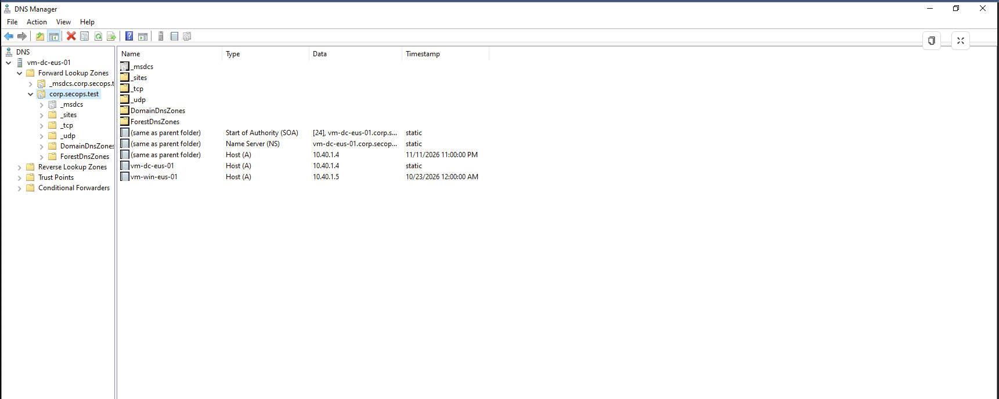

**Figure 07 — Resolve-dnsname**

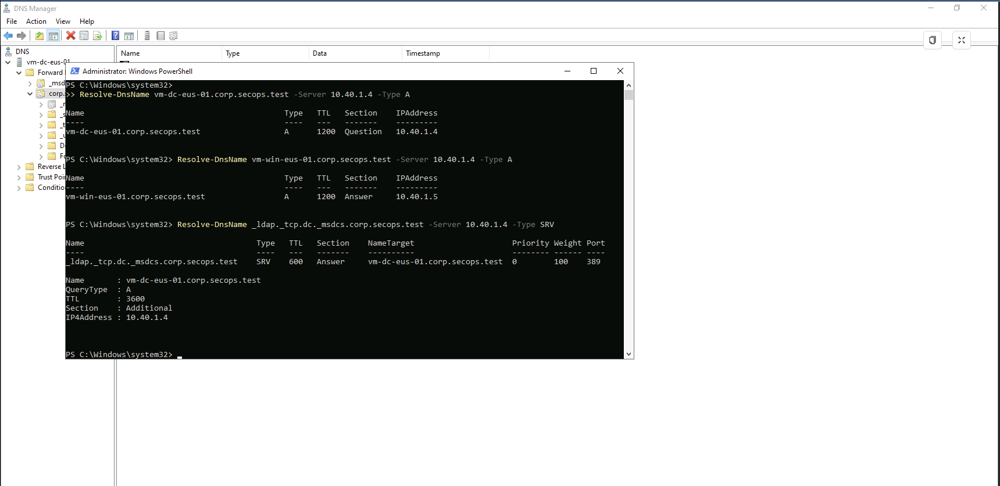

**Figure 08 — Nslookup**

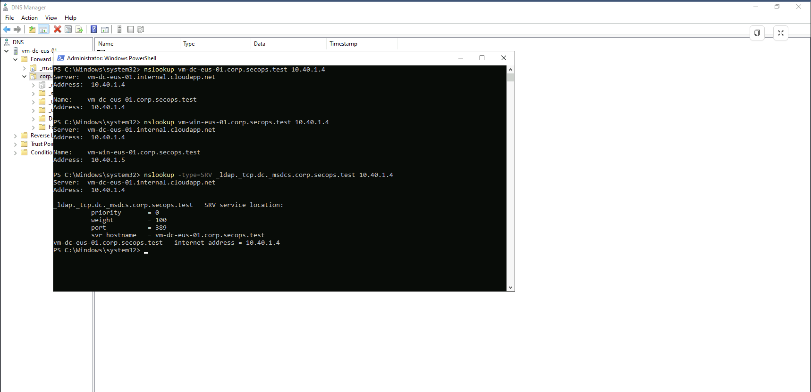

**Figure 09 — Creation**

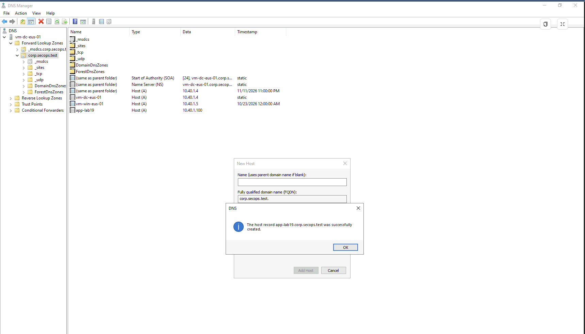

**Figure 10 — Initial resolution**

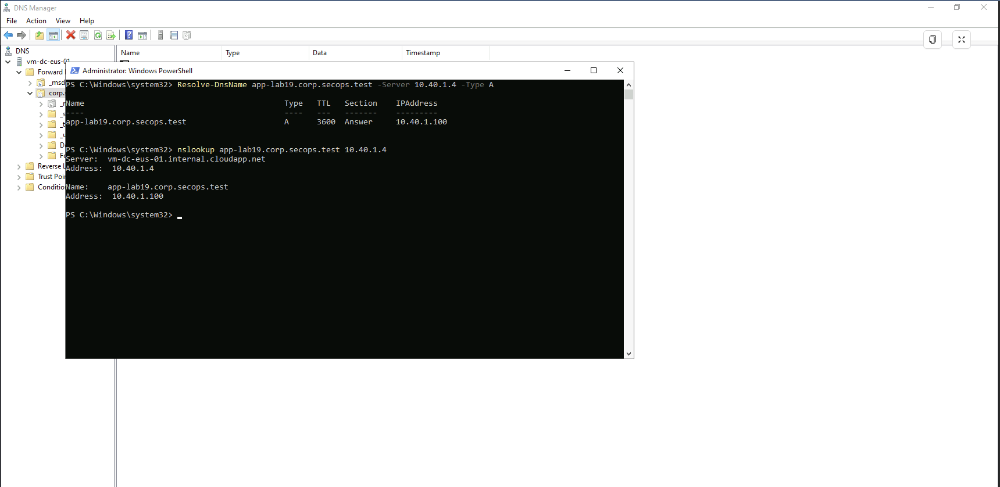

**Figure 11 — Modification**

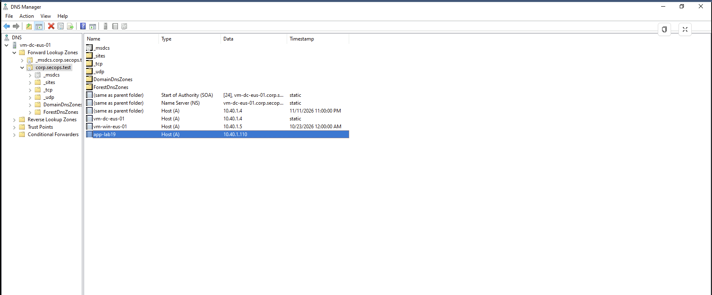

**Figure 12 — Updated resolution**

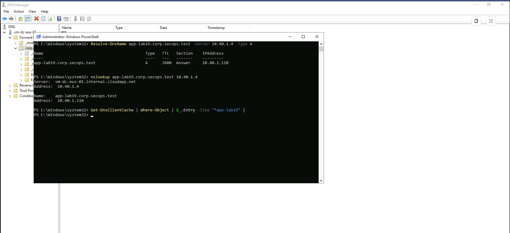

**Figure 13 — Deletion**

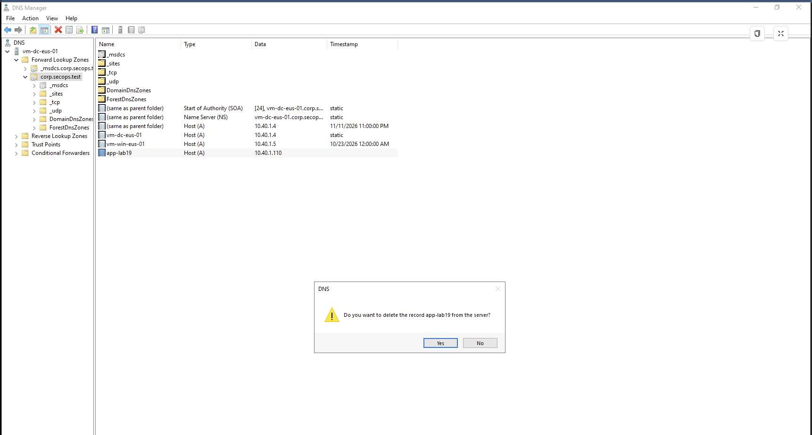

**Figure 14 — Negative lookup**

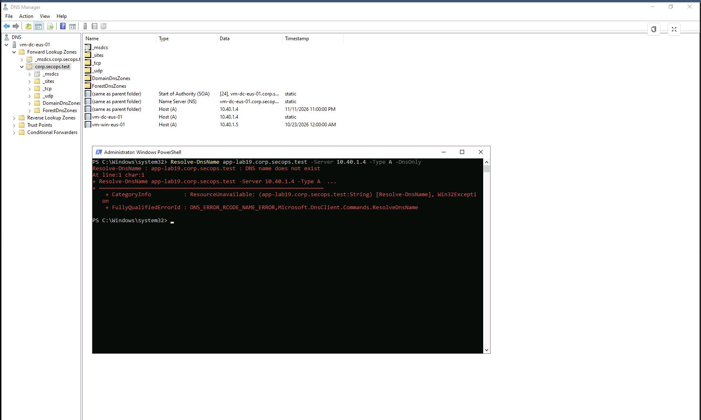

## 3. Group Policy baseline and endpoint validation

Inspected `GPO-Servers-Security-Baseline` in Group Policy Management. Verified that the GPO was linked to `corp.secops.test/Servers`, with link enabled and `Authenticated Users` in security filtering. The GPO report showed these settings:

| Baseline area | Configured / demonstrated setting |
|---|---|
| Process Creation | Include command line in process creation events — enabled |
| Windows PowerShell | Turn on Module Logging — enabled |
| Windows PowerShell | Turn on PowerShell Script Block Logging — enabled |
| Legal notice | Lab-specific logon caption and message defined via policy |

On `vm-win-eus-01`, refreshed Group Policy and inspected resultant policy:

```powershell
gpupdate /force
gpresult /r /scope computer
```

**Observed:** Computer and user policy updates succeeded; `GPO-Servers-Security-Baseline` appeared under applied computer GPOs, alongside the default domain policy.

Validated effective configuration in the local registry:

```powershell
Get-ItemProperty -Path 'HKLM:\SOFTWARE\Microsoft\Windows\CurrentVersion\Policies\System\Audit' -Name ProcessCreationIncludeCmdLine_Enabled
Get-ItemProperty -Path 'HKLM:\SOFTWARE\Policies\Microsoft\Windows\PowerShell\ScriptBlockLogging' -Name EnableScriptBlockLogging
Get-ItemProperty -Path 'HKLM:\SOFTWARE\Policies\Microsoft\Windows\PowerShell\ModuleLogging' -Name EnableModuleLogging
```

**Observed:** All three returned an enabled value of `1`. This verifies effective local configuration in addition to the presence of the GPO link.

**Figure 15 — Gpo list**

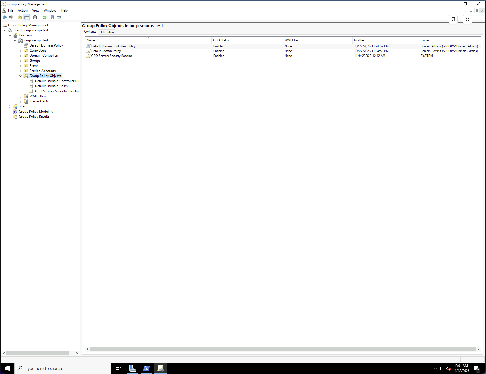

**Figure 16 — Gpo settings**

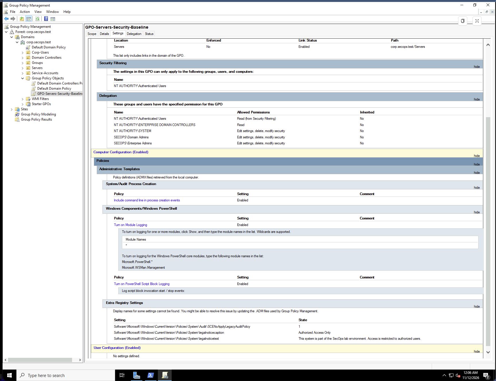

**Figure 17 — Gpo scope**

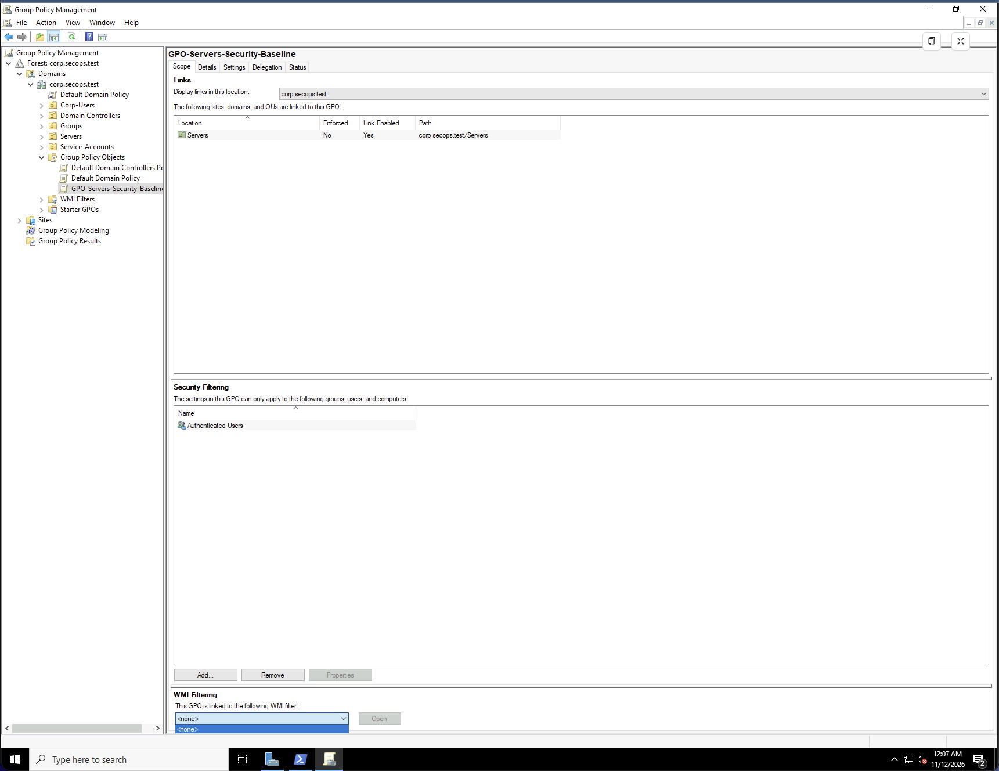

**Figure 18 — Gpresult**

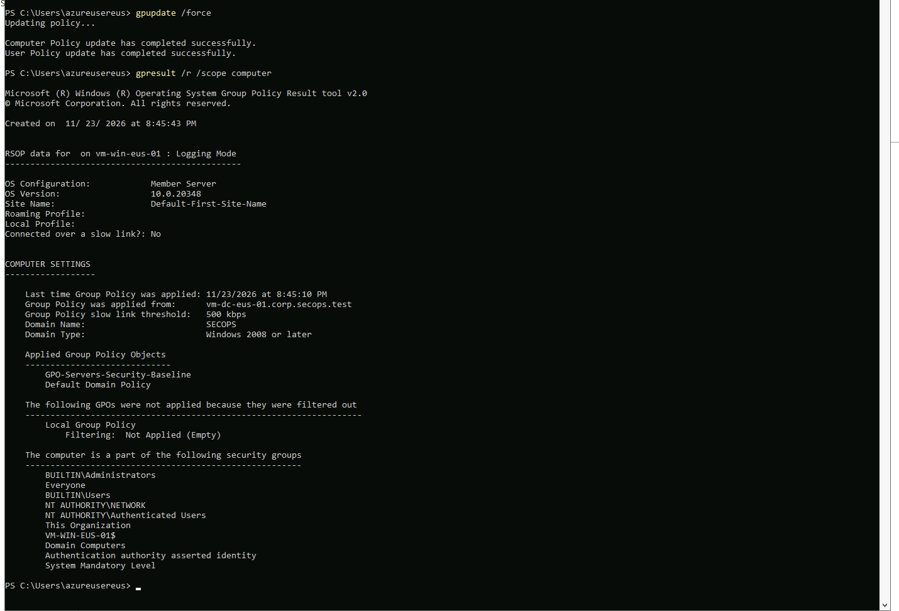

**Figure 19 — Registry checks**

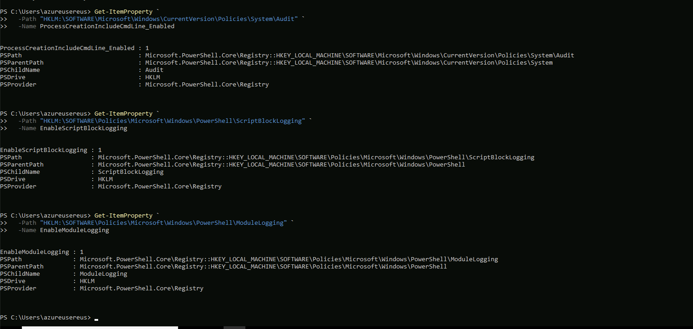

## 4. Security telemetry: events 4104, 4688, and 4103

### PowerShell script block logging — Event ID 4104

Opened **Applications and Services Logs → Microsoft → Windows → PowerShell → Operational**, filtered for `4104`, and inspected a test script block containing the identifiable `Lab19-ScriptBlock-Test` marker. The event included `ScriptBlockText`, confirming content-level collection.

**Figure 20 — Event 4104**

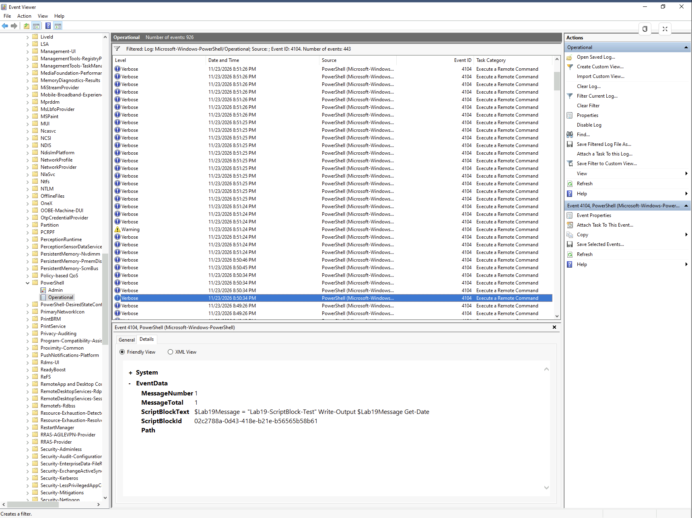

### Process creation audit — Event ID 4688

Verified audit configuration:

```powershell
auditpol /get /subcategory:'Process Creation'
```

**Observed:** `Success` was enabled. Generated an explicit and harmless `cmd.exe` process:

```powershell
Start-Process -FilePath 'cmd.exe' -ArgumentList '/c echo Lab19-ProcessCreation-Test' -Wait
```

Then retrieved the matching security event:

```powershell
$StartTime = (Get-Date).AddMinutes(-10)
Get-WinEvent -FilterHashtable @{
    LogName   = 'Security'
    Id        = 4688
    StartTime = $StartTime
} -MaxEvents 100 |
Where-Object { $_.Message -like '*Lab19-ProcessCreation-Test*' } |
Select-Object TimeCreated, Id, Message |
Format-List
```

**Observed:** A `4688` event identified `cmd.exe`, its PowerShell parent, and the test command line. This is direct evidence of process command-line auditing on the member server.

**Figure 21 — Audit policy**

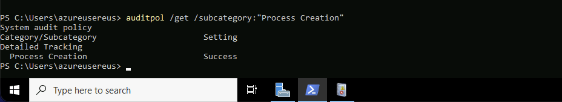

**Figure 22 — Powershell event query**

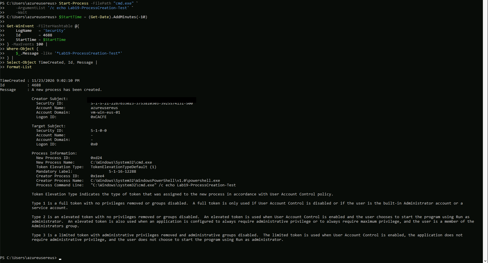

**Figure 23 — Event viewer 4688**

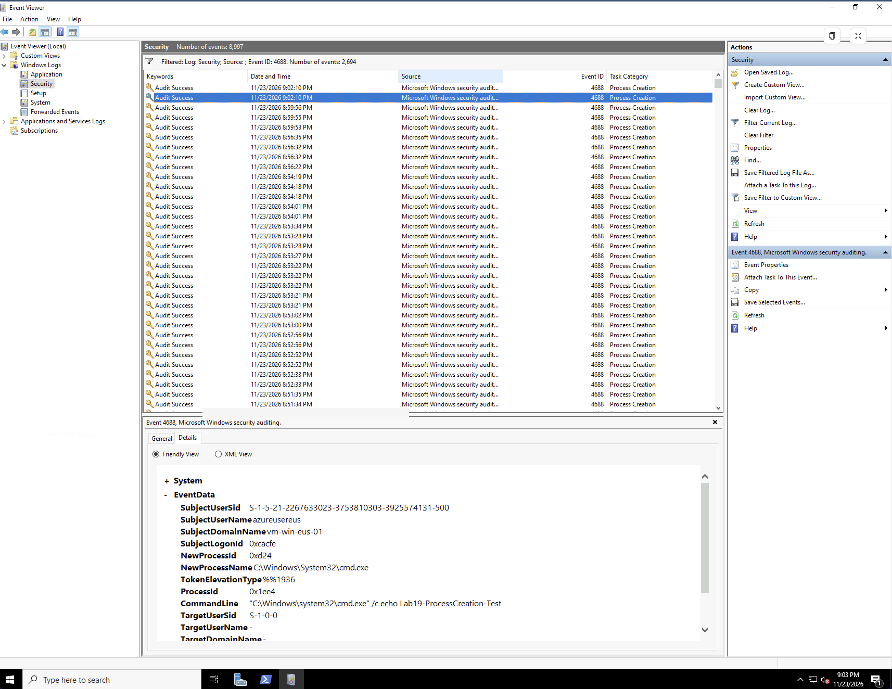

### PowerShell module logging — Event ID 4103

Ran read-only service and process inspection commands:

```powershell
Import-Module Microsoft.PowerShell.Management
Get-Service -Name WinRM
Get-Process -Name explorer -ErrorAction SilentlyContinue
```

Queried matching events in the PowerShell Operational log:

```powershell
Get-WinEvent -FilterHashtable @{
    LogName   = 'Microsoft-Windows-PowerShell/Operational'
    Id        = 4103
    StartTime = (Get-Date).AddMinutes(-15)
} -MaxEvents 30 |
Where-Object { $_.Message -match 'Get-Service|Get-Process' } |
Select-Object TimeCreated, Id, Message |
Format-List
```

**Observed:** `4103` captured command invocation and parameter binding for `Get-Service` and `Get-Process`, providing a different telemetry perspective from script block logging (`4104`).

**Figure 24 — Powershell results**

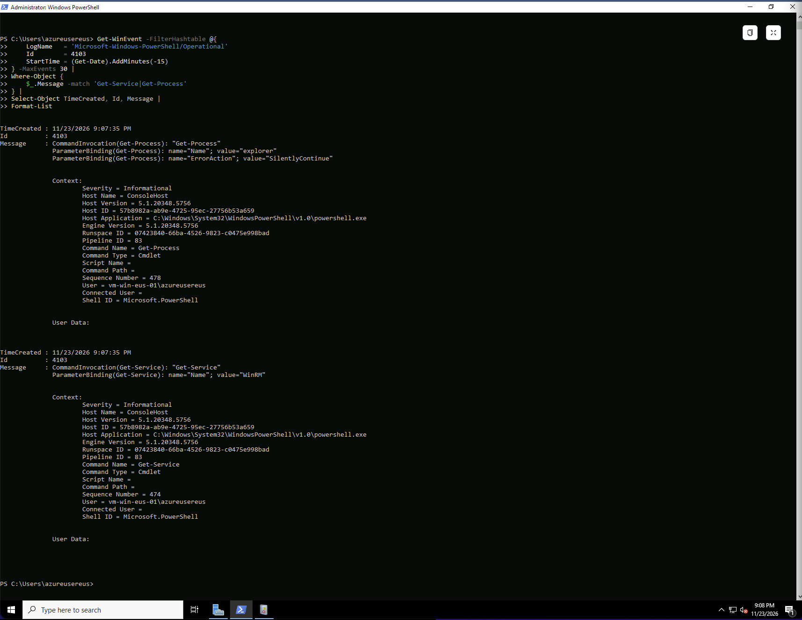

**Figure 25 — Get-process details**

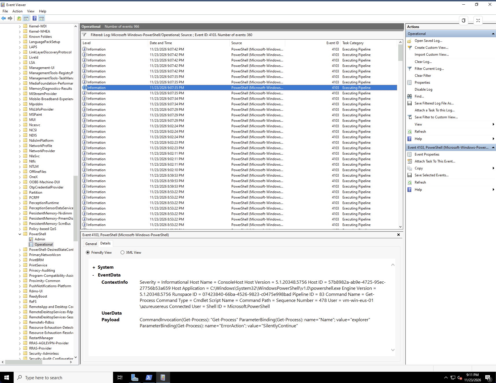

**Figure 26 — Get-service details**

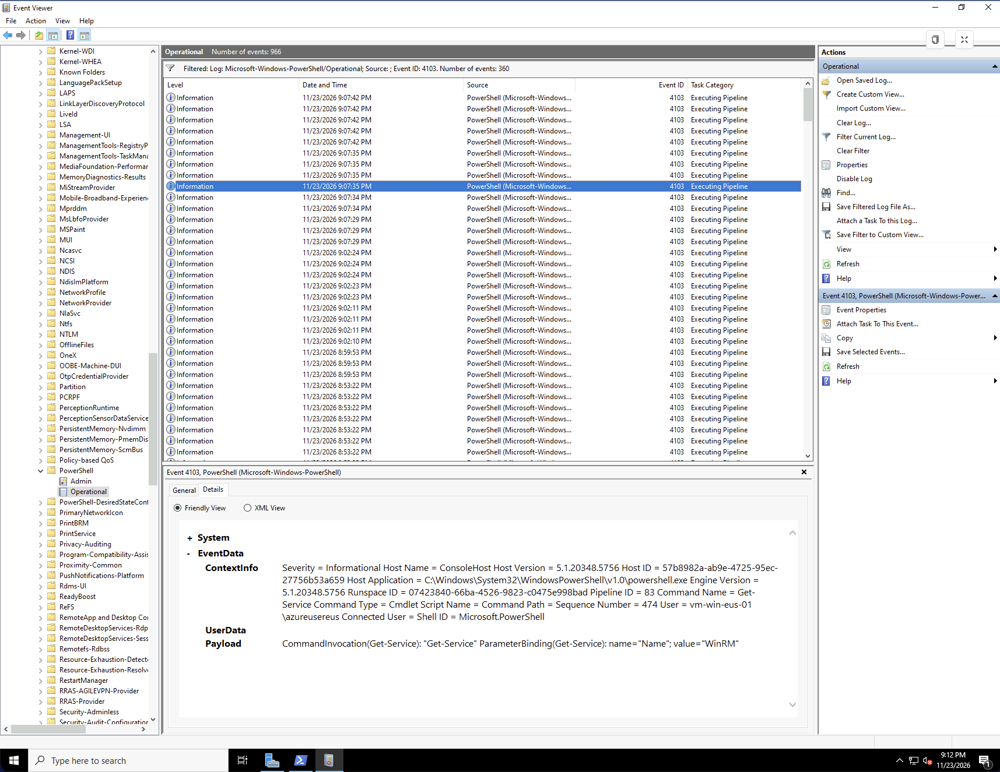

## 5. Windows services, dependencies, and inspection

Used the **Services** management console and PowerShell/CIM to examine running states, start modes, and dependencies. Confirmed that the following core services were running with automatic start configuration: `WinRM`, `EventLog`, `gpsvc`, `Dnscache`, and `W32Time`.

```powershell
Get-CimInstance Win32_Service |
Where-Object { $_.Name -in @('WinRM','EventLog','gpsvc','Dnscache','W32Time') } |
Select-Object Name, DisplayName, State, StartMode |
Format-Table -AutoSize

Get-Service -Name WinRM -RequiredServices
Get-Service -Name WinRM -DependentServices
```

The required-service inspection returned `RPCSS` and `HTTP` running. The dependent-services query returned no rows in the captured session; this does **not** mean that WinRM has no architectural dependencies in every deployment.

**Figure 27 — Gui**

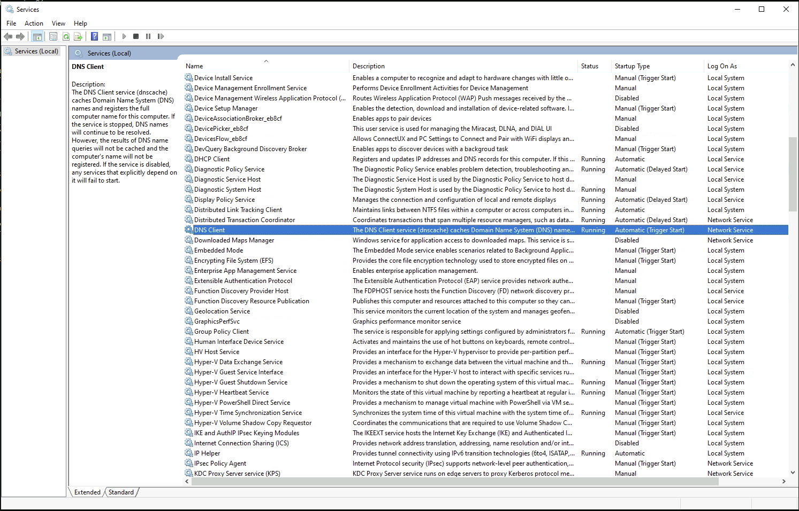

**Figure 28 — Service state and dependencies**

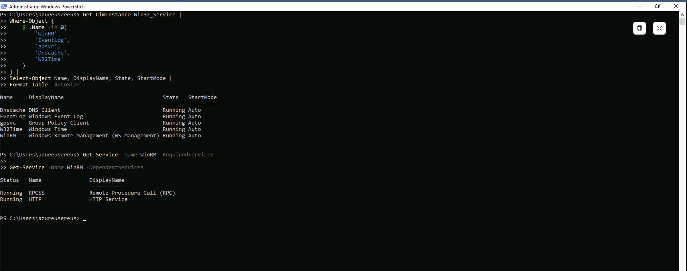

## 6. Controlled service failure and RCA

Created the disposable `Lab19HealthSvc` service with manual start and `svchost.exe` as the configured binary path. `svchost.exe` is a host process for services with appropriate service DLL registration/configuration; pointing a standalone test service at `svchost.exe` does **not** create a functioning hosted service. Therefore, a startup failure was anticipated and used for troubleshooting practice.

```powershell
$ServiceName = 'Lab19HealthSvc'
New-Item -ItemType Directory -Path 'C:\Lab19' -Force
sc.exe create $ServiceName binPath= 'C:\Windows\System32\svchost.exe' start= demand DisplayName= 'Lab19 Health Service'
Get-CimInstance Win32_Service -Filter "Name='Lab19HealthSvc'" |
    Select-Object Name, DisplayName, State, StartMode, PathName

Start-Service -Name 'Lab19HealthSvc' -ErrorAction Stop
```

**Observed:** The service was created and remained stopped; the start attempt failed. Event Viewer recorded `7045` (service installed), `7009` (30,000 ms timeout), and `7000` (service failed to start). Correlation supports the conclusion that an improperly configured test service could not satisfy Service Control Manager startup expectations; it does not prove a production outage or malware activity.

See [Root Cause Analysis — controlled service startup failure](rca-service-failure.md) for the investigation, impact, corrective action, and limitations.

**Figure 29 — Service creation**

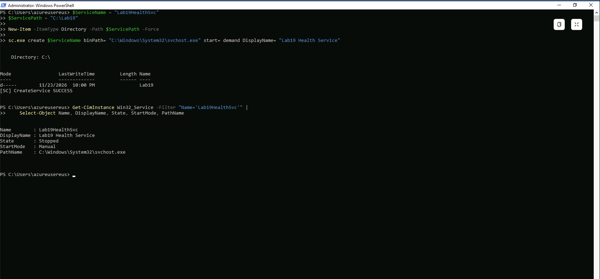

**Figure 30 — Properties**

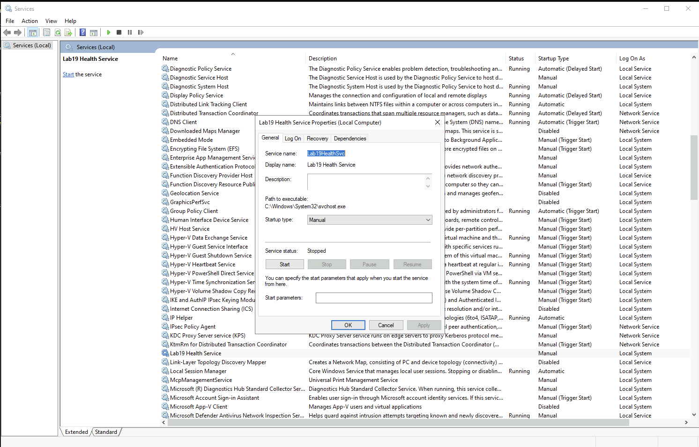

**Figure 31 — Failed start**

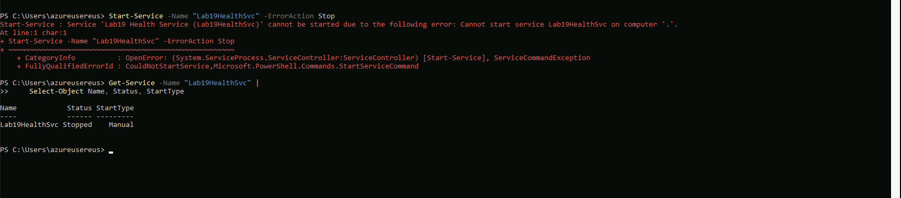

**Figure 32 — 7045**

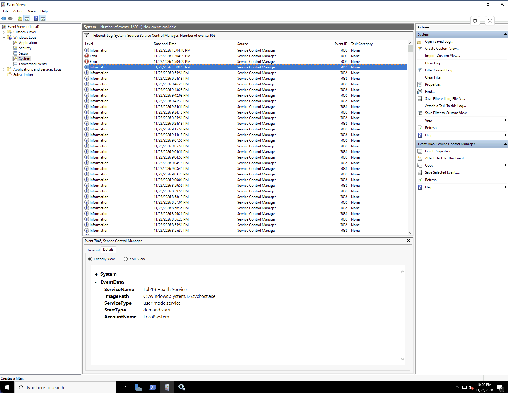

**Figure 33 — 7009**

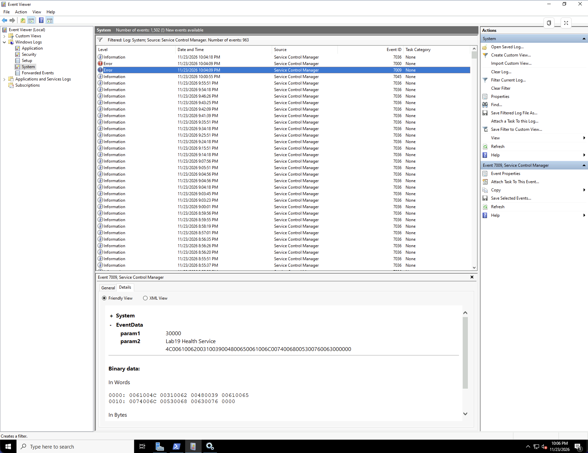

**Figure 34 — 7000**

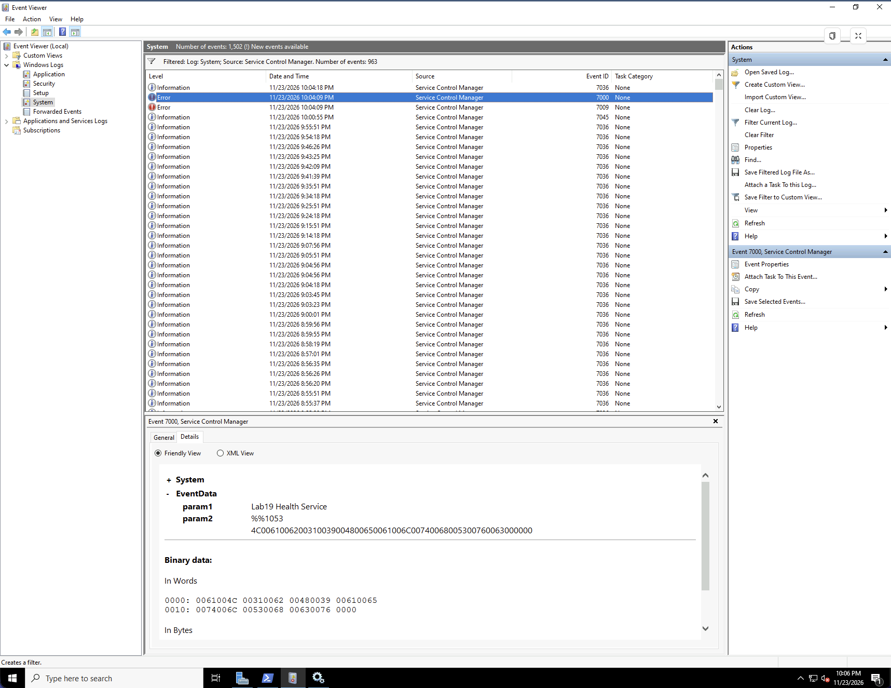

## 7. Remediation, verification, and cost-aware teardown

Deleted the temporary service, removed the lab-only `C:\Lab19` directory, and rechecked the running state of core Windows services:

```powershell
Get-Service -Name 'Lab19HealthSvc'
sc.exe delete 'Lab19HealthSvc'
Get-Service -Name 'Lab19HealthSvc' -ErrorAction SilentlyContinue
Remove-Item 'C:\Lab19' -Recurse -Force
Get-Service -Name WinRM, EventLog, gpsvc, Dnscache, W32Time |
    Select-Object Name, Status
```

**Observed:** `sc.exe` returned `DeleteService SUCCESS`; the service no longer appeared in the subsequent silent query, the lab directory was removed, and all five core services remained running.

Azure VMs were stopped/deallocated after validation. The temporary Bastion host and its associated public IP resource were deleted to avoid ongoing Bastion charges. **Deallocation does not delete VM disks or all related billable resources**, so subscription cost monitoring remains necessary.

**Figure 35 — Post-cleanup checks**

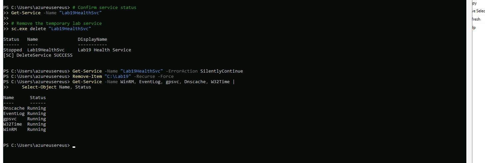

## Results and lessons learned

| Area | Result |
|---|---|
| Bastion GUI administration | Validated |
| AD user/group inspection and membership | Validated |
| DNS A/SRV lookups and A-record lifecycle | Validated |
| GPO scope and application to member server | Validated |
| Process creation audit and command line (4688) | Validated |
| PowerShell script block (4104) and module logs (4103) | Validated |
| Service inspection and dependency review | Validated |
| Controlled failed-service diagnosis (7045, 7009, 7000) | Validated |
| Temporary service cleanup and service health recheck | Validated |

**Takeaways:** GUI and PowerShell are complementary tools for Windows infrastructure administration. A GPO's existence is not proof of endpoint enforcement: verify with `gpresult`, registry settings, and actual event telemetry. Likewise, a service's presence in Services does not prove it is correctly implemented or startable. Service Control Manager events offer a practical RCA trail when correlated with original configuration and time of failure.

## Screenshot navigation

The 35 screenshots are embedded throughout the walkthrough, directly beneath their corresponding commands, configuration steps, and observed results. Each image uses a relative Markdown path such as `screenshots/lab19-18-gpo-application-gpresult.png`, so GitHub displays it automatically when this README and the `screenshots/` folder are committed together. The full image collection is available in [`screenshots/`](screenshots/).

## Responsible publication

This repository documents an authorized, isolated learning environment. Screenshots omit account SID material where observed and contain no passwords, access keys, public host addresses, or subscription/tenant identifiers. Private lab IPs and the reserved `.test` domain remain to make reproduction understandable. Before publishing new screenshots, inspect for identities, tokens, real public IPs, connection strings, tenant IDs, and customer or employer data.
