# Lab 16 — Mini SOC Capstone: From Excessive Azure RBAC to Detected Persistence and Validated Containment

## Executive Summary

Lab 16 is the capstone for the first fifteen labs in this Azure Security Operations project. Instead of introducing one new portal feature, the goal was to answer a harder question: **can the identity, cloud-governance, Windows, telemetry, KQL, Microsoft Sentinel, detection-engineering, incident-response, and least-privilege skills built earlier be used together to investigate and close one coherent security scenario?**

The scenario starts with a deliberately over-permissioned analyst path. `SG-SecOps-Analysts` has `Virtual Machine Contributor` over the compute resource group, which allows an analyst identity to use Azure Run Command against `vm-win-cac-01`. In the controlled simulation, that cloud permission is used to add an existing lab account to the local `Administrators` group, perform discovery, and create a scheduled task named `SystemHealthCheck` as a persistence mechanism.

The important part of the lab is not simply that the commands worked. The capstone follows the evidence across layers:

**Microsoft Entra / Azure RBAC → Azure control plane → Windows Security telemetry → AMA/DCR collection → Log Analytics → Microsoft Sentinel analytics rules → SecurityAlert → SecurityIncident → containment → RBAC remediation → validation → closure**

The investigation also encountered real operational problems. The first privilege-escalation alert did not automatically become a new incident. Later, Windows generated Event ID `4698` locally, but Sentinel could not see it because the Data Collection Rule did not collect that event. Rather than treating those gaps as failures to hide, the lab uses them as part of the investigation: verify the source, isolate the broken layer, repair collection, regenerate evidence, validate ingestion, then build the detection.

This was a controlled lab performed only in my own authorized Azure environment. The scheduled task payload was intentionally benign and wrote a lab marker file rather than executing malware or destructive actions.

---

## What I Wanted to Prove

Before starting the scenario, I defined several questions that a SOC analyst should be able to answer with evidence rather than assumptions:

1. **Could an Azure analyst role with excessive RBAC permissions become an endpoint security problem?**
2. **Could I distinguish the cloud identity that initiated an action from the local Windows security context that executed it?**
3. **Would the existing Sentinel detections from Lab 11 detect the privilege change and suspicious PowerShell execution?**
4. **Could post-escalation activity be reconstructed from raw Windows process telemetry?**
5. **Would a scheduled-task persistence mechanism be visible end to end?**
6. **If a security event existed on the VM but was missing from Sentinel, could I troubleshoot the telemetry pipeline instead of only rewriting KQL?**
7. **Could a newly created persistence detection produce both a `SecurityAlert` and an automatic `SecurityIncident`?**
8. **Could containment remove not only the artifacts but also the permission path that enabled the activity?**
9. **Could the final incident be classified accurately without calling a correct detection a false positive?**

The rest of the lab is the evidence-based answer to those questions.

---

## How Labs 00–15 Converge in This Capstone

The capstone intentionally reuses earlier project components instead of building a disconnected demo. Each previous lab contributes something to the final investigation.

| Previous Lab | Capability Reused in Lab 16 | Why It Matters Here |
| --- | --- | --- |
| **Lab 00 — Baseline & Cost Governance** | Resource groups, naming, tags, cost-aware operation | The capstone runs inside a controlled, organized lab subscription rather than an ad hoc environment. |
| **Lab 01 — Entra Users & Groups** | Alice Analyst and `SG-SecOps-Analysts` | The initiating cloud identity and group-based access path already exist and can be investigated. |
| **Lab 02 — Administrative Units** | Scoped-administration / least-privilege thinking | Reinforces the principle that administrative capability should be bounded rather than granted broadly. |
| **Lab 03 — Azure RBAC** | Resource-group role assignments and inheritance | The scenario begins with the analyst group having `Virtual Machine Contributor`, which becomes the root control weakness to remediate. |
| **Lab 04 — Azure Policy** | Governance and preventive-control mindset | The lab treats security as both detection and control design, not only alert response. |
| **Lab 05 — VNet & NSG** | Segmented Azure network | The Windows host exists inside the previously designed server network rather than as an isolated test VM. |
| **Lab 06 — Virtual Machines** | Windows Server target and secure administration | `vm-win-cac-01` is the endpoint used throughout the scenario. |
| **Lab 07 — VM Administration** | Azure Run Command | The same legitimate administrative feature becomes the cloud-to-endpoint execution path investigated in the capstone. |
| **Lab 08 — Log Analytics, AMA & DCR** | Windows event ingestion and XPath filtering | This becomes critical when Event ID `4698` exists locally but is missing from Sentinel. |
| **Lab 09 — Microsoft Sentinel & Azure Activity** | SIEM workspace and Azure control-plane telemetry | Allows the investigation to attribute Run Command to the Azure identity that initiated it. |
| **Lab 10 — KQL Investigation** | Parsing, time correlation, unified timelines | Used to reconstruct the incident across `Event`, `AzureActivity`, `SecurityAlert`, and `SecurityIncident`. |
| **Lab 11 — Scheduled Analytics Rules** | Existing detections for `4732` and PowerShell execution | Provides the initial detection layer that the capstone validates under a more realistic sequence. |
| **Lab 12 — Incident Triage & Correlation** | Ownership, comments, cross-source correlation, classification | Provides the SOC workflow used to investigate, document, and close the incident. |
| **Lab 13 — Threat Hunting** | Parent/child process analysis and command-line visibility | Used to investigate `4688` process chains and understand what happened after privilege escalation. |
| **Lab 14 — MFA / Identity Security** | Identity-control awareness and authentication context | Reinforces that a valid cloud identity can still become risky when authorization is broader than necessary. |
| **Lab 15 — Policy Compliance** | Governance drift, remediation, evidence-based validation | The capstone applies the same mindset to RBAC: identify the control gap, remediate it, then prove the change had the intended effect. |

Lab 16 is therefore less about learning one more feature and more about **connecting controls, telemetry, detection logic, analyst reasoning, and remediation into one end-to-end case**.

---

## Environment

| Component | Value |
| --- | --- |
| SIEM | Microsoft Sentinel |
| Workspace | `law-secops-cc-01` |
| Windows host | `vm-win-cac-01` |
| Resource group | `rg-secops-compute-canadacentral` |
| Analyst group | `SG-SecOps-Analysts` |
| Controlled local account | `lab11-persist` |
| Controlled persistence task | `SystemHealthCheck` |
| Main telemetry tables | `Event`, `AzureActivity`, `SecurityAlert`, `SecurityIncident` |
| Key Windows events | `4732`, `4688`, `4698` |

### Scenario path

```text
Alice Analyst
    │
    ▼
SG-SecOps-Analysts
    │  Virtual Machine Contributor
    ▼
Azure control plane
    │
    ├── Azure Run Command
    ▼
vm-win-cac-01
    │
    ├── add lab11-persist to local Administrators      → Event 4732
    ├── discovery: whoami / groups / users             → Event 4688
    └── create SystemHealthCheck scheduled task        → Event 4688 + Event 4698
                                                        │
                                                        ▼
                                      Azure Monitor Agent / DCR
                                                        │
                                                        ▼
                                             Log Analytics
                                                        │
                                                        ▼
                                           Microsoft Sentinel
                                                        │
                              analytics rule → alert → incident
                                                        │
                                                        ▼
                         containment + RBAC remediation + validation
```

---

# Investigation Story

## 1. Start with the control path, not with an attack command

The first step was to validate what detection and access already existed. The existing `LAB11 - User Added to Local Administrators` rule was enabled, high severity, and designed to detect Event ID `4732` when a member is added to the local `Administrators` group.

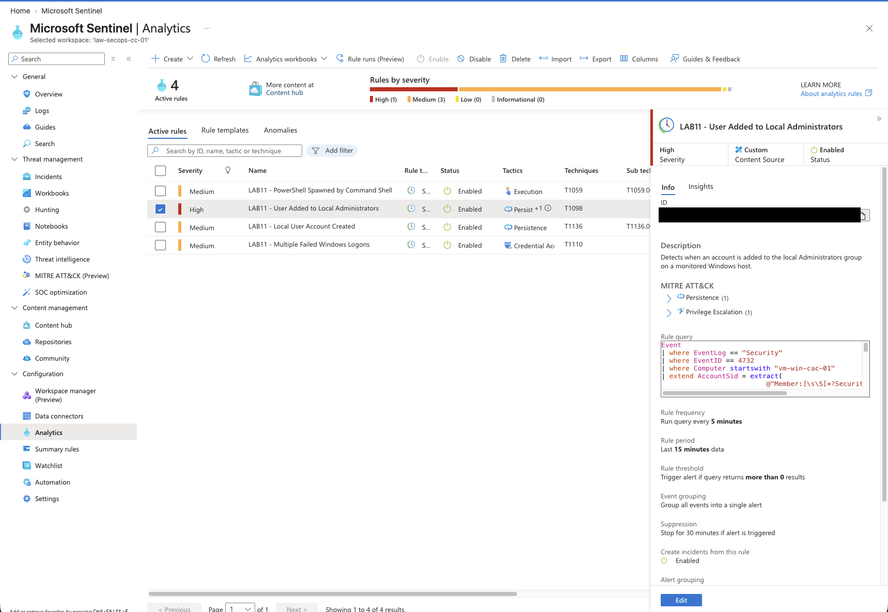

That confirmed that a detection existed, but it did not yet explain **who could generate the event**. The next question was authorization: what Azure permissions did the analyst group actually have over the Windows VM?

The IAM review showed that `SG-SecOps-Analysts` had `Virtual Machine Contributor` at the compute resource-group scope, and the effective-access view showed that Alice inherited that access through the group.

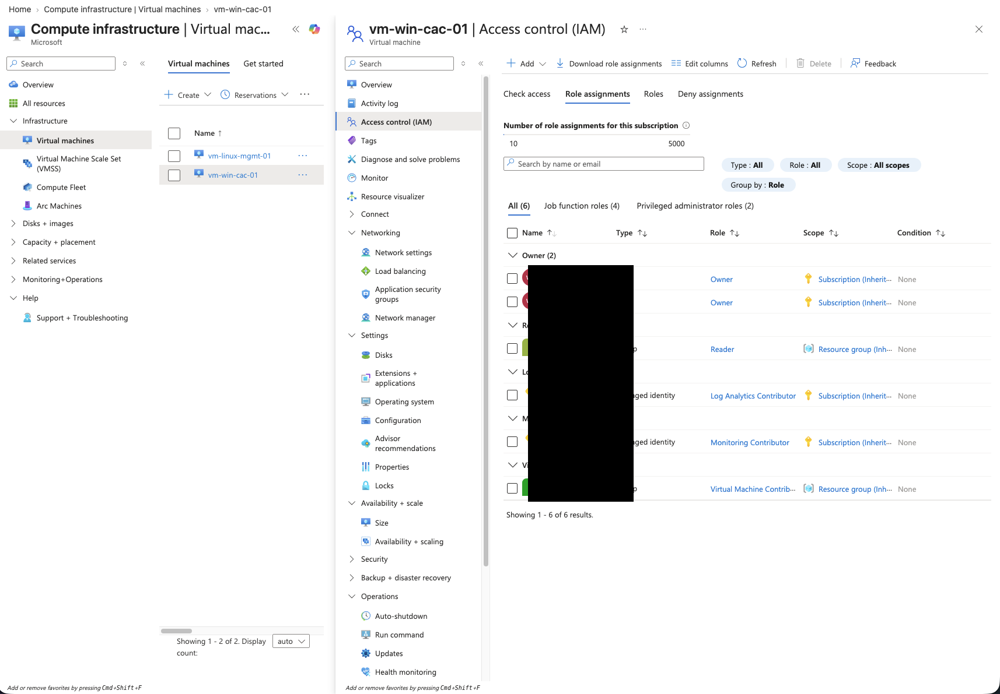

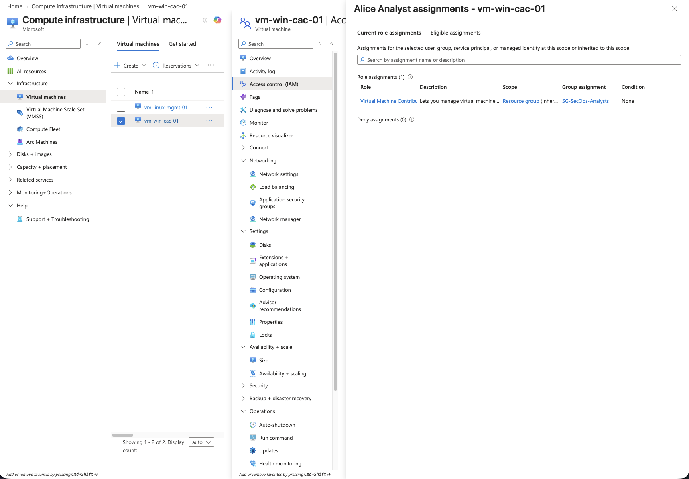

This mattered because `Virtual Machine Contributor` is not only a viewing role. In this lab, it gave the analyst account enough control-plane capability to invoke Azure Run Command. That created the central risk hypothesis for the capstone:

> **A cloud analyst with excessive VM-management permission may be able to execute commands inside the server and turn a cloud authorization problem into a local privilege-escalation problem.**

The purpose of the next steps was to prove or disprove that hypothesis with telemetry.

---

## 2. Remove old Lab 11 state before generating new evidence

The Windows host still contained state from Lab 11. The reusable local account `lab11-persist` existed and was already a member of the local `Administrators` group.

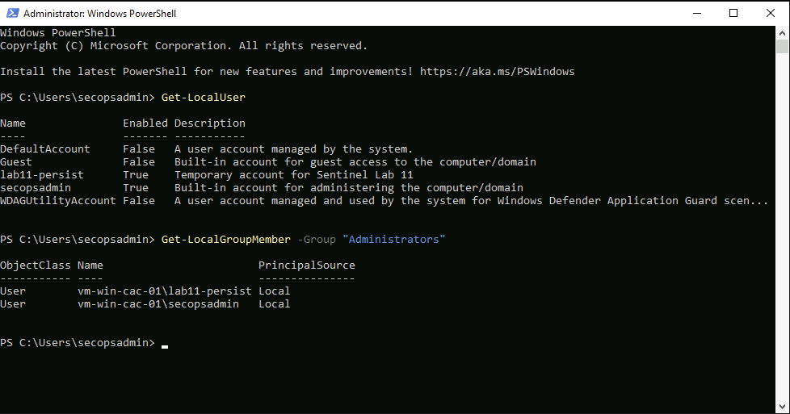

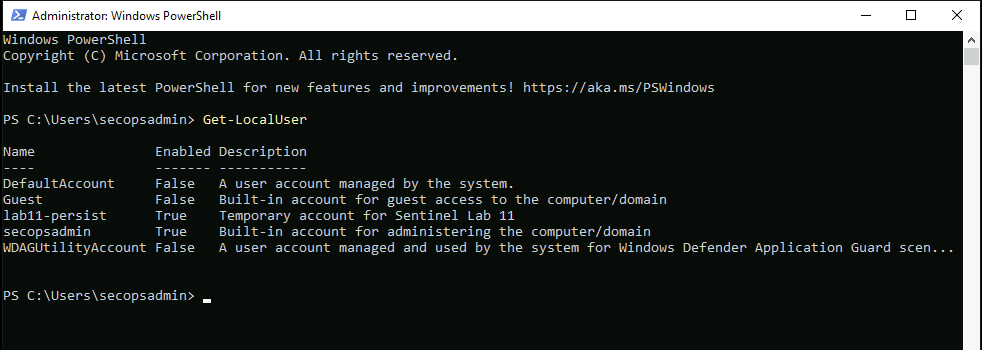

This is an important preparation step. If the account had remained in `Administrators`, adding it again would not have produced a clean privilege-change sequence. More importantly, any later `4732` evidence could have been confused with residual state from a previous lab.

So I deliberately removed `lab11-persist` from the local `Administrators` group and enumerated the group again to confirm a clean baseline.

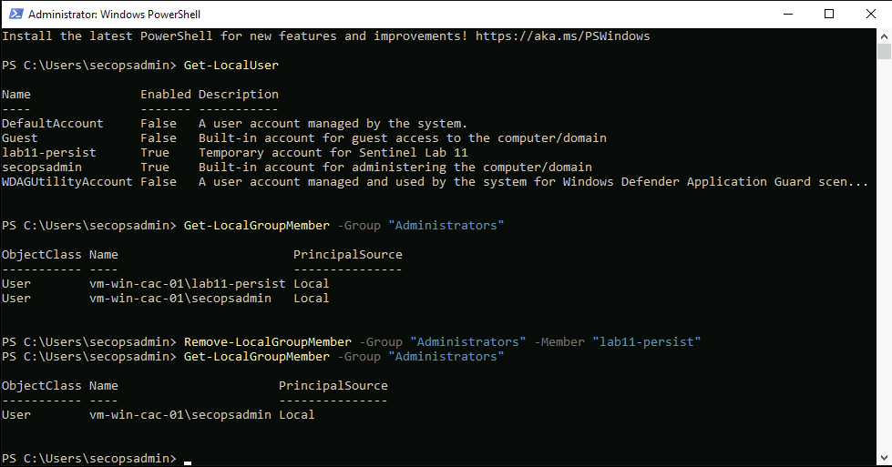

This screenshot has a different purpose from the later containment screenshot. Here, the removal is **preparation**: it resets the environment so that the capstone generates a fresh, attributable security event. Later, the same membership is removed again as **containment** after the activity has been detected and investigated.

The resulting sequence is intentional:

```text
state inherited from Lab 11
        ↓
remove lab11-persist from Administrators
        ↓
verify clean baseline
        ↓
run the controlled capstone action
        ↓
add lab11-persist back to Administrators
        ↓
generate a fresh Event 4732
```

---

## 3. Turn excessive Azure RBAC into a fresh endpoint privilege event

With the baseline clean, the analyst session used Azure Run Command to add `lab11-persist` back to the Windows local `Administrators` group.

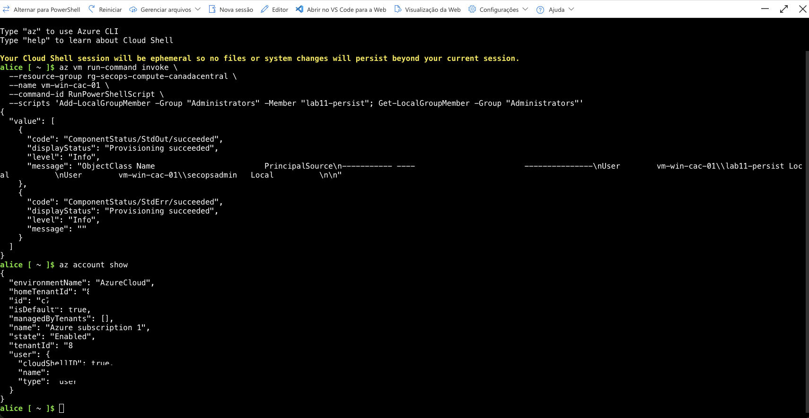

This action was chosen because it connects multiple layers from earlier labs in one operation:

- the **identity** comes from Entra ID;
- the **authorization** comes from Azure RBAC;
- the **execution path** is Azure Run Command;
- the **endpoint effect** is a Windows local-group membership change;
- the **detection evidence** is Windows Security Event ID `4732`.

Windows generated the expected event and Sentinel ingested it.

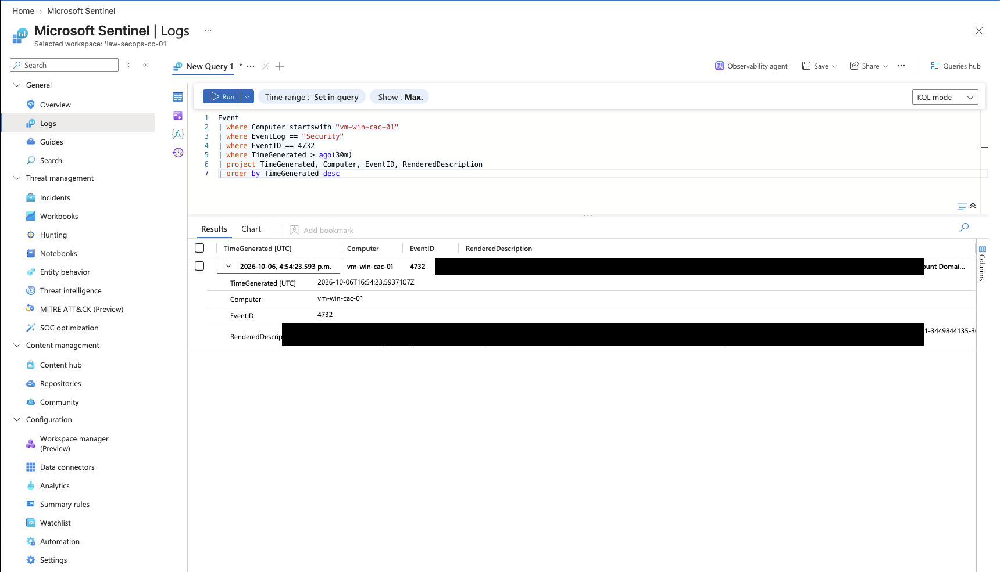

I also measured ingestion delay rather than assuming that event generation and SIEM availability were simultaneous.

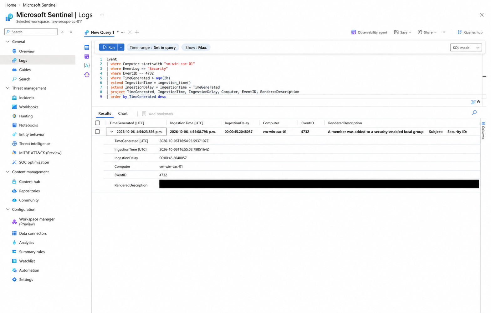

This matters operationally because scheduled analytics rules work with evaluation windows. If telemetry arrives later than expected, an overly narrow lookback can miss otherwise-correct data.

The detection KQL then parsed the affected member SID and target group from `RenderedDescription`, restricted the result to `Administrators`, and returned the expected event.

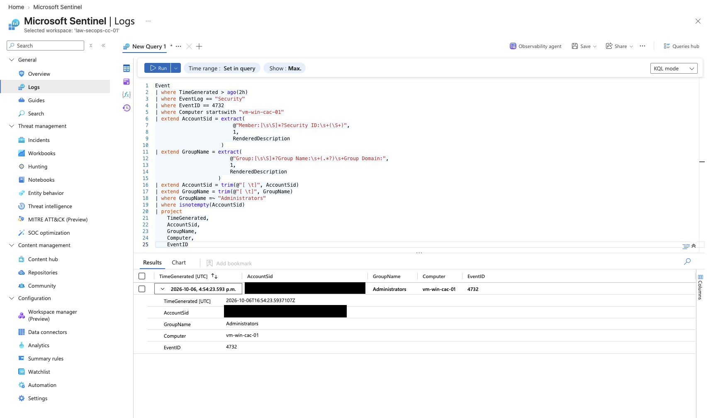

Reusable query: [`01_local_admin_membership_change_4732.kql`](../../kql/lab16/01_local_admin_membership_change_4732.kql)

---

## 4. A valid alert did not automatically become a new incident

The existing scheduled rule generated the expected high-severity `SecurityAlert`.

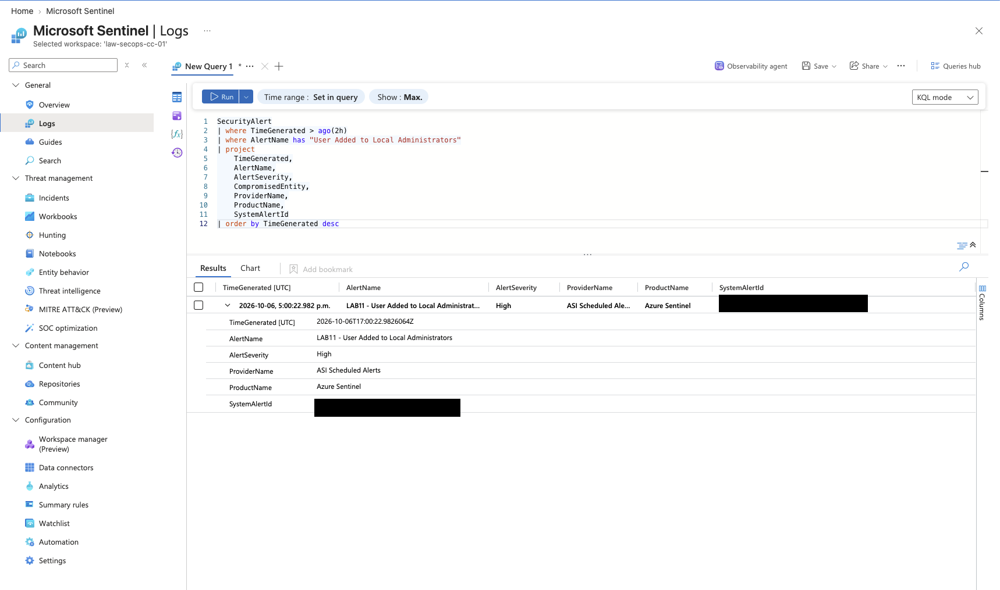

At this point I expected a corresponding `SecurityIncident`, but the alert could not be matched to a new incident during the validation window.

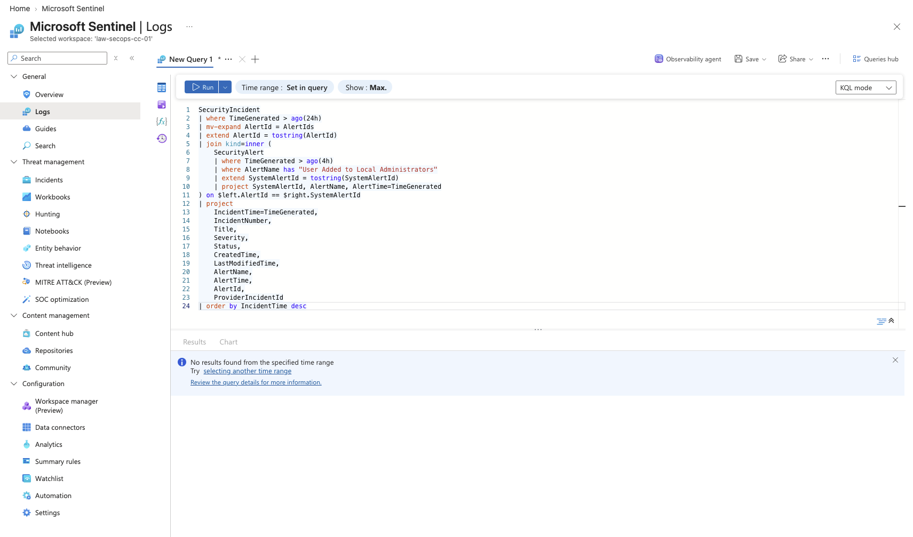

This became the first operational lesson of the capstone: **event, alert, and incident are separate objects and should be validated separately**.

Instead of assuming the incident pipeline was broken, I reviewed historical incident records. Previous LAB11 incidents existed and were represented with `Microsoft XDR` as the provider.

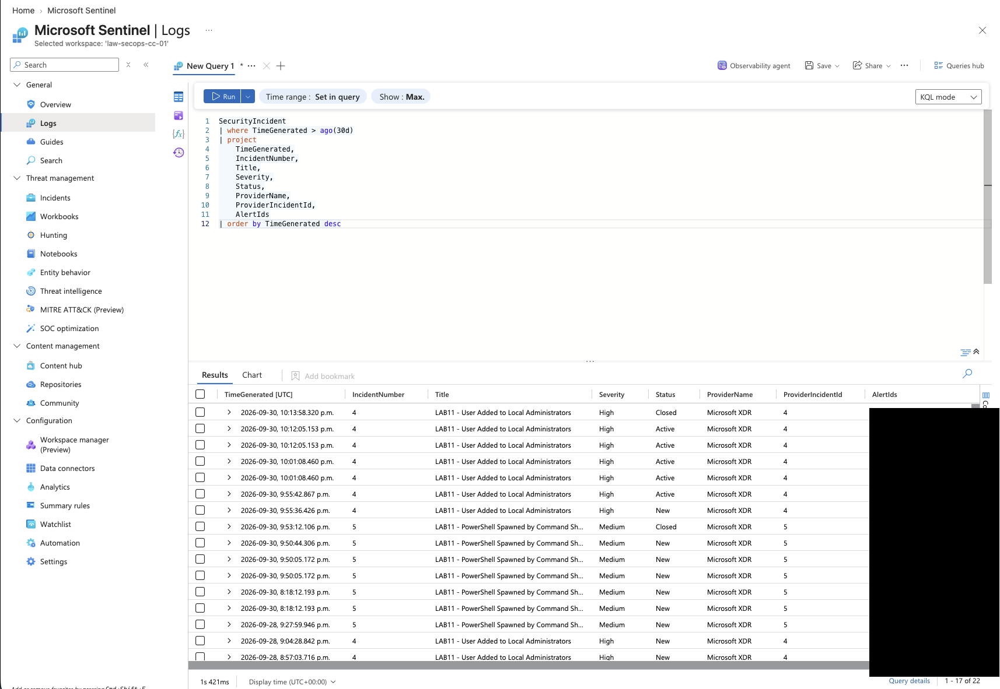

That told me that incident creation had worked previously, while the current alert still lacked a matching incident. To continue the investigation transparently, I created a manual high-severity incident and assigned it to myself.

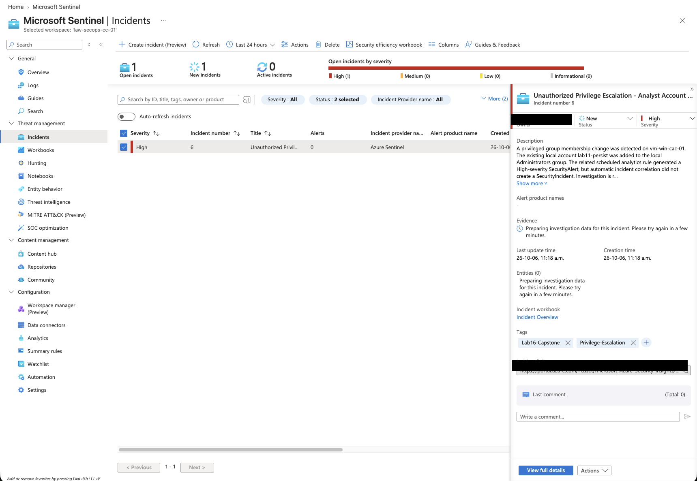

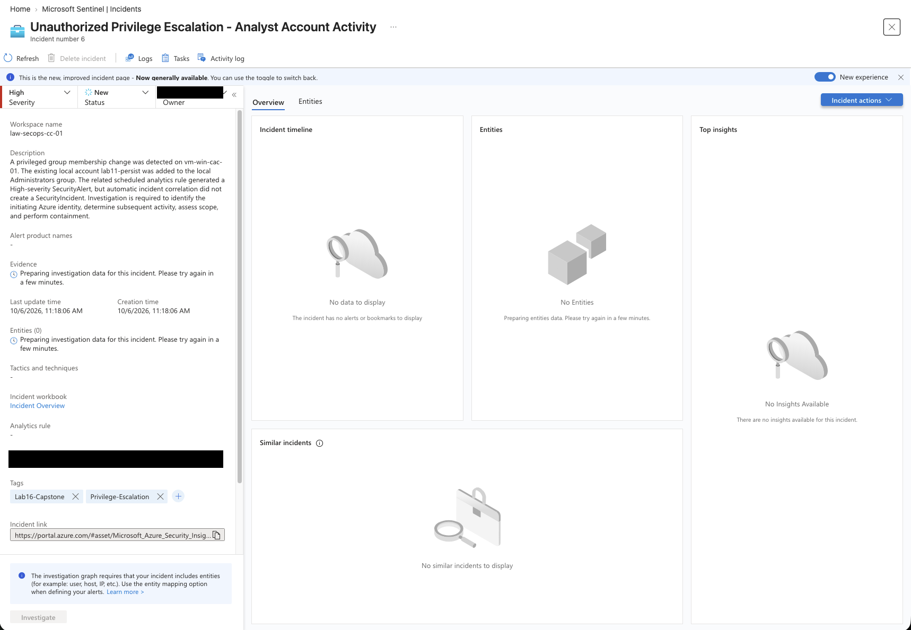

The manual incident was not treated as evidence that automatic correlation had succeeded. It was simply an analyst workflow container so the rest of the investigation could proceed while preserving the fact that the initial automatic association had not occurred.

Relevant queries:

- [`03_privilege_escalation_alert_validation.kql`](../../kql/lab16/03_privilege_escalation_alert_validation.kql)
- [`04_alert_incident_association_check.kql`](../../kql/lab16/04_alert_incident_association_check.kql)
- [`05_historical_security_incident_review.kql`](../../kql/lab16/05_historical_security_incident_review.kql)

---

## 5. Windows said LOCAL SYSTEM; AzureActivity answered who actually initiated it

A Windows event can show what happened on the endpoint without necessarily identifying the human or cloud identity that initiated the management operation. Azure Run Command is a good example: guest-side processes can execute under a system context even though a specific Azure user initiated the action.

That is why the next pivot was to `AzureActivity`.

The query around the event time identified the analyst identity invoking `Microsoft.Compute/virtualMachines/runCommand/action` against `vm-win-cac-01`, with the operation progressing through Start, Accept, and Success.

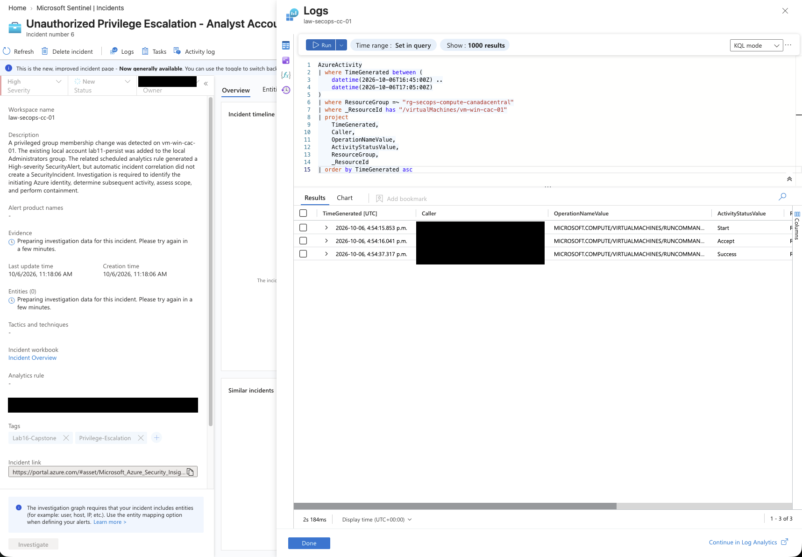

A normalized union query then placed the cloud control-plane records and the Windows `4732` event into one chronological view.

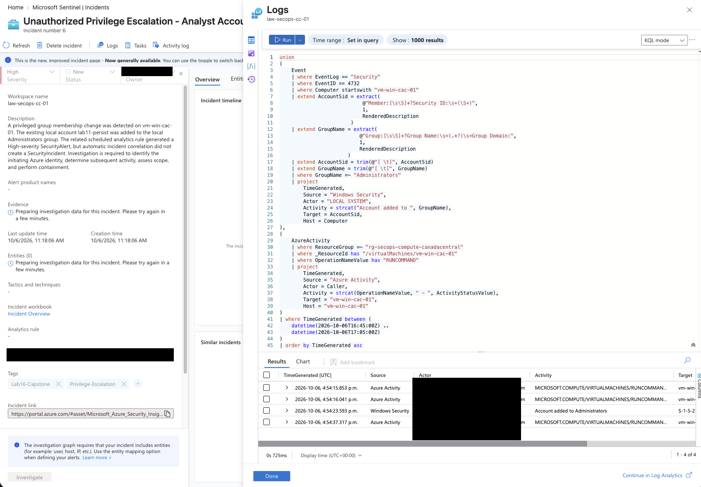

This is one of the most important correlations in the capstone:

```text
AzureActivity
Alice Analyst → Run Command → vm-win-cac-01

                    correlates by host + time
                              │
                              ▼
Windows Security
LOCAL SYSTEM → member added to Administrators → Event 4732
```

The endpoint tells me **what changed**. AzureActivity tells me **which cloud identity initiated the management action**. Together, they produce attribution that neither source provides as clearly on its own.

Relevant queries:

- [`06_azure_run_command_activity.kql`](../../kql/lab16/06_azure_run_command_activity.kql)
- [`07_cross_source_privilege_escalation_timeline.kql`](../../kql/lab16/07_cross_source_privilege_escalation_timeline.kql)

---

## 6. Investigate what happened after the privilege change

A SOC investigation should not stop at the first confirmed alert. After a privilege change, the next questions are usually about **scope and follow-on behavior**: what commands ran, what information was collected, and whether the actor established persistence.

The analyst therefore performed controlled discovery through Run Command using commands such as `whoami`, `whoami /groups`, local Administrators enumeration, and local user enumeration.

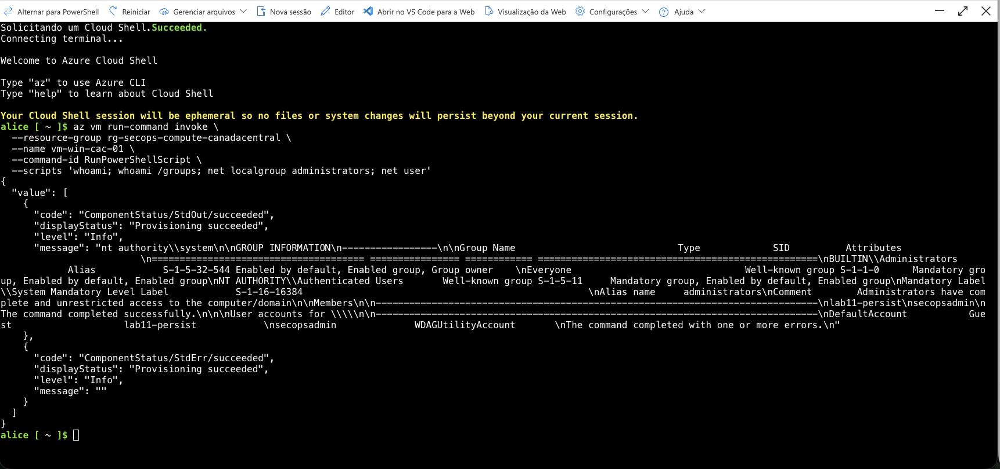

Event ID `4688` provided the process-creation view. The event stream showed processes including `powershell.exe`, `cmd.exe`, `net.exe`, `net1.exe`, and `whoami.exe`.

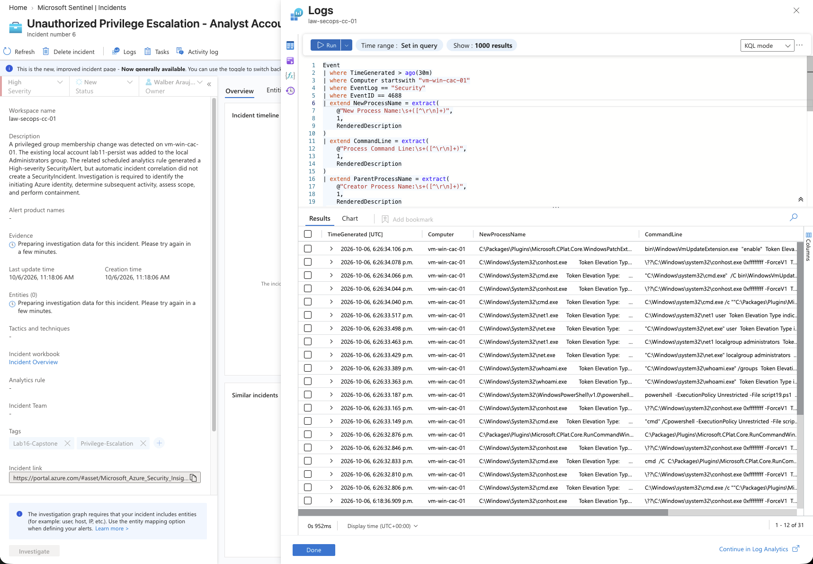

This reused the process-analysis skills from Lab 13. Rather than only searching for one executable name, I looked at process relationships and command-line context to understand the execution chain.

The existing `LAB11 - PowerShell Spawned by Command Shell` alert did not immediately appear for the newest test window.

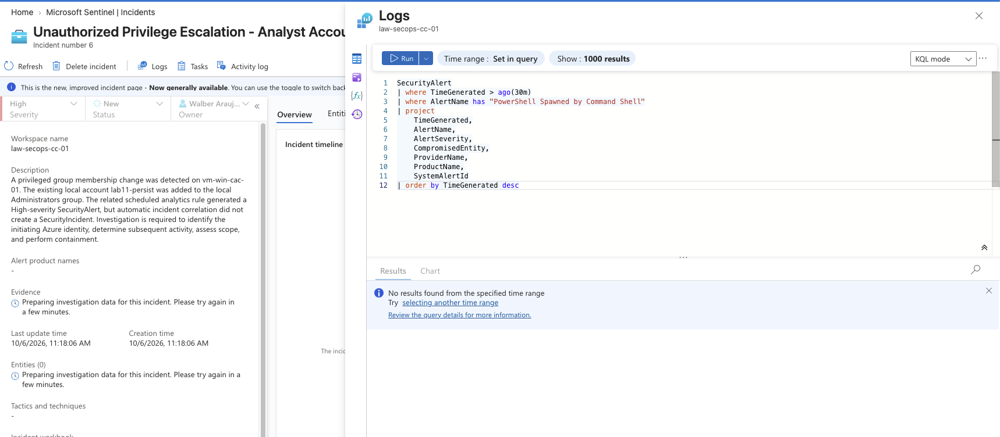

Instead of changing the rule first, I validated the raw telemetry. The KQL confirmed that `powershell.exe` had in fact been spawned by `cmd.exe`, which meant the underlying detection condition existed.

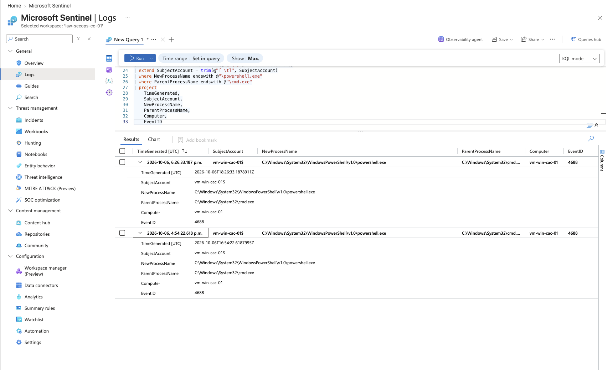

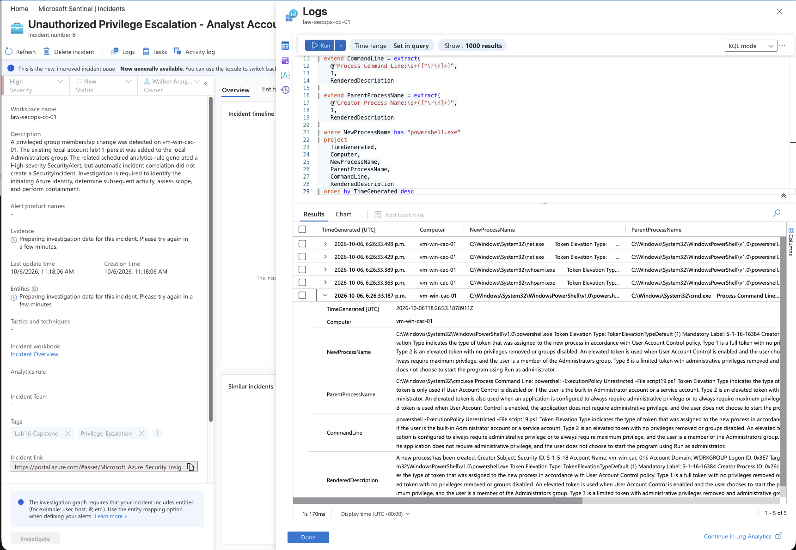

The scheduled rule subsequently produced the expected medium-severity alert.

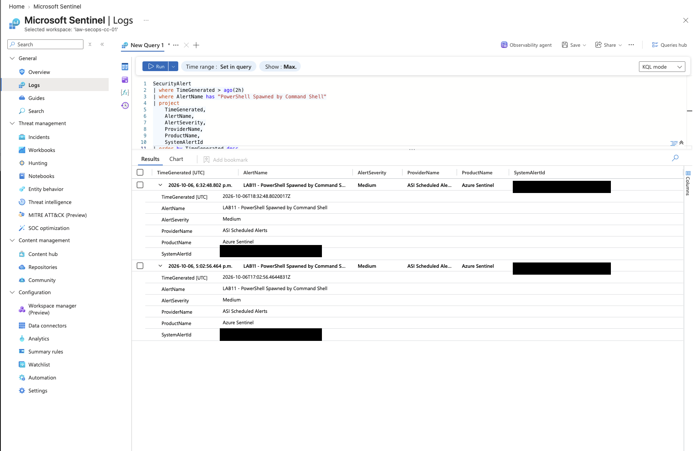

The sequence reinforced a useful troubleshooting pattern:

```text
Expected alert not visible yet
        ↓
validate raw Event 4688 telemetry
        ↓
confirm parent/child condition
        ↓
wait for scheduled-rule evaluation
        ↓
SecurityAlert appears
```

Relevant queries:

- [`08_post_escalation_process_discovery_4688.kql`](../../kql/lab16/08_post_escalation_process_discovery_4688.kql)
- [`09_powershell_spawned_by_cmd_4688.kql`](../../kql/lab16/09_powershell_spawned_by_cmd_4688.kql)
- [`10_powershell_alert_validation.kql`](../../kql/lab16/10_powershell_alert_validation.kql)

---

## 7. Introduce persistence with a harmless scheduled task

The next phase simulated persistence. The analyst created a scheduled task named `SystemHealthCheck` that ran as `SYSTEM` at startup. Its payload was intentionally harmless: it wrote a `Lab16-HealthCheck` marker to `C:\ProgramData\lab16-healthcheck.txt`.

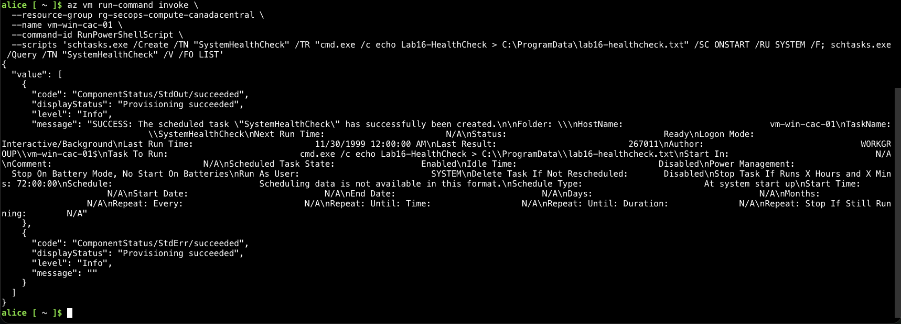

A scheduled task was chosen because it creates a realistic persistence pattern while remaining safe and fully reversible in a lab. It also gives two useful forms of Windows evidence:

1. **Process evidence** — `schtasks.exe` execution in Event ID `4688`.
2. **Object-creation evidence** — scheduled-task creation in Event ID `4698`.

The first evidence source worked as expected. Event ID `4688` captured `schtasks.exe` and the command-line arguments.

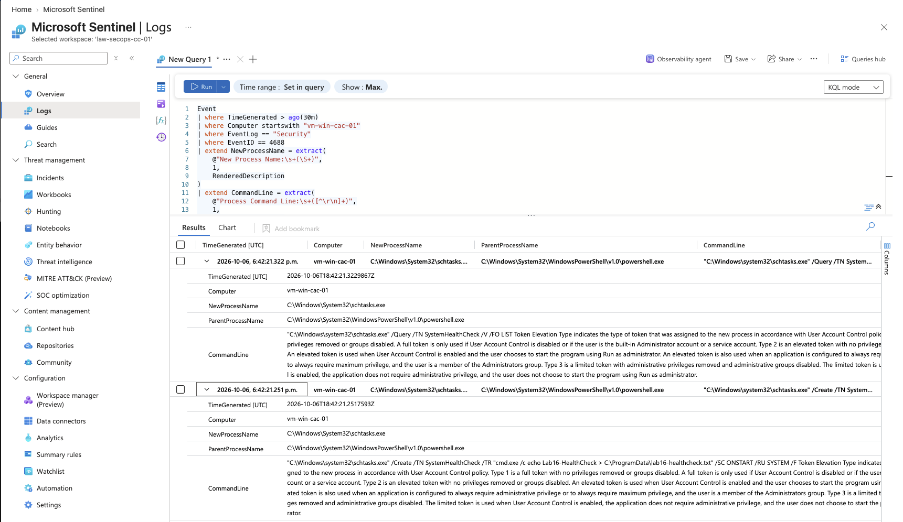

Reusable query: [`11_scheduled_task_process_creation_4688.kql`](../../kql/lab16/11_scheduled_task_process_creation_4688.kql)

The second source created the most useful troubleshooting problem in the entire lab.

---

## 8. Event 4698 existed on Windows, but Sentinel could not see it

When the initial Sentinel query for Event ID `4698` returned nothing, there were several possible explanations:

- Windows auditing might not be enabled;
- the task might not have generated the event;
- the agent might not be healthy;
- the Data Collection Rule might not request that event;
- the event might simply be delayed in ingestion.

I tested those possibilities from the source outward rather than immediately rewriting the KQL.

On the VM, `auditpol` showed that **Other Object Access Events** auditing was enabled for success and failure. `Get-WinEvent` then returned Event ID `4698` locally.

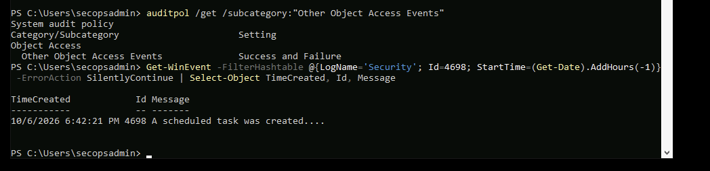

That single check changed the direction of the investigation. The endpoint was generating the expected telemetry, so the problem had to be somewhere **after Windows Event Log and before Sentinel query results**.

The next layer was the Data Collection Rule from Lab 08. Its custom XPath collected a curated set of Security event IDs, but `4698` was not included.

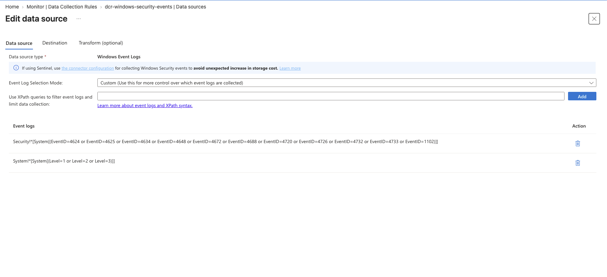

This explained the gap: **the detection could never work because the event was not being collected**.

The DCR was updated to add Event ID `4698`.

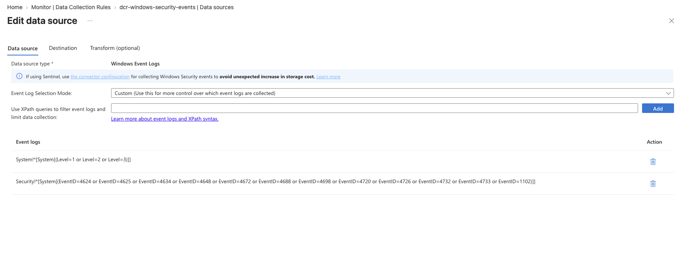

After the configuration change, I recreated the scheduled task so that a fresh `4698` would exist after the new collection rule was in effect.

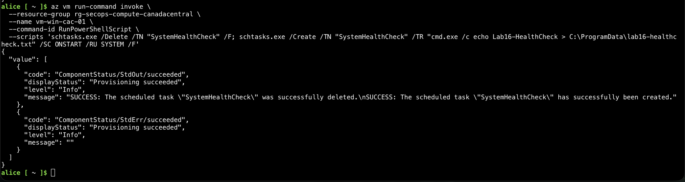

Sentinel then received the event. The validation query also used `ingestion_time()` so I could compare event time with workspace ingestion time rather than treating the pipeline as instantaneous.

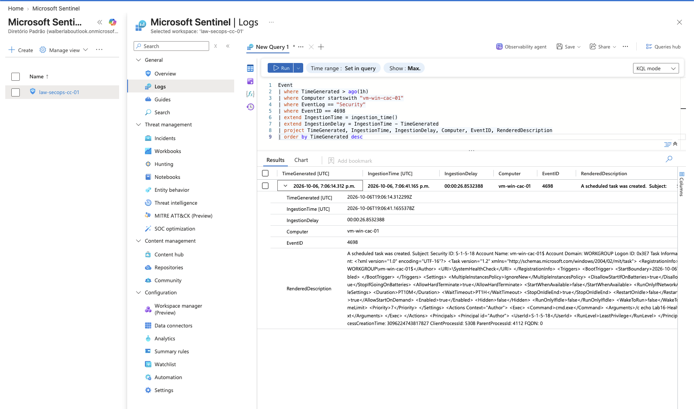

This is the telemetry-engineering lesson of the capstone:

```text
Windows Security Log
Event 4698 exists locally
        │
        ▼
Sentinel query returns no 4698
        │
        ▼
Check endpoint auditing          → healthy
        │
        ▼
Check AMA / DCR path             → DCR filter missing 4698
        │
        ▼
Add 4698 to XPath
        │
        ▼
Generate a fresh scheduled-task event
        │
        ▼
Validate ingestion + ingestion delay
        │
        ▼
Only now build the detection rule
```

This distinction matters: **KQL cannot detect data that the collection pipeline never sends to the workspace**.

Relevant queries:

- [`12_scheduled_task_creation_4698.kql`](../../kql/lab16/12_scheduled_task_creation_4698.kql)
- [`13_4698_ingestion_delay_validation.kql`](../../kql/lab16/13_4698_ingestion_delay_validation.kql)

---

## 9. Build the new detection only after telemetry is proven

Once Event ID `4698` was reliably visible in Sentinel, I converted the validated query into a new scheduled analytics rule:

**`LAB16 - Scheduled Task Persistence Created`**

Configuration:

- **Severity:** High
- **MITRE ATT&CK:** Persistence / `T1053.005` Scheduled Task/Job: Scheduled Task
- **Frequency:** 5 minutes
- **Lookback:** 15 minutes
- **Threshold:** more than 0 results
- **Incident creation:** Enabled

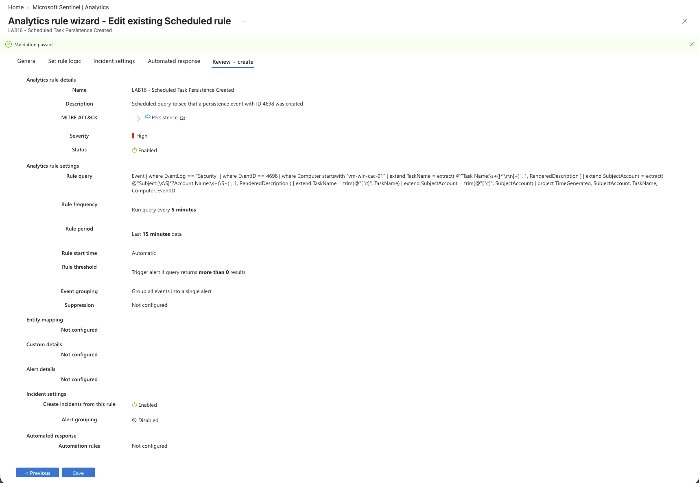

The rule was then enabled with the existing LAB11 detections.

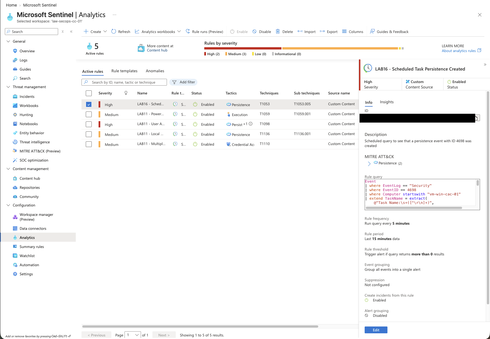

A later query showed the newly generated `4698` and older records that also became visible in the workspace during the troubleshooting period. The important validation point was that scheduled-task creation telemetry was now queryable through the Sentinel pipeline.

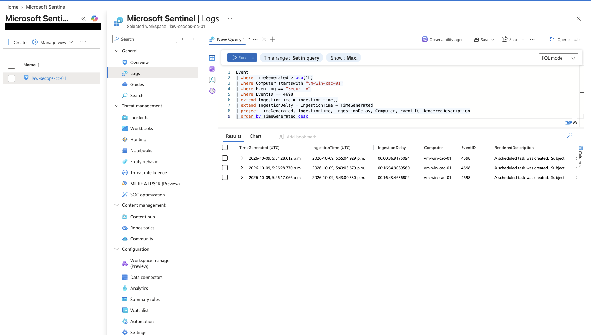

Why use a **15-minute lookback** for a rule that runs every **5 minutes**? The earlier ingestion-delay checks showed that event availability is not always immediate. The wider lookback gives the rule tolerance for delayed telemetry, while rule grouping and later tuning can be used to control duplicates if necessary.

The exact rule query is preserved separately in [`12_scheduled_task_creation_4698.kql`](../../kql/lab16/12_scheduled_task_creation_4698.kql).

---

## 10. Validate the entire detection chain: event → alert → incident

The new rule produced a high-severity `SecurityAlert`.

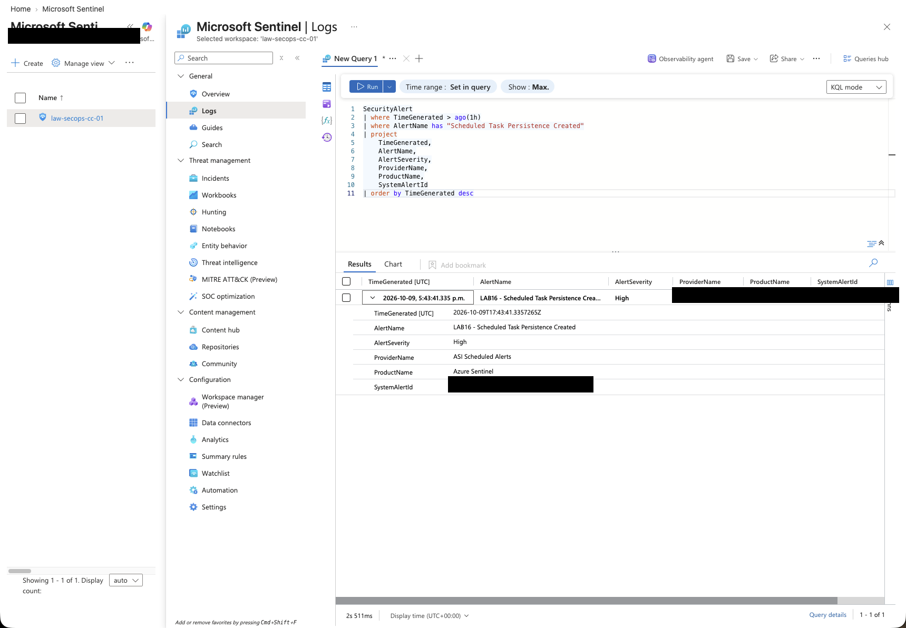

This time I did not stop at the alert. I queried `SecurityIncident` separately and confirmed a corresponding high-severity incident with the alert ID associated to it.

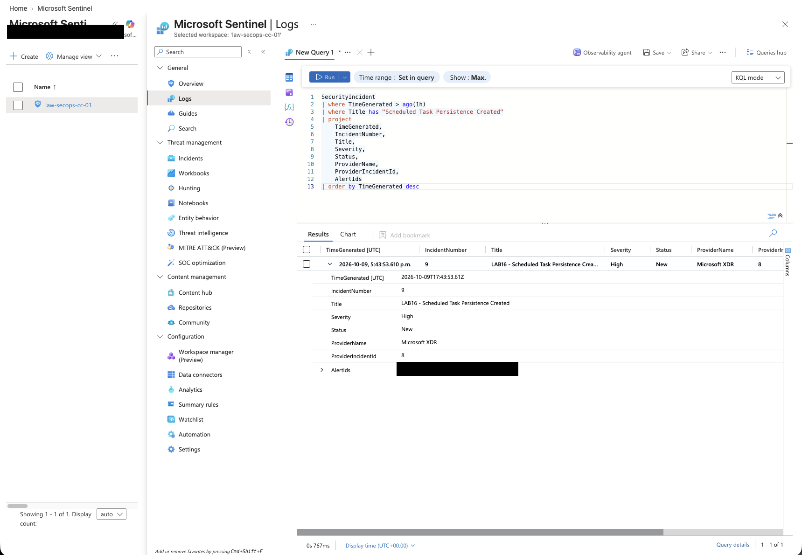

The incident also appeared in the Sentinel incident queue with one alert and supporting events.

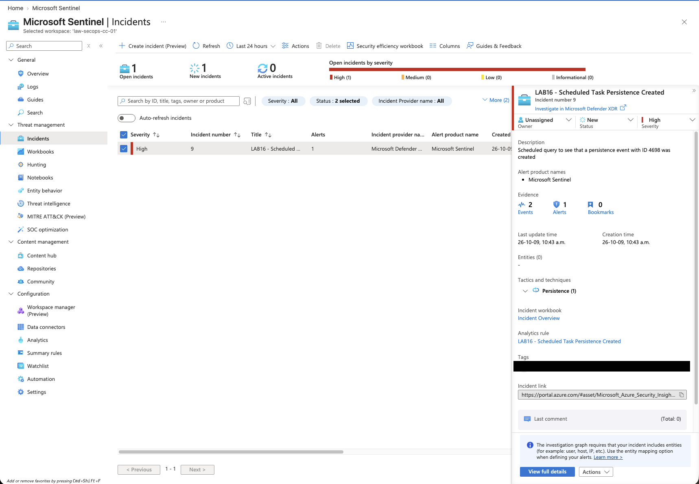

I then assigned the incident for triage.

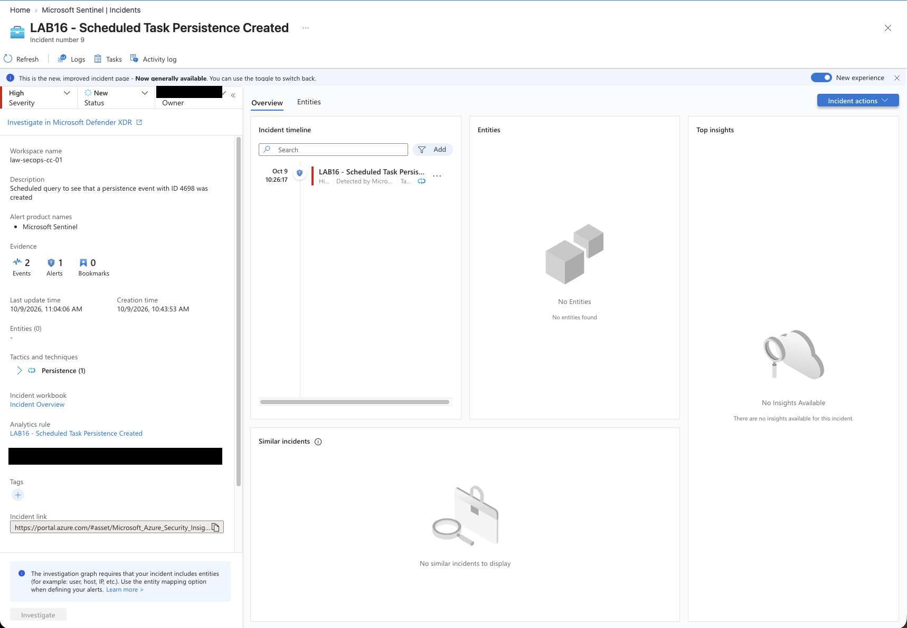

This stage deliberately validates each layer independently:

```text
Windows Event 4698
        ↓
Log Analytics Event table
        ↓
LAB16 scheduled analytics rule
        ↓
SecurityAlert
        ↓
SecurityIncident
        ↓
Analyst ownership / triage
```

This is stronger evidence than simply showing an incident in the portal because it demonstrates the chain that created it.

Relevant queries:

- [`14_scheduled_task_alert_validation.kql`](../../kql/lab16/14_scheduled_task_alert_validation.kql)
- [`15_scheduled_task_incident_validation.kql`](../../kql/lab16/15_scheduled_task_incident_validation.kql)

---

## 11. Contain both persistence and privilege

Containment had two endpoint goals: remove the persistence mechanism and remove the elevated local-group membership.

First, `SystemHealthCheck` was deleted and queried again. The follow-up command returned that the task could not be found, which verified removal rather than only assuming the delete command succeeded.

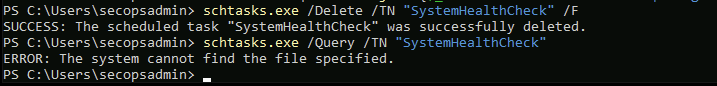

Next, `lab11-persist` was removed from the local `Administrators` group. The group was enumerated again to confirm that the controlled account no longer held local administrative membership.

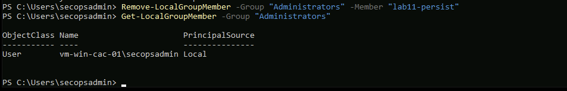

These actions remove the immediate artifacts, but they do **not** address why the analyst could create them in the first place. Closing the incident here would leave the root authorization path intact.

That is why the response continued into Azure RBAC.

---

## 12. Remediate the enabling condition: excessive Azure RBAC

The IAM review confirmed that `SG-SecOps-Analysts` still had `Virtual Machine Contributor` over the compute resource group.

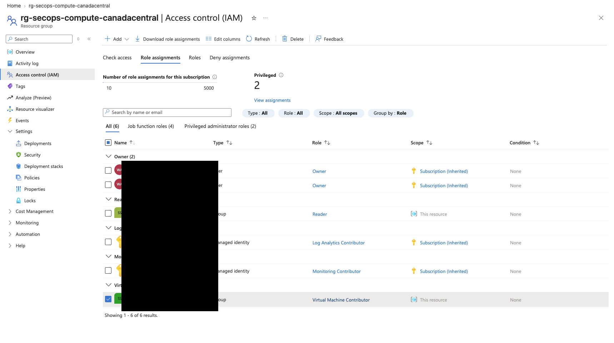

For this lab's intended analyst function, that role was broader than necessary because it allowed the Run Command path used to change the endpoint. The response goal was not to remove all visibility; it was to preserve read access while removing VM-management capability.

That made `Reader` the appropriate replacement for this controlled scenario.

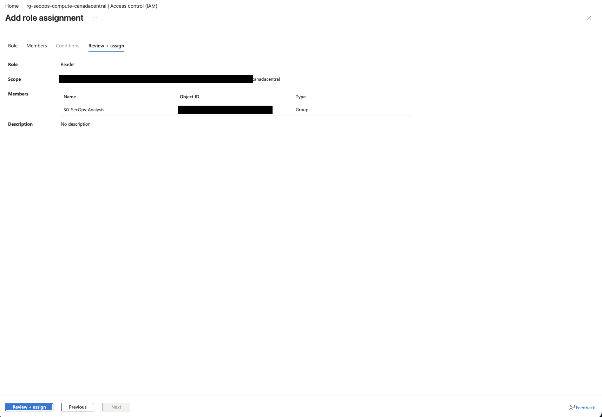

`SG-SecOps-Analysts` was assigned `Reader`, and the previous `Virtual Machine Contributor` assignment was removed.

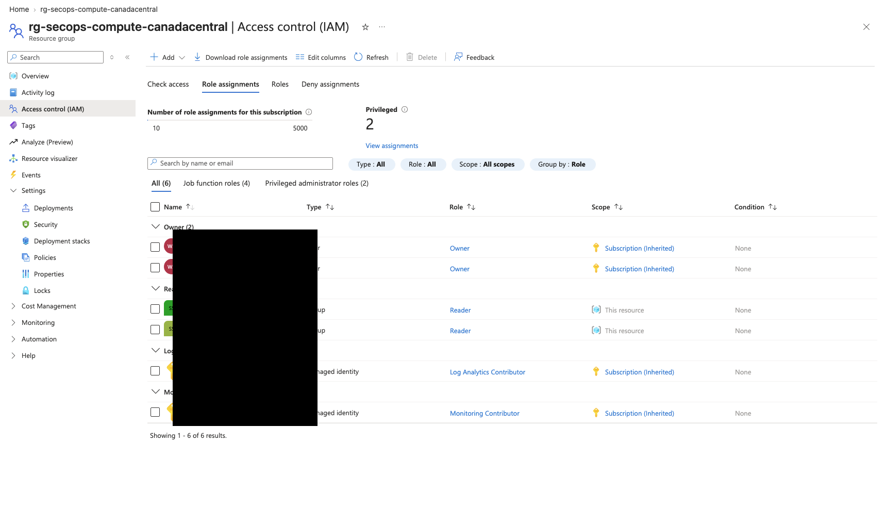

A remediation is not complete until its effect is tested. I returned to the same analyst session and attempted the same Azure Run Command capability again.

Azure returned `AuthorizationFailed` for `Microsoft.Compute/virtualMachines/runCommand/action`.

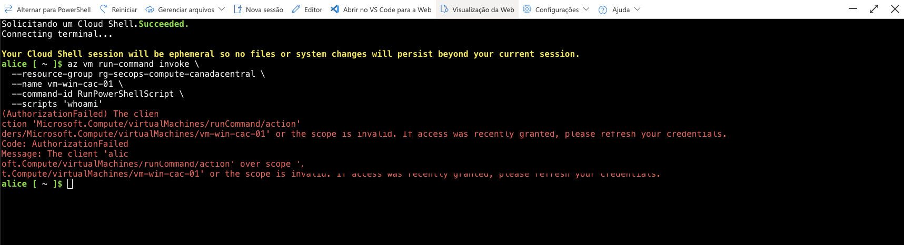

That negative test is important evidence. It proves that the RBAC change altered the attack path:

```text
BEFORE
SG-SecOps-Analysts → Virtual Machine Contributor → Run Command succeeds

AFTER
SG-SecOps-Analysts → Reader → Run Command = AuthorizationFailed
```

This is the point where containment becomes **control remediation** rather than only artifact cleanup.

---

## 13. Document the investigation and close it accurately

The incident activity log was used to record both the investigation and the response. The notes documented:

- the privilege-escalation path;
- Azure/Windows correlation;
- scheduled-task persistence;
- the missing `4698` telemetry;
- DCR remediation;
- the new analytics rule;
- endpoint containment;
- RBAC reduction;
- the failed post-remediation Run Command test.

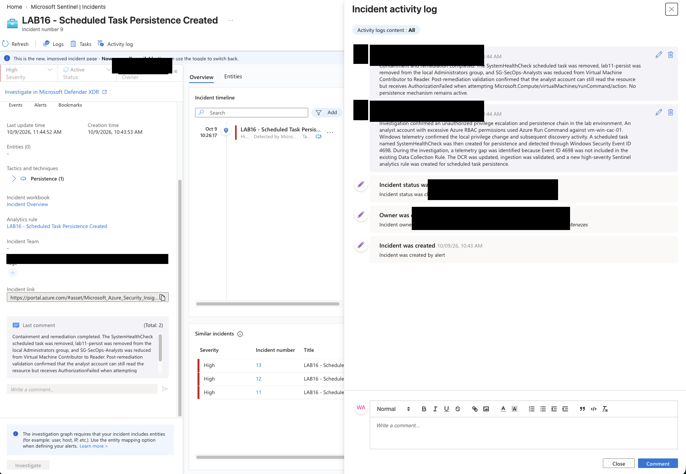

The incident was closed as **BenignPositive — Suspicious but expected**.

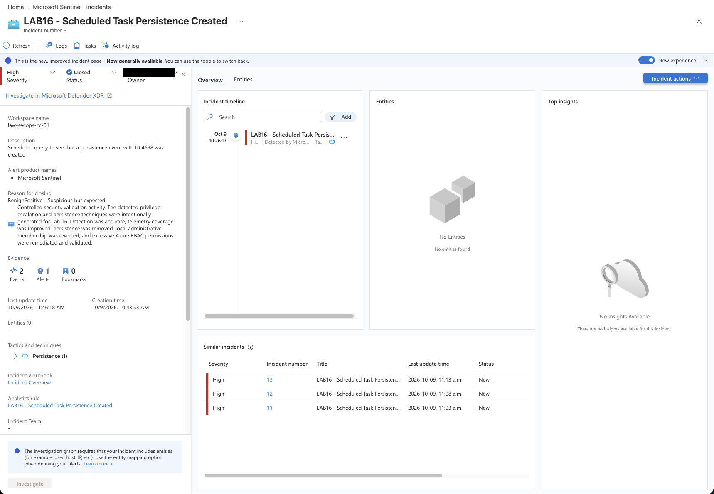

That classification was deliberate. Calling the detection a **false positive** would be incorrect because the detection logic worked: the privilege and persistence actions really occurred. The reason the incident was benign was contextual — the activity was intentionally generated inside an authorized security lab.

This distinction mirrors real SOC work: **detection accuracy and malicious intent are separate questions**.

---

# Key Decision Points

| Decision | Why I Chose It | What It Demonstrates |
| --- | --- | --- |
| Reuse `lab11-persist` instead of creating another account | Keeps the scenario focused on privilege change and persistence instead of adding unrelated account-creation noise | Controlled test design |
| Remove the old admin membership before starting | Ensures the capstone generates a fresh, attributable `4732` event | Clean baseline / evidence integrity |
| Use Azure Run Command | Reuses a legitimate admin feature from Lab 07 and proves how excessive cloud RBAC can affect an endpoint | Cloud-to-endpoint attack path |
| Create a manual incident when the first alert was not automatically associated | Preserves investigation continuity without pretending automatic incident creation worked | Analyst workflow integrity |
| Query `AzureActivity` after Windows showed `LOCAL SYSTEM` | Endpoint context alone did not identify the cloud initiator | Cross-source attribution |
| Validate raw `4688` before changing the PowerShell rule | Separates missing alerts from missing telemetry | Detection troubleshooting |
| Validate `4698` locally before changing KQL | Proves the event existed and shifts troubleshooting to collection | Source-first diagnostics |
| Fix the DCR before creating the persistence rule | A rule is useless if its required event never arrives | Telemetry engineering |
| Replace VM Contributor with Reader | Preserves visibility while removing the execution capability used in the scenario | Least privilege |
| Re-run Run Command after remediation | Tests the control, not just the configuration | Evidence-based validation |
| Close as Benign Positive | The activity was authorized, but the detections were technically correct | Accurate SOC classification |

---

# KQL Query Library

The investigation queries are stored as separate, reusable files under [`kql/lab16/`](../../kql/lab16/). This keeps the README focused on analyst reasoning while preserving the exact investigation logic as portfolio artifacts.

| File | Purpose |
| --- | --- |
| `01_local_admin_membership_change_4732.kql` | Parse Event `4732` and identify membership changes to local `Administrators`. |
| `02_4732_ingestion_delay_validation.kql` | Compare `TimeGenerated` with `ingestion_time()` for the privilege-change event. |
| `03_privilege_escalation_alert_validation.kql` | Confirm the LAB11 high-severity alert in `SecurityAlert`. |
| `04_alert_incident_association_check.kql` | Test whether the privilege-escalation alert was linked to a `SecurityIncident`. |
| `05_historical_security_incident_review.kql` | Review previous Sentinel/XDR incident-provider behavior. |
| `06_azure_run_command_activity.kql` | Identify Azure Run Command activity and the initiating cloud identity. |
| `07_cross_source_privilege_escalation_timeline.kql` | Normalize AzureActivity and Windows `4732` evidence into one timeline. |
| `08_post_escalation_process_discovery_4688.kql` | Review process creation after the privilege change. |
| `09_powershell_spawned_by_cmd_4688.kql` | Validate the `cmd.exe` → `powershell.exe` parent-child condition. |
| `10_powershell_alert_validation.kql` | Confirm the existing PowerShell scheduled-rule alert. |
| `11_scheduled_task_process_creation_4688.kql` | Identify `schtasks.exe` process creation and the persistence command line. |
| `12_scheduled_task_creation_4698.kql` | Parse Event `4698` and provide the LAB16 scheduled-task detection logic. |
| `13_4698_ingestion_delay_validation.kql` | Validate scheduled-task ingestion and measure delay. |
| `14_scheduled_task_alert_validation.kql` | Confirm the new high-severity LAB16 `SecurityAlert`. |
| `15_scheduled_task_incident_validation.kql` | Confirm automatic `SecurityIncident` creation for the new rule. |

> The queries intentionally keep lab resource names such as `vm-win-cac-01` so the repository evidence matches the documented environment. Replace those values when reusing the queries elsewhere.

---

# Detection and MITRE ATT&CK Coverage

| Phase | Detection / Evidence | ATT&CK Mapping Used in Lab |
| --- | --- | --- |
| Privilege escalation / persistence | Local account added to `Administrators`, Event `4732`, LAB11 rule | `T1098` Account Manipulation |
| Execution | `cmd.exe` spawning `powershell.exe`, Event `4688` | `T1059.001` PowerShell |
| Persistence | `SystemHealthCheck` scheduled task, Event `4698`, LAB16 rule | `T1053.005` Scheduled Task/Job: Scheduled Task |

The discovery commands were investigated with Event `4688`, but this capstone did not create a separate ATT&CK-mapped detection rule specifically for discovery activity.

---

# Troubleshooting Lessons

## 1. A missing alert is not automatically a bad query

The PowerShell alert did not immediately appear, but the raw `4688` process telemetry satisfied the rule condition. That pointed toward rule timing/evaluation rather than a missing event.

## 2. A missing Sentinel event is not automatically a Windows auditing problem

For `4698`, the VM had the event locally. That evidence ruled out one layer and moved the investigation downstream to AMA/DCR collection.

## 3. Collection configuration is part of detection engineering

The DCR did exactly what it had been configured to do: it collected only selected event IDs. The missing `4698` was therefore a **coverage gap**, not a mysterious SIEM failure. Fixing the DCR was a prerequisite to building the detection.

## 4. Ingestion delay changes how scheduled rules should be designed

The lab compared `TimeGenerated` with `ingestion_time()` for both privilege and persistence events. The observed delay reinforced why a rule may execute every five minutes while looking back farther than five minutes.

## 5. Control-plane and endpoint telemetry answer different questions

Windows showed the local execution context. AzureActivity showed the cloud identity and management operation. The investigation needed both to explain the full sequence.

## 6. Artifact removal is not the same as root-cause remediation

Deleting the scheduled task and removing the local admin membership contained the immediate endpoint state. Reducing Azure RBAC removed the permission path that had enabled the activity.

---

# Control Gaps, Remediation, and Proof

| Gap / Condition | Remediation | Validation Evidence |
| --- | --- | --- |
| Analyst group could invoke VM Run Command | Replace `Virtual Machine Contributor` with `Reader` | Post-remediation Run Command returned `AuthorizationFailed` |
| `lab11-persist` had been re-added to local Administrators | Remove it from the group | Follow-up group enumeration showed only the intended admin account |
| `SystemHealthCheck` persistence existed | Delete scheduled task | Follow-up task query returned that the task could not be found |
| DCR did not collect Event `4698` | Add `4698` to the Security XPath | Event `4698` became visible in Sentinel |
| No dedicated scheduled-task persistence rule | Create `LAB16 - Scheduled Task Persistence Created` | High-severity `SecurityAlert` generated |
| Need automatic incident validation | Enable incident creation on LAB16 rule | Corresponding `SecurityIncident` appeared in Sentinel |

---

# Final Outcome

The capstone completed the full security-operations lifecycle:

**Preparation → Clean Baseline → Privilege Escalation → Detection → Alert Validation → Incident Workflow → Cross-source Attribution → Discovery → Persistence → Telemetry Troubleshooting → Collection Repair → Detection Engineering → Automatic Incident Creation → Containment → Least-Privilege Remediation → Control Validation → Documentation → Closure**

At the end of the lab:

- the controlled persistence task had been removed;
- `lab11-persist` no longer held local administrative membership;
- Event ID `4698` had been added to the Windows Security DCR;
- scheduled-task telemetry was queryable in Sentinel;
- a reusable high-severity scheduled-task persistence analytics rule was enabled;
- automatic `SecurityAlert` and `SecurityIncident` creation were validated;
- `SG-SecOps-Analysts` had been reduced from `Virtual Machine Contributor` to `Reader`;
- the analyst identity could no longer execute Azure Run Command against the VM;
- the incident contained investigation and remediation notes;
- the case was closed as **Benign Positive — Suspicious but expected** because the detections were correct and the activity was intentionally generated for the lab.

The main lesson from the capstone is that a SOC workflow is not just a KQL query or a Sentinel incident. It is the ability to move between **identity, authorization, cloud operations, endpoint evidence, collection configuration, detections, incident handling, and preventive controls** while explaining why each step is necessary and proving that the final remediation actually changed the environment.

---

# Evidence Index

| # | Screenshot | What the Evidence Proves |
|---:|---|---|
| 01 | `01_privileged_group_detection_rule_ready.png` | Existing high-severity `4732` detection was enabled before the scenario. |
| 02 | `02_analyst_group_vm_contributor_access.png` | Analyst group held VM-management permission over the compute scope. |
| 03 | `03_alice_effective_vm_access.png` | Alice inherited the access through group membership. |
| 04 | `04_local_privileged_membership_preparation.png` | Residual Lab 11 privileged membership existed before capstone reset. |
| 05 | `05_local_users_baseline.png` | Controlled local account existed before the new activity. |
| 06 | `06_pre_lab_privilege_cleanup_and_clean_baseline.png` | Old admin membership was removed and the clean baseline verified. |
| 07 | `07_alice_run_command_privilege_change.png` | Analyst successfully used Azure Run Command to perform the fresh privilege change. |
| 08 | `08_event_4732_privileged_group_change.png` | Windows generated the local Administrators membership-change event. |
| 09 | `09_event_ingestion_delay_validation.png` | Event timing and SIEM ingestion delay were measured. |
| 10 | `10_detection_query_validation.png` | KQL correctly parsed and matched the expected `4732` event. |
| 11 | `11_security_alert_generated.png` | Existing LAB11 analytics rule generated a high-severity alert. |
| 12 | `12_alert_not_associated_with_incident.png` | The new alert had no matching automatic incident during that validation window. |
| 13 | `13_historical_xdr_incident_provider_validation.png` | Earlier incidents existed and showed Microsoft XDR provider behavior. |
| 14 | `14_manual_incident_created_and_assigned.png` | Manual investigation container was created and assigned transparently. |
| 15 | `15_manual_incident_details_baseline.png` | Manual incident baseline before deeper investigation. |
| 16 | `16_azure_control_plane_actor_identification.png` | AzureActivity identified the initiating cloud identity and Run Command action. |
| 17 | `17_cross_source_privilege_escalation_timeline.png` | Azure and Windows evidence were correlated into one timeline. |
| 18 | `18_post_escalation_discovery_via_run_command.png` | Controlled discovery commands were executed after the privilege change. |
| 19 | `19_post_escalation_process_discovery_4688.png` | Windows `4688` recorded the resulting discovery process chain. |
| 20 | `20_existing_powershell_detection_gap.png` | Expected PowerShell alert was not immediately visible. |
| 21 | `21_powershell_detection_query_match.png` | Raw event telemetry matched the PowerShell detection condition. |
| 22 | `22_powershell_parent_process_validation.png` | Parent/child process relationship was validated. |
| 23 | `23_powershell_security_alert_generated.png` | Scheduled PowerShell rule later generated the alert. |
| 24 | `24_scheduled_task_persistence_created.png` | `SystemHealthCheck` persistence mechanism was created successfully. |
| 25 | `25_scheduled_task_process_creation_4688.png` | `schtasks.exe` creation command was visible in process telemetry. |
| 26 | `26_local_4698_audit_event_validation.png` | Windows locally generated Event `4698`; source auditing was working. |
| 27 | `27_dcr_missing_scheduled_task_event_4698.png` | DCR XPath did not collect `4698`, explaining the Sentinel gap. |
| 28 | `28_dcr_updated_for_scheduled_task_auditing.png` | DCR was corrected to include scheduled-task creation telemetry. |
| 29 | `29_scheduled_task_recreated_after_dcr_update.png` | Fresh test event was generated after the collection change. |
| 30 | `30_scheduled_task_4698_ingestion_validated.png` | Sentinel successfully ingested `4698` after DCR remediation. |
| 31 | `31_scheduled_task_persistence_detection_rule_logic.png` | New LAB16 scheduled analytics rule logic and settings. |
| 32 | `32_scheduled_task_persistence_rule_enabled.png` | New persistence detection was enabled with the existing rules. |
| 33 | `33_4698_ingestion_recovered_and_validated.png` | Scheduled-task telemetry remained queryable after recovery. |
| 34 | `34_scheduled_task_persistence_alert_generated.png` | New rule generated a high-severity `SecurityAlert`. |
| 35 | `35_scheduled_task_security_incident_generated.png` | Corresponding `SecurityIncident` was created automatically. |
| 36 | `36_automatic_persistence_incident_created.png` | Incident appeared in Sentinel with supporting evidence. |
| 37 | `37_persistence_incident_assigned_for_triage.png` | Incident ownership was established for analyst workflow. |
| 38 | `38_scheduled_task_containment_removed.png` | Scheduled-task persistence was removed and absence verified. |
| 39 | `39_privileged_membership_containment_removed.png` | Elevated local-group membership was removed and verified. |
| 40 | `40_excessive_azure_rbac_before_remediation.png` | Root authorization condition remained before RBAC remediation. |
| 41 | `41_reader_role_assignment_review.png` | Replacement least-privilege role was reviewed before assignment. |
| 42 | `42_least_privilege_rbac_applied.png` | Analyst group retained Reader but no longer held VM Contributor. |
| 43 | `43_run_command_blocked_after_rbac_remediation.png` | Same Run Command path failed with `AuthorizationFailed` after remediation. |
| 44 | `44_incident_investigation_and_response_documented.png` | Investigation and response were recorded in the incident activity log. |
| 45 | `45_incident_closed_after_containment.png` | Case was closed with the controlled-lab Benign Positive classification. |

---

## Privacy and Scope

All actions in this lab were performed against resources in my own authorized Azure environment. No third-party or production systems were targeted.

The screenshots were prepared for public portfolio use. Personal identities, email addresses, subscription and tenant identifiers, object IDs, alert IDs, and other unnecessary unique identifiers were redacted with opaque black bars while preserving the technical evidence needed to understand the workflow.
