# Lab 17 — Windows Server Administration, Infrastructure Operations & Troubleshooting

## Overview

Lab 17 is intentionally larger than the earlier labs in this project. Instead of focusing on one Azure control, one Sentinel rule, or one identity feature, this lab moved down into the Windows Server operating-system and infrastructure layer and treated the server as an operational system that must be understood, administered, troubleshot, validated, and eventually automated.

The lab used the existing `vm-win-cac-01` Windows Server 2022 Datacenter Azure Edition virtual machine and the Linux management VM to build a practical administration workflow across:

- server identity and local administration
- installed Windows roles and features
- service management and service dependencies
- Windows Event Log investigation
- time synchronization and DNS validation
- Task Scheduler administration and auditing
- Windows Defender Firewall
- Azure Network Security Groups
- TCP listeners and remote connectivity testing
- WinRM and PowerShell Remoting
- patch and update health
- disk, partition, volume, and capacity analysis
- reusable PowerShell health-check automation
- a final controlled WinRM troubleshooting challenge

This is therefore better understood as a **Windows Server Administration Fundamentals capstone** than as a single-feature lab.

---

## Why This Lab Became Larger Than the Previous Labs

The earlier labs in the Azure Security Operations project frequently started with telemetry already available in Azure Monitor or Microsoft Sentinel. Lab 17 deliberately asked a different question:

> What is actually happening inside the Windows Server that produces the telemetry, network state, service behavior, and security events that a SOC later investigates?

That shift significantly broadened the scope.

Rather than treating the operating system as a black box, the lab examined the relationships between:

```text
Administrator action
        ↓
Windows service / process / task
        ↓
Operating-system state
        ↓
Windows Event Log
        ↓
Network accessibility
        ↓
Azure controls
        ↓
Telemetry and detection
```

The lab also showed that infrastructure troubleshooting is rarely isolated to one layer. A failed connection can involve an application listener, Windows Firewall, an Azure NSG, routing, authentication, or the service itself. A service failure can involve its startup state, dependencies, process creation, and event-log evidence. A scheduled task can be both legitimate administration and a persistence technique, depending on context.

For that reason, this lab was organized into major operational domains while preserving the real investigation sequence.

---

## Learning Objectives

By the end of this lab, the objective was to be able to:

- establish a Windows Server operational baseline
- distinguish server, service, process, network, and cloud-control layers
- investigate service failures instead of immediately restarting them
- correlate PowerShell findings with Windows Event Viewer evidence
- interpret common System and Security events in context
- create, execute, modify, and audit scheduled tasks
- understand the interaction between Azure NSGs and Windows Defender Firewall
- validate TCP reachability from a separate management host
- validate WinRM, WSMan, and PowerShell Remoting
- review Windows Update and storage health
- consolidate repeated administrative checks into PowerShell automation
- follow a repeatable troubleshooting methodology: observe, test, isolate, remediate, validate

---

## Environment

| Component | Purpose |
|---|---|
| `vm-win-cac-01` | Windows Server 2022 administration target |
| `vm-linux-mgmt-01` | Separate management host used for remote TCP validation |
| `10.20.1.0/24` | Server subnet |
| `10.20.2.0/24` | Management subnet |
| Azure Bastion | Administrative access without depending on direct public RDP/SSH exposure |
| Windows PowerShell | Primary Windows administration interface |
| Azure Cloud Shell | Azure NSG inspection and Run Command execution |

The most important network relationship used later in the lab was:

```text
vm-linux-mgmt-01
10.20.2.0/24
        ↓
Azure NSG
        ↓
Windows Defender Firewall
        ↓
vm-win-cac-01
10.20.1.4
        ↓
TCP listener / Windows service
```

---

# Phase 1 — System Baseline and Local Administration

## 1.1 Establishing Server Identity

The first step was to understand what was being administered before changing anything.

`hostname` and `Get-ComputerInfo` established:

- hostname
- Windows edition and build
- workgroup/domain state
- domain role
- processor information
- physical memory

This immediately confirmed that the machine was a **standalone Windows Server**, not yet an Active Directory domain member or domain controller. That distinction becomes important later because WinRM authentication and remote-management behavior differ significantly between workgroup and domain environments.

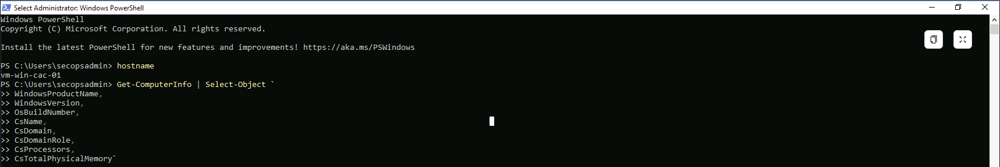

## 1.2 Network, Local Users, and Installed Features

The next baseline expanded from identity into the machine's operational context.

`Get-NetIPConfiguration` and `Get-NetAdapter` verified the active Windows networking configuration, while `Get-LocalUser` and `Get-LocalGroupMember` showed the local-account model. Installed Windows features were also enumerated.

One important finding was the presence of the temporary `lab11-persist` account left behind from an earlier Sentinel lab. This was a useful example of why administrators should not assume that a reused lab server begins in a clean state.

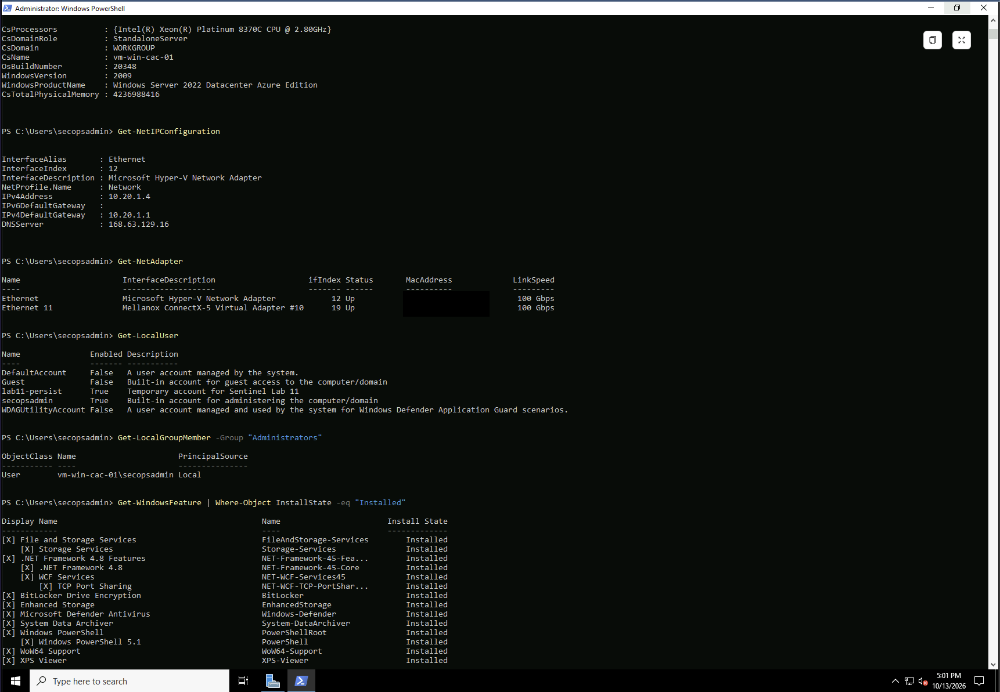

## 1.3 Legacy Account Review and Cleanup

Rather than deleting the account immediately, the account was searched across local groups first. This preserved the investigation mindset:

```text
Find account
    ↓
Check privilege/group membership
    ↓
Determine current role
    ↓
Disable unused account
    ↓
Validate state
```

The account was then disabled and verified as `Enabled = False`.

This reinforced a least-privilege operational principle: stale test identities should not remain active simply because the original exercise ended.

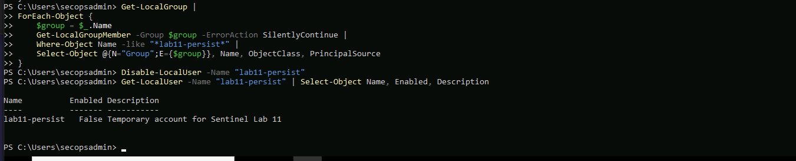

## 1.4 Server Manager Baseline

Server Manager provided the graphical counterpart to the PowerShell baseline.

The Local Server view was used to review:

- computer name
- workgroup status
- Windows Defender Firewall
- remote management
- Remote Desktop
- network state
- update status
- Defender Antivirus
- time zone
- event warnings
- service state

This was useful because Windows Server administration in practice often alternates between GUI tools and PowerShell rather than relying exclusively on one interface.

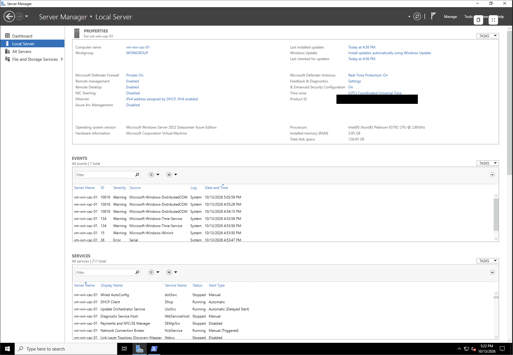

---

# Phase 2 — Services and Windows Event Troubleshooting

## 2.1 Service Baseline and Service Accounts

The next domain was Windows services.

A service-state count first established the broad picture. Running services were then inspected with both `Get-Service` and `Get-CimInstance Win32_Service`.

The CIM view was important because it exposed attributes that `Get-Service` alone does not emphasize, especially:

- startup mode
- service account / `StartName`
- current state

This moved the analysis from simply asking "is the service running?" toward understanding **how and under which identity it runs**.

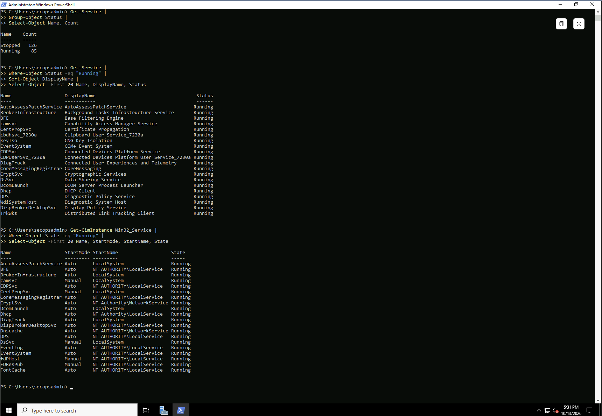

## 2.2 Why the Print Spooler Was Chosen

The Print Spooler was selected as a safe troubleshooting target because it provided a real Windows service with:

- a dedicated process (`spoolsv.exe`)
- dependencies
- a clear running/stopped state
- Service Control Manager event generation
- straightforward recovery

Before introducing any failure, its healthy baseline was recorded.

The service ran automatically as `LocalSystem`, used `C:\Windows\System32\spoolsv.exe`, and depended on RPC-related services.

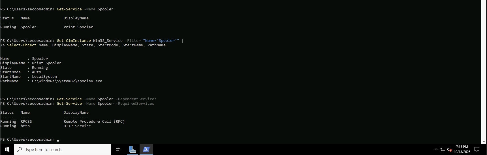

## 2.3 Controlled Spooler Failure

The Spooler service was deliberately stopped.

Instead of immediately restarting it, the investigation asked several questions:

```text
Is the service stopped?
        ↓
Did its dependencies fail?
        ↓
Does the service process still exist?
        ↓
Did Windows record the transition?
```

The service showed `Stopped`, while its required RPC/HTTP dependencies remained running. This ruled out a broader dependency failure.

The missing `spoolsv` process was not itself an error to "fix"; it was evidence consistent with the service being stopped.

The System log was then queried for Service Control Manager activity.

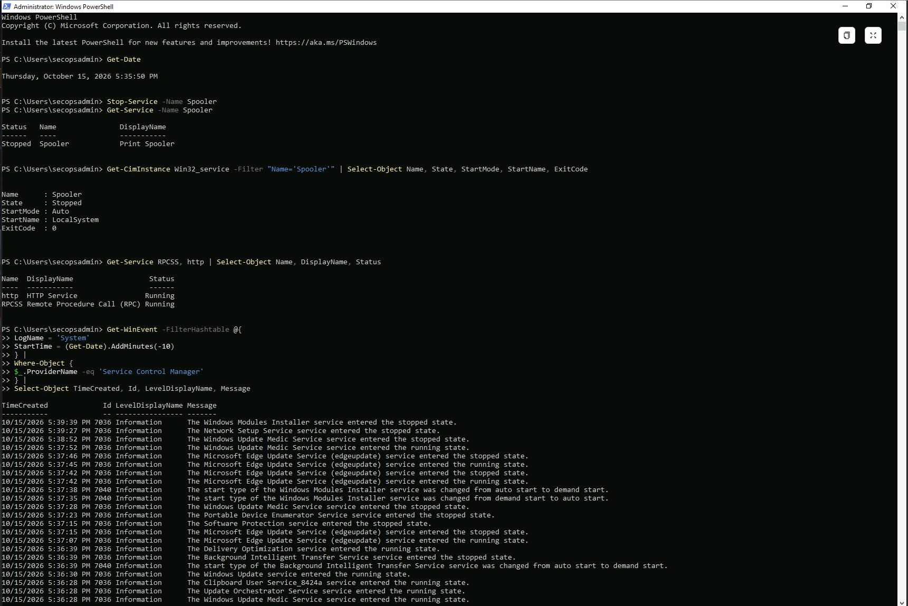

## 2.4 Recovery and Event Correlation

After the root cause had been isolated to the intentionally stopped service, the Spooler was restarted.

Validation confirmed:

- `Spooler = Running`
- `spoolsv.exe` returned
- Event ID `7036` recorded both stopped and running transitions

This was an important operational lesson: **service state, process state, dependencies, and event logs should agree with each other**.

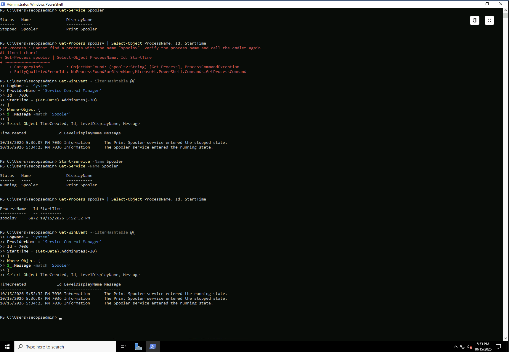

Event Viewer was also used to confirm Event ID `7036` visually.

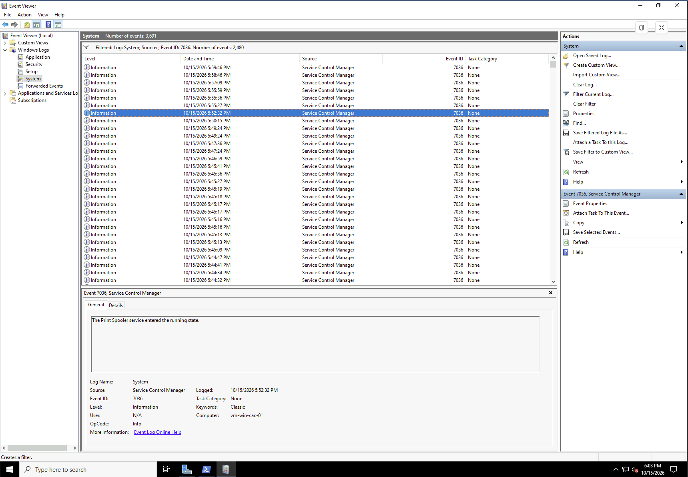

### Service troubleshooting mental model

```text
Reported symptom
        ↓
Service state
        ↓
Startup configuration
        ↓
Dependencies
        ↓
Process
        ↓
Windows Event Log
        ↓
Remediation
        ↓
Validation
```

---

# Phase 3 — Windows Logs and Operational Triage

## 3.1 Triage Across System, Application, and Security Logs

The lab then moved from a known service event into broader log triage.

System warnings and errors were reviewed first. The output included:

- DistributedCOM warnings
- Windows Time-Service Event 134
- Windows initialization warnings
- a serial-device error

The Application log did not contain matching recent warning/error events for the same time window. The Security log, however, contained normal audit events such as process creation and logon-related activity.

This reinforced that each Windows log has a different operational purpose and should not be treated interchangeably.

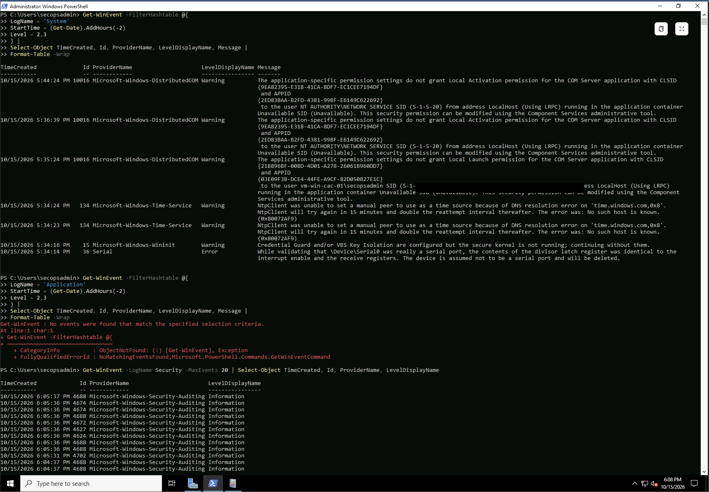

## 3.2 Investigating Windows Time Event 134

Event ID `134` showed that the Windows Time service had experienced DNS resolution trouble for `time.windows.com`.

Instead of assuming that the warning represented an active fault, the investigation validated the current state:

- `W32Time` was running
- `w32tm /query /status` showed synchronization
- the current source was the Azure VM time synchronization provider
- configured peers were inspected
- `Resolve-DnsName time.windows.com` succeeded
- the machine's DNS configuration was reviewed

This demonstrated an important troubleshooting distinction:

> A historical warning is evidence of something that happened, not proof that the problem is still occurring.

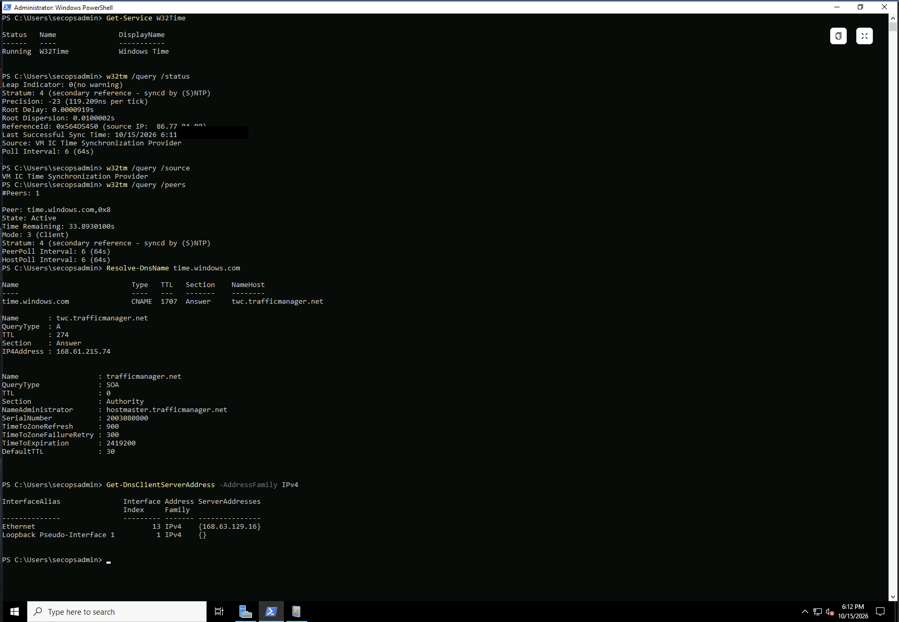

A targeted search for new Event ID `134` instances in the most recent period found none.

The absence of new matching events, combined with successful current DNS resolution and valid time synchronization, supported the conclusion that no corrective action was required.

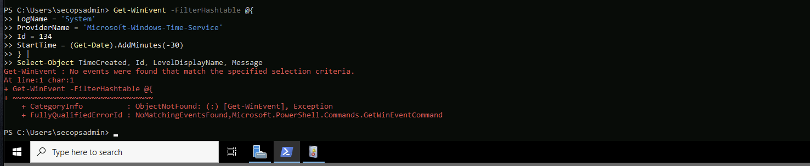

---

# Phase 4 — Task Scheduler and Security Auditing

## 4.1 Scheduled Task Administration

Scheduled Tasks were reviewed as another core Windows administration area.

This topic intentionally connected back to Lab 16, where scheduled-task creation was treated as a persistence technique. In Lab 17 the same operating-system mechanism was examined from the administrator's perspective.

A legitimate task named `Lab17-DailyHealthCheck` was created to run PowerShell as `SYSTEM`.

The action wrote the current date into:

`C:\Lab17\healthcheck.txt`

The task configuration, action, trigger, privilege level, and description were validated.

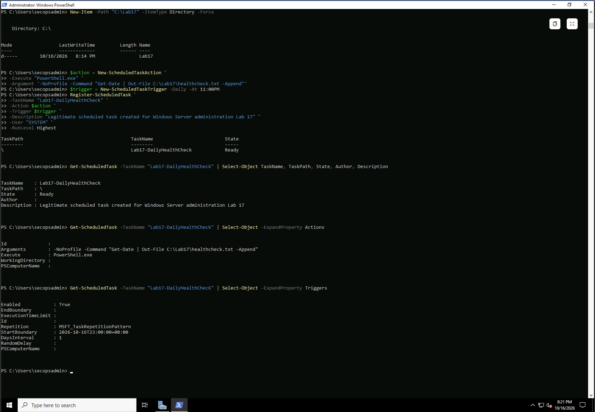

## 4.2 Task Execution and Output Validation

The task was manually started.

The first file check intentionally exposed a path mistake: `C:\Lab\healthcheck.txt` was queried instead of `C:\Lab17\healthcheck.txt`.

Correcting the path immediately returned the output file and validated a successful task result.

This small mistake was retained because it reflects real administration: troubleshooting often starts with verifying assumptions as simple as the file path being queried.

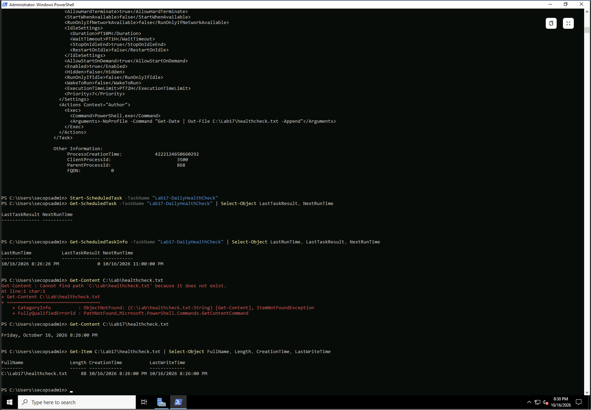

## 4.3 Operational Logging Gap

An attempt to inspect Task Scheduler operational events returned no matching data.

Rather than assuming the task had not executed, the event channel itself was inspected. The key finding was:

```text
Microsoft-Windows-TaskScheduler/Operational
IsEnabled = False
```

The channel was enabled with `wevtutil`, the task was run again, and operational telemetry appeared.

Events showed the task being queued, launched, started, executing `PowerShell.exe`, completing successfully, and finishing.

This mirrored a lesson learned earlier with Sentinel telemetry:

> Before concluding that an event does not exist, verify that the relevant logging source is actually enabled and collecting it.

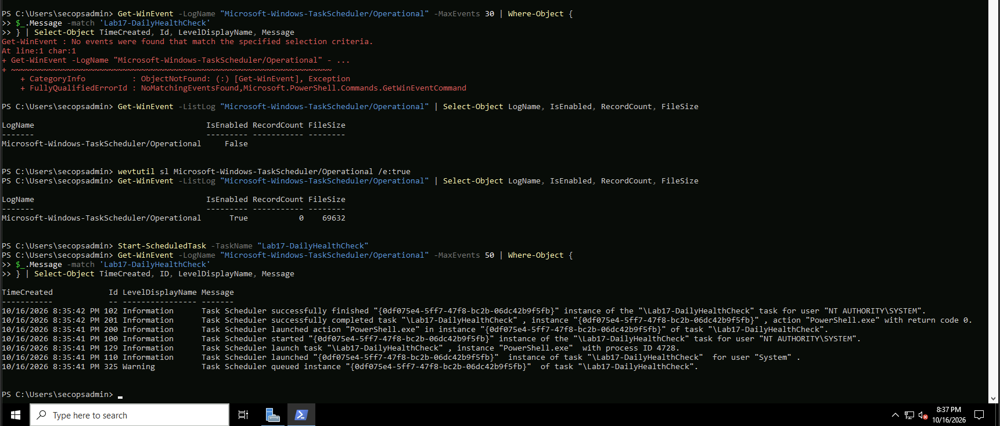

## 4.4 Task Modification and Security Event 4702

The scheduled task trigger was modified. Windows Security Event ID `4702` then recorded:

> A scheduled task was updated.

This directly connected administrative action to security auditing.

The important distinction from Lab 16 is context:

- in Lab 16, scheduled-task creation was a persistence technique
- in Lab 17, scheduled-task creation/modification was legitimate administration

The same event family can therefore represent normal operations or suspicious activity depending on who performed the action, why it occurred, and whether it matches expected behavior.

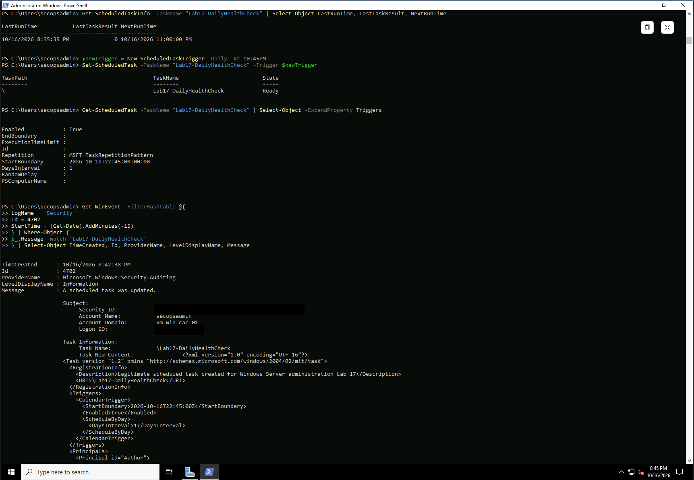

---

# Phase 5 — Network Administration and Firewall Troubleshooting

## 5.1 Windows Firewall and TCP Listener Baseline

All Windows Defender Firewall profiles were confirmed enabled.

The server's listening TCP ports were then enumerated.

A local RDP connectivity check on TCP/3389 succeeded.

This established a known-good network service before introducing a separate test port.

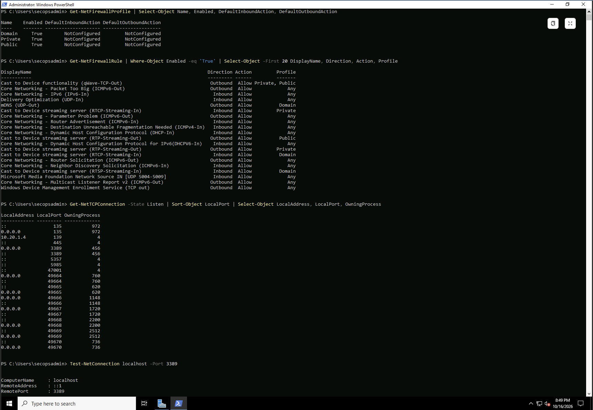

## 5.2 Mapping RDP from Service to Process to Firewall

RDP was examined across several layers:

```text
TermService
    ↓
TCP/3389 listener
    ↓
svchost.exe
    ↓
Windows Firewall rules
    ↓
Private network profile
```

This exercise showed that a working network service is not represented by one object. A service, process, TCP listener, connection profile, and firewall policy all contribute to the final behavior.

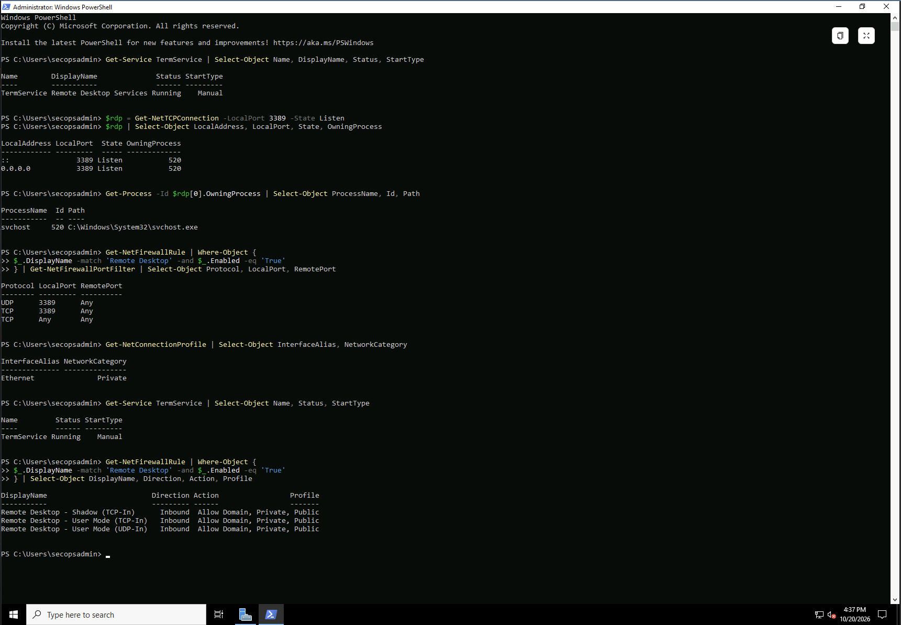

## 5.3 Creating a Controlled TCP Listener

A temporary TCP listener was created on port `8085`.

Local validation succeeded, which established:

```text
Application/listener exists ✓
Local TCP stack works ✓
Port is reachable locally ✓
```

No Windows Firewall rule existed for TCP/8085.

This created a useful troubleshooting scenario in which the application itself was healthy but remote accessibility was not yet configured.

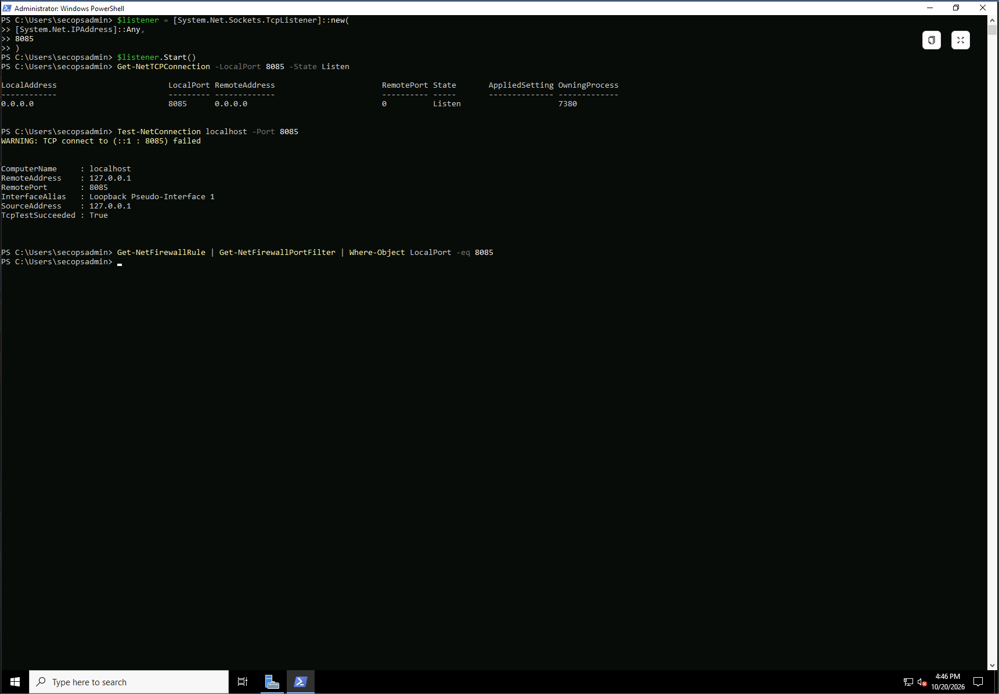

## 5.4 Testing from a Separate Management Host

The Linux management VM was used to test the Windows server remotely.

Two tests produced very different results:

- TCP/3389 succeeded
- TCP/8085 timed out

Because both tests originated from the same management host and targeted the same server, successful RDP immediately ruled out a total routing failure between the subnets.

The investigation could therefore focus on controls specific to TCP/8085.

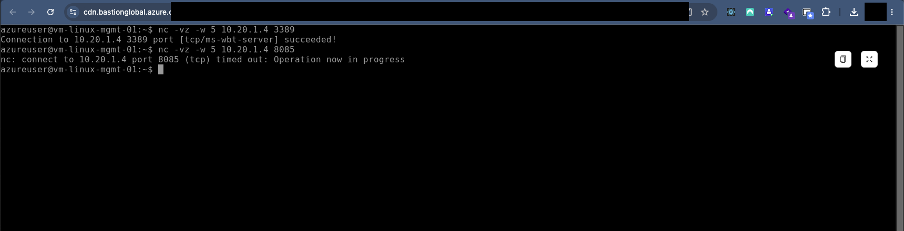

### Network troubleshooting mental model

```text
Client
  ↓
Routing
  ↓
Azure NSG
  ↓
Windows Defender Firewall
  ↓
TCP Listener
  ↓
Application
```

## 5.5 Inspecting Effective Azure NSG Rules

The effective NSG rules for the Windows server NIC showed the critical policy structure:

- allow RDP from the management subnet
- allow SSH from the management subnet
- deny other management-subnet inbound traffic
- Azure default rules after the custom rules

The rule priorities explained the behavior observed from Linux.

TCP/3389 was explicitly permitted before the broader deny rule. TCP/8085 had no earlier allow rule and therefore matched the management-subnet deny.

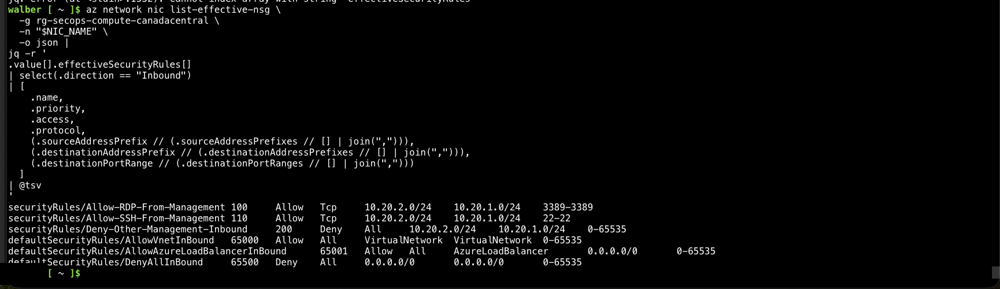

The subnet-attached NSG was then identified directly and its custom rules enumerated, confirming the same logic.

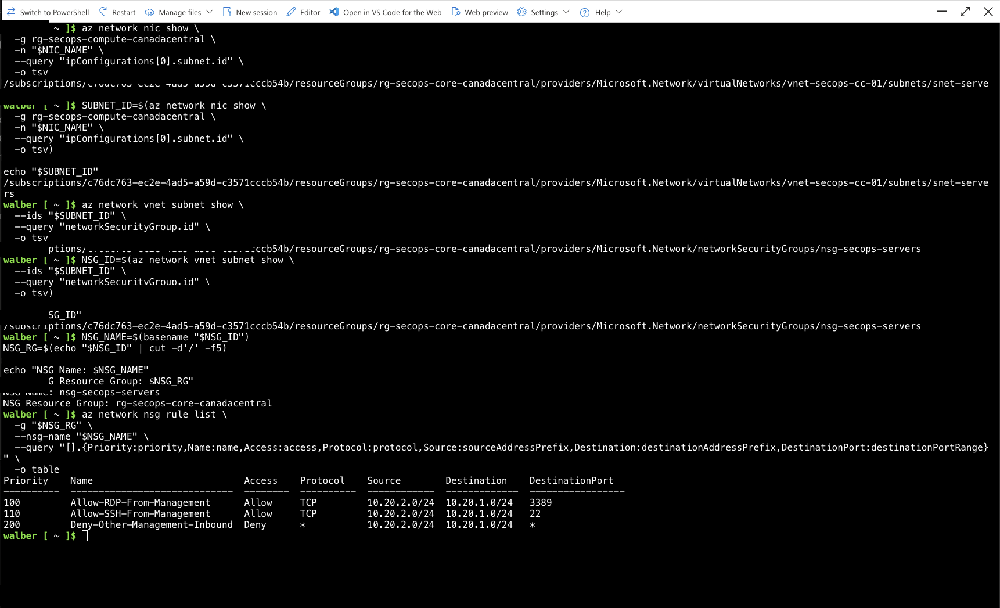

## 5.6 Adding an Azure NSG Allow Rule

A narrowly scoped inbound NSG rule was added for:

- source: management subnet
- destination: server subnet
- protocol: TCP
- destination port: 8085
- priority: 120

The new rule appeared ahead of the broad management-subnet deny.

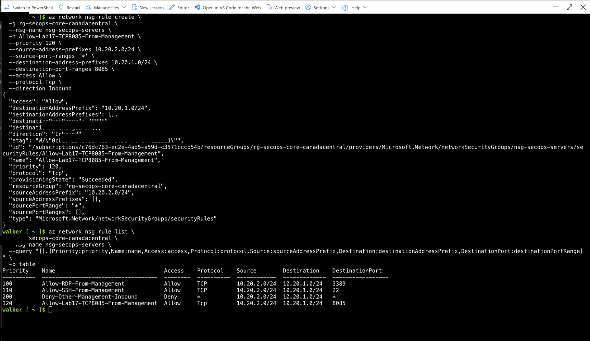

## 5.7 Why Connectivity Still Failed

Remote TCP/8085 was tested again.

It still timed out.

This was a valuable result because it proved that the Azure NSG was **one blocking layer, but not the only blocking layer**.

At this point:

```text
Listener exists ✓
Routing works ✓
Azure NSG allows 8085 ✓
Remote TCP still fails ✗
```

The remaining likely control was the Windows host firewall.

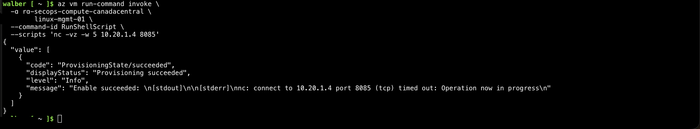

## 5.8 Adding the Windows Defender Firewall Rule

A Windows Defender Firewall rule was created specifically for:

- inbound TCP
- local port 8085
- management subnet as the remote-address scope
- Private profile only

The rule was then validated through PowerShell.

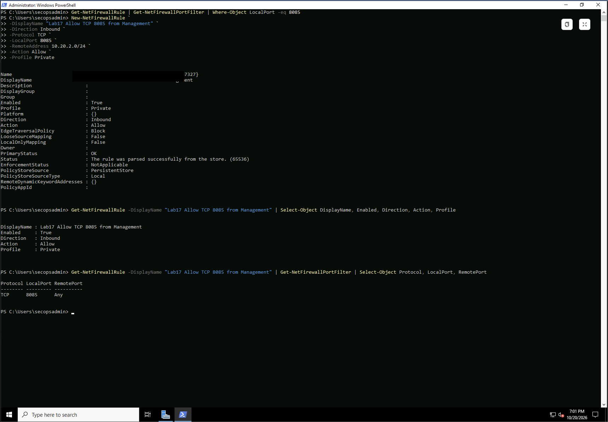

## 5.9 End-to-End Validation

The remote Linux management test finally succeeded.

The troubleshooting chain was therefore:

```text
TCP listener created
      ↓
Local test succeeds
      ↓
Remote test fails
      ↓
Effective NSG analysis
      ↓
NSG rule added
      ↓
Remote test still fails
      ↓
Windows Firewall analysis
      ↓
Host firewall rule added
      ↓
Remote test succeeds
```

This was one of the most important sections of the lab because it demonstrated **layered network security troubleshooting** rather than treating "the firewall" as a single control.

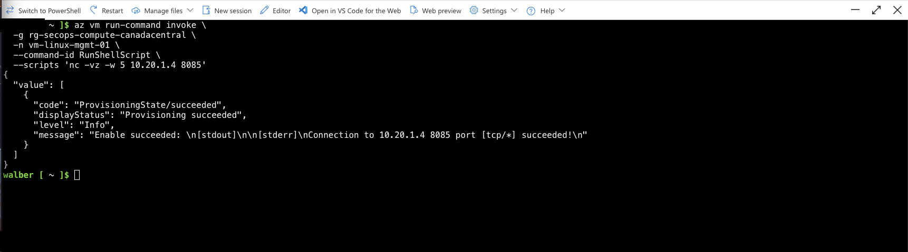

---

# Phase 6 — WinRM and PowerShell Remote Administration

## 6.1 WinRM Baseline

The Windows Remote Management service was inspected next.

The baseline confirmed:

- `WinRM` running
- automatic startup
- HTTP listener
- TCP/5985
- `Test-WSMan localhost` success

The full WinRM configuration was also reviewed to understand authentication methods, service settings, and remote shell configuration.

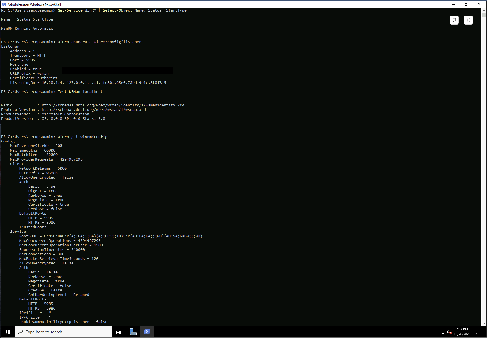

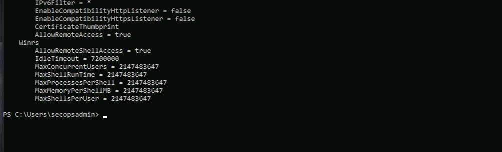

## 6.2 TCP/5985 as a Network Service

The WinRM listener was validated using the same network-layer thinking used earlier for RDP and TCP/8085.

`Get-NetTCPConnection` confirmed port 5985 listening, while `Test-NetConnection localhost -Port 5985` confirmed local connectivity.

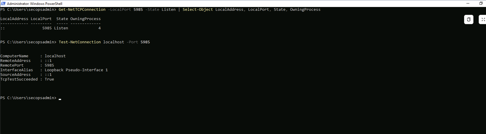

## 6.3 PowerShell Remoting

The service was then validated at the application layer.

`Invoke-Command` successfully executed commands through WinRM, and `Enter-PSSession` created an interactive PowerShell Remoting session.

This demonstrated the distinction between:

```text
Port reachable
      vs.
WSMan responding
      vs.
PowerShell Remoting functional
```

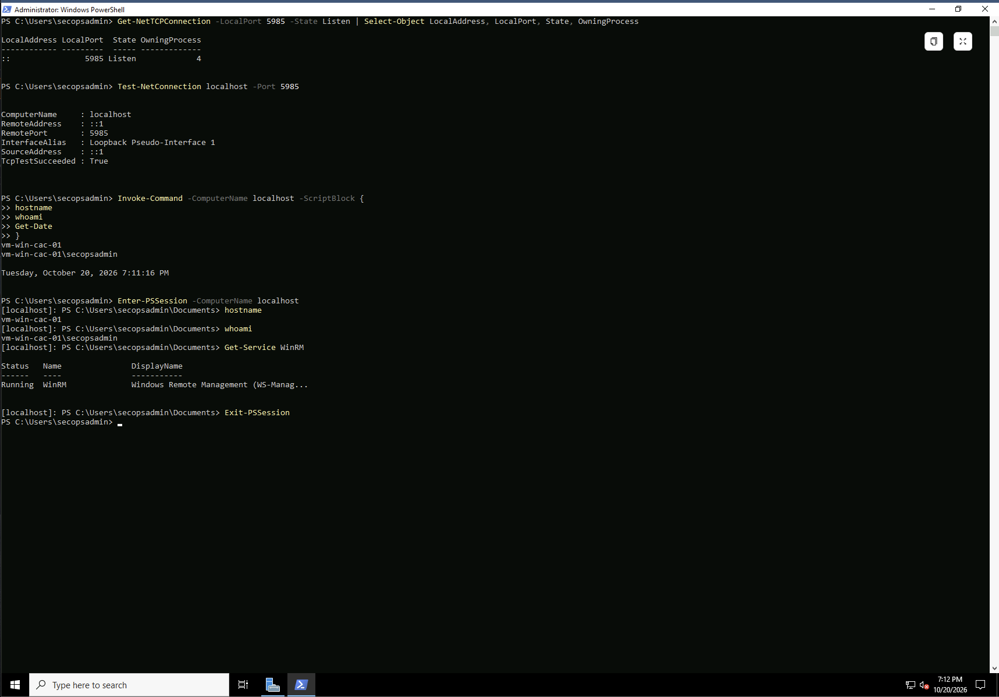

## 6.4 Remote WinRM Test from Linux

The Linux management VM tested TCP/5985 remotely.

The first attempt timed out.

Because local WinRM was healthy, this immediately shifted the investigation away from the Windows service itself and toward the network-policy layer.

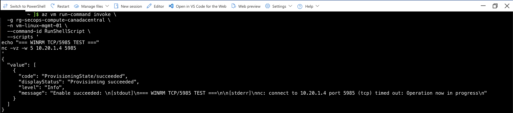

A dedicated NSG rule was then created for TCP/5985 from the management subnet, after which the remote Linux test succeeded.

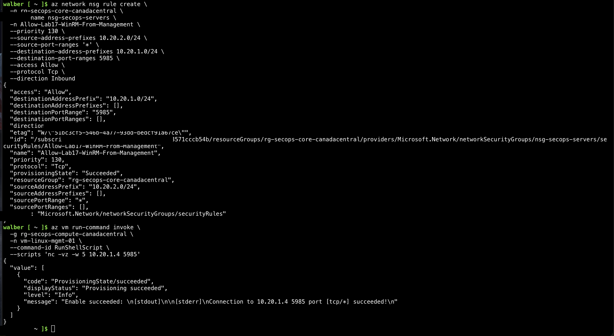

### WinRM mental model

```text
WinRM service
    ↓
WSMan listener
    ↓
TCP/5985
    ↓
Windows Firewall
    ↓
Azure NSG
    ↓
Authentication
    ↓
PowerShell Remoting
```

The server remained in a workgroup throughout this lab. This was intentional; a future Active Directory lab can revisit remote administration in a domain environment where Kerberos and centralized identity change the trust model.

---

# Phase 7 — Server Maintenance and Patch Health

## 7.1 Installed Updates

Installed hotfixes were reviewed with both:

- `Get-HotFix`
- `Win32_QuickFixEngineering`

This provided a basic patch inventory.

Windows Update-related services were then inspected. `wuauserv` was running, while BITS was stopped with Manual startup.

A stopped BITS service was not automatically treated as a problem; services configured for manual or triggered startup can legitimately remain stopped until needed.

## 7.2 Windows Update Event Evidence

Recent Windows Update Client events showed update download, installation start, and successful installation activity, including Microsoft Defender updates.

This was a more reliable operational view than simply asking whether one service happened to be running at the exact moment of inspection.

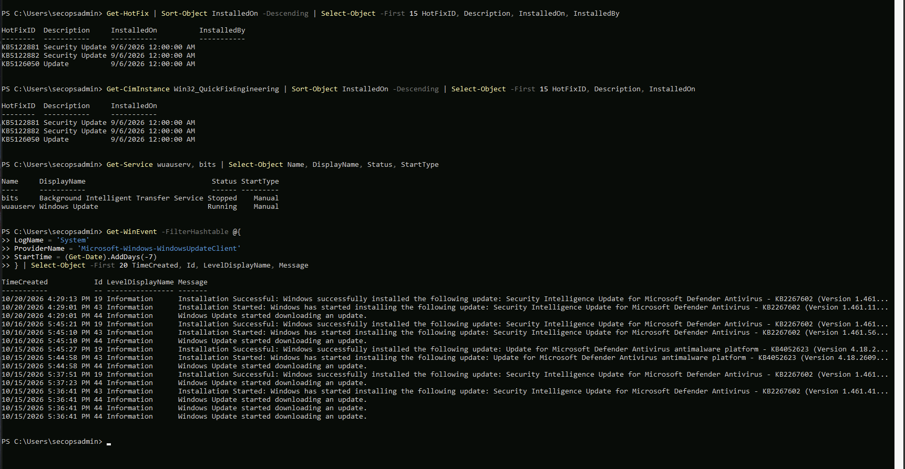

---

# Phase 8 — Storage Administration Fundamentals

## 8.1 Disk, Partition, Volume, and Filesystem

Storage was intentionally broken into layers because these terms are often incorrectly treated as interchangeable.

```text
Physical / virtual disk
        ↓
Partition
        ↓
Volume
        ↓
Filesystem
        ↓
Capacity and free space
```

`Get-Disk`, `Get-Partition`, `Get-Volume`, and `Get-PSDrive` were used to inspect the Windows OS disk.

The Azure VM exposed a Microsoft virtual disk using GPT, with system, recovery, reserved, and Windows partitions.

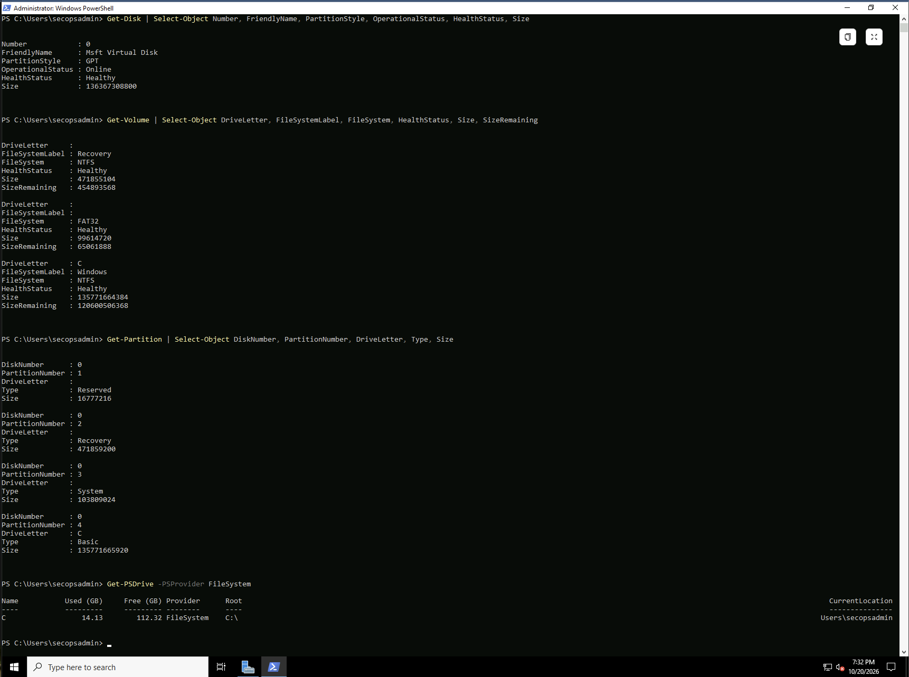

## 8.2 Capacity and Health

The C: volume was approximately 126 GB with more than 88% free capacity and a healthy status.

Physical-disk and storage-pool health were also reviewed.

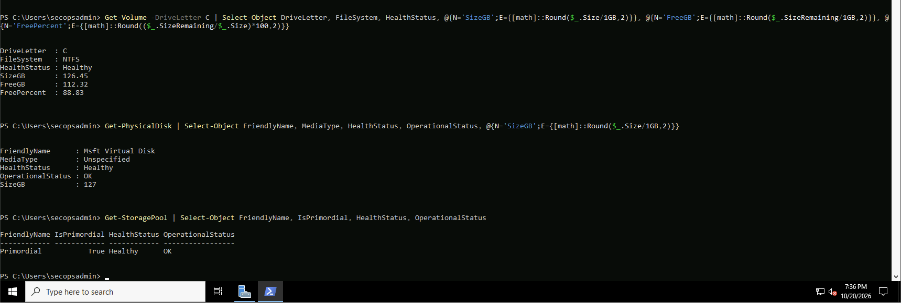

A concise PowerShell object was then created to summarize:

- drive
- total size
- free space
- free-space percentage
- health state

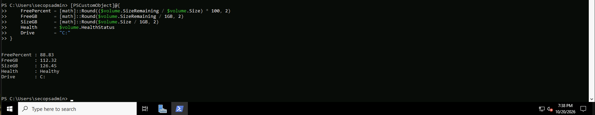

---

# Phase 9 — PowerShell Automation

## 9.1 Why Automate the Health Check

By this point the lab had repeatedly performed the same categories of operational validation:

- server identity
- uptime
- CPU and memory
- storage health
- network configuration
- firewall/network profile
- critical services
- recent System warnings and errors

Repeated manual checks are useful while learning, but they are inefficient as an operational workflow.

The next logical step was to consolidate those checks into a reusable PowerShell script.

## 9.2 `server-health-check.ps1`

The resulting script is included in the repository at:

[`../../scripts/lab17/server-health-check.ps1`](../../scripts/lab17/server-health-check.ps1)

The script collects:

```text
SERVER IDENTITY
COMPUTE
STORAGE
NETWORK
FIREWALL PROFILE
CRITICAL SERVICES
RECENT SYSTEM WARNINGS / ERRORS
```

This was not designed to replace enterprise monitoring. Its purpose is to provide a lightweight and repeatable first-pass administrative health check.

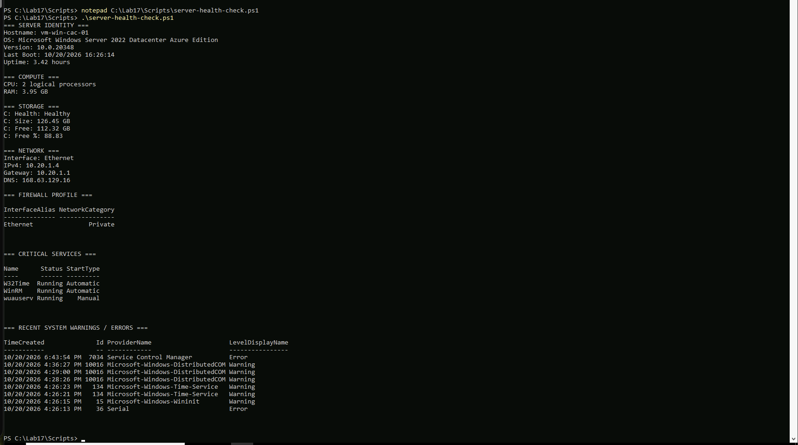

### Progression

```text
Manual administration
        ↓
Repeated troubleshooting checks
        ↓
Identify common validation steps
        ↓
PowerShell automation
        ↓
Reusable operational tool
```

---

# Phase 10 — Final Troubleshooting Challenge

The lab concluded with a controlled failure designed to combine several skills from the previous phases.

## 10.1 Scenario

The scenario was:

> Remote PowerShell administration has stopped working. RDP access remains available. Investigate the failure, identify the affected layer, validate the root cause, remediate it, and prove service recovery.

The goal was not to simply restart WinRM. The goal was to **investigate before remediation**.

## 10.2 Healthy Baseline and Controlled Failure

Before introducing the failure, the healthy state was verified:

- WinRM running
- TCP/5985 listening
- `Test-WSMan localhost` successful

WinRM was then deliberately stopped.

The resulting observations were:

- WinRM = Stopped
- TCP/5985 listener absent
- `Test-WSMan localhost` failed

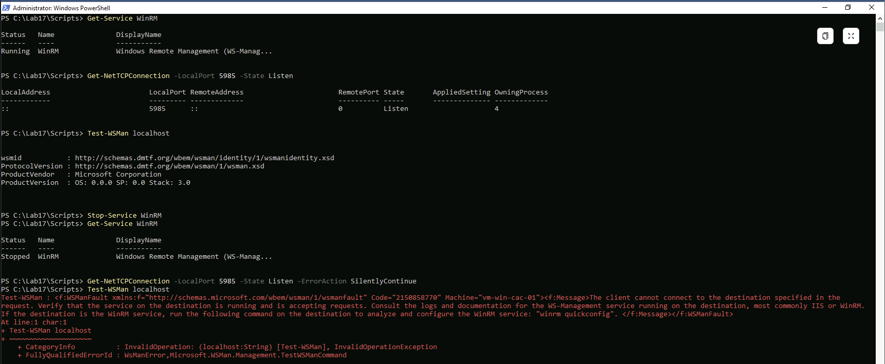

## 10.3 Correlation with the Health-Check Script and Event Log

The reusable health-check script was executed while the failure was active.

It independently reported:

```text
WinRM   Stopped
```

The System log was then queried for Service Control Manager Event ID `7036`.

The log confirmed:

> The Windows Remote Management (WS-Management) service entered the stopped state.

This created a strong evidence chain:

```text
Remote-management symptom
        ↓
Service state = Stopped
        ↓
TCP/5985 listener missing
        ↓
WSMan request fails
        ↓
Health-check detects stopped critical service
        ↓
Event 7036 confirms state transition
        ↓
Root cause isolated
```

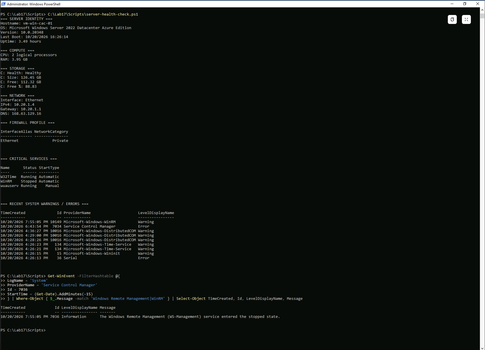

## 10.4 Recovery and Independent Validation

Only after the root cause had been isolated was WinRM restarted.

Recovery was then validated independently at multiple levels:

- `Get-Service WinRM` → Running
- TCP/5985 → Listen
- `Test-WSMan localhost` → Success
- `Invoke-Command` → Success

This matters because a successful `Start-Service` command alone does not prove that remote administration is functional.

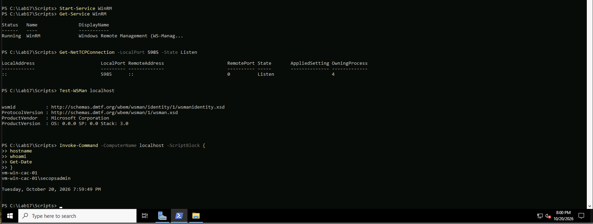

---

# Troubleshooting Methodology Used Throughout the Lab

The most important outcome of Lab 17 was not memorizing individual PowerShell commands.

The repeated methodology was:

```text
1. Observe the symptom
2. Establish the current state
3. Compare against a known-good baseline
4. Form a hypothesis
5. Test the relevant layer
6. Correlate with independent evidence
7. Make the smallest necessary change
8. Validate at multiple layers
9. Document what changed and why
```

Examples:

### Service failure

```text
Service state
→ dependencies
→ process
→ Event 7036
→ recovery
→ revalidation
```

### Network failure

```text
Remote test
→ routing inference
→ effective NSG
→ host firewall
→ listener
→ remote validation
```

### Scheduled task telemetry

```text
Task exists
→ task runs
→ output file exists
→ expected log absent
→ event channel state checked
→ logging enabled
→ execution events confirmed
```

### Historical warning

```text
Warning observed
→ current service state
→ current DNS resolution
→ current synchronization source
→ targeted recurrence search
→ no active fault found
```

---

# Important Windows Events Observed

| Event ID | Source | Meaning in this lab |
|---|---|---|
| `7036` | Service Control Manager | Service entered running/stopped state |
| `134` | Windows Time-Service | Time-service DNS/source issue observed historically |
| `4698` | Security | Scheduled task created |
| `4702` | Security | Scheduled task updated |
| `100/102/110/129/200/201/325` | Task Scheduler Operational | Task queueing, launch, action execution, and completion |
| `4688` | Security | Process creation activity visible from prior security auditing |
| `10016` | DistributedCOM | Warning-level operational noise requiring context rather than automatic remediation |

The main lesson is that an Event ID is not meaningful by itself. Context determines whether it represents:

- expected administration
- benign operational noise
- configuration failure
- security-relevant behavior

---

# Security and Network Controls Used

The lab intentionally compared two firewall/control planes:

| Control | Scope |
|---|---|
| Azure Network Security Group | Azure virtual network/subnet/NIC traffic filtering |
| Windows Defender Firewall | Host-level Windows filtering |
| Application/service listener | Whether a process or service is actually accepting connections |
| Windows service | Whether the underlying service is operational |
| PowerShell Remoting / WSMan | Application-layer remote administration |

A successful remote connection required the entire path to be valid.

This is why TCP/8085 remained inaccessible after the NSG was fixed: the host firewall still denied the traffic.

---

# Skills Demonstrated

This lab demonstrates hands-on practice with:

**Windows Server administration**
- Server Manager
- PowerShell
- local users/groups
- Windows Features
- services
- service accounts
- startup configuration
- scheduled tasks
- Event Viewer
- Windows Update
- storage administration

**Infrastructure troubleshooting**
- service/process correlation
- dependency validation
- TCP listener inspection
- firewall analysis
- cross-subnet connectivity
- layered fault isolation
- evidence-based remediation

**Azure infrastructure**
- effective NSG rules
- subnet-associated NSGs
- scoped inbound rules
- Linux management host
- Azure Run Command

**Remote administration**
- WinRM
- WSMan
- TCP/5985
- `Invoke-Command`
- `Enter-PSSession`

**Security operations**
- Security Event IDs 4698 and 4702
- Service Control Manager 7036
- telemetry-gap identification
- distinguishing legitimate administration from persistence-like behavior
- relating endpoint state to earlier Sentinel investigations

**Automation**
- reusable PowerShell server health-check script

---

# Evidence Index

## System Administration — Screenshots 01–05

| # | Evidence |
|---|---|
| 01 | Windows Server identity baseline |
| 02 | Network identity, local users, and installed features |
| 03 | Legacy Lab 11 account disabled after review |
| 04 | Server Manager local-server baseline |
| 05 | Windows services and service-account baseline |

## Services and Event Troubleshooting — Screenshots 06–12

| # | Evidence |
|---|---|
| 06 | Print Spooler service baseline and dependencies |
| 07 | Controlled Spooler failure and dependency validation |
| 08 | Spooler recovery and Event 7036 correlation |
| 09 | Event Viewer validation of Spooler Event 7036 |
| 10 | System/Application/Security event-log triage |
| 11 | Windows Time, DNS, and synchronization validation |
| 12 | No recurrent Time-Service Event 134 |

## Task Scheduler and Auditing — Screenshots 13–16

| # | Evidence |
|---|---|
| 13 | Scheduled task configuration |
| 14 | Task execution and output validation |
| 15 | Task Scheduler Operational logging enabled and validated |
| 16 | Scheduled-task modification and Security Event 4702 |

## Network and Firewall — Screenshots 17–26

| # | Evidence |
|---|---|
| 17 | Firewall profiles and TCP listeners |
| 18 | RDP service/listener/process/firewall relationship |
| 19 | Controlled TCP/8085 listener and local success |
| 20 | Remote 3389 success vs 8085 timeout |
| 21 | Effective NSG rules expose TCP/8085 block |
| 22 | Subnet NSG identification and custom-rule analysis |
| 23 | Scoped Azure NSG rule added for TCP/8085 |
| 24 | NSG fixed but TCP/8085 still blocked |
| 25 | Windows Firewall rule added for TCP/8085 |
| 26 | End-to-end remote TCP/8085 success |

## WinRM and Remote Administration — Screenshots 27–32

| # | Evidence |
|---|---|
| 27 | WinRM service, listener, and WSMan baseline |
| 28 | WinRM and remote-shell configuration |
| 29 | TCP/5985 listener and local connectivity |
| 30 | `Invoke-Command` and `Enter-PSSession` |
| 31 | Remote TCP/5985 blocked |
| 32 | WinRM NSG rule and remote validation |

## Maintenance and Storage — Screenshots 33–36

| # | Evidence |
|---|---|
| 33 | Windows Update and patch-health baseline |
| 34 | Disk, partition, volume, filesystem baseline |
| 35 | Storage capacity and physical-disk health |
| 36 | PowerShell storage-capacity summary |

## Automation — Screenshot 37

| # | Evidence |
|---|---|
| 37 | Reusable `server-health-check.ps1` execution |

## Final Troubleshooting Challenge — Screenshots 38–40

| # | Evidence |
|---|---|
| 38 | Healthy WinRM baseline followed by controlled failure |
| 39 | Health-check and Event 7036 root-cause correlation |
| 40 | WinRM recovery and PowerShell Remoting validation |

---

# Lessons Learned

Lab 17 produced several broader lessons that extend beyond Windows Server itself.

First, **a warning is not the same thing as an active incident**. The Time-Service Event 134 investigation demonstrated that current state must be validated before deciding to remediate historical evidence.

Second, **a connection failure should be decomposed into layers**. The TCP/8085 exercise showed that a listener can be healthy while both cloud and host security controls independently prevent remote access.

Third, **missing telemetry may represent a logging problem rather than an activity problem**. Task Scheduler execution was functioning correctly even though the Operational log was disabled.

Fourth, **the same Windows mechanism can be legitimate or malicious depending on context**. Scheduled tasks were persistence in Lab 16 and normal administration in Lab 17.

Fifth, **successful remediation requires validation beyond the command that performs the fix**. Restarting WinRM was followed by service, listener, WSMan, and PowerShell Remoting validation.

Finally, **repetition should eventually become automation**. The server health-check script emerged naturally from repeated manual checks performed throughout the lab.

---

# Connection to Earlier Labs

Lab 17 complements the security-operations work completed earlier in the project.

Earlier labs frequently followed:

```text
Windows event
      ↓
Log Analytics
      ↓
Microsoft Sentinel
      ↓
Analytics rule
      ↓
Alert / Incident
```

Lab 17 explored the other direction:

```text
Administrative action
      ↓
Windows service / process / scheduled task
      ↓
Operating-system state
      ↓
Windows Event Log
      ↓
Network behavior
      ↓
Telemetry
```

Understanding both sides is important for security operations. An analyst who understands how Windows actually generates and exposes the underlying behavior is better equipped to distinguish:

- detection logic problems
- telemetry problems
- operating-system problems
- network-control problems
- legitimate administration
- suspicious behavior

---

# Repository Artifacts

```text
labs/
└── lab-17-windows-server-administration/
    ├── README-lab-17.md
    └── screenshots/
        ├── 01_windows_server_identity_baseline.png
        ├── ...
        └── 40_final_challenge_winrm_recovery_and_remoting_validation.png

scripts/
└── lab17/
    └── server-health-check.ps1
```

---

# Next Step

The next infrastructure step is **Active Directory Domain Services**.

Lab 17 intentionally established the standalone Windows Server administration foundation first. The next lab can build on that baseline by introducing:

- AD DS
- DNS integration
- domain identities
- organizational units
- domain administration
- domain joining
- Group Policy
- Kerberos-based administration
- centralized authentication and authorization

That transition will allow the project to compare standalone-server administration with domain-based enterprise administration.
