# Lab 20 — Active Directory Authentication, Least Privilege, and Delegated Administration

> **Azure Security Operations Lab** · Windows Server / AD DS / DNS / Kerberos / SMB / NTFS / Delegation · Region: East US · Evidence captured November 25–26, 2026

## 1. Overview

This lab validates how an Azure-hosted, domain-joined Windows Server discovers Active Directory, authenticates domain users, receives a Kerberos security context, and enforces least-privilege access across **local files**, **SYSVOL/NETLOGON**, and **directory objects**. We then delegate one narrowly defined administrative capability—resetting passwords within the `Corp-Users` OU—to `GG-IT-Support`, test it using the non-administrative account **Bob**, and verify that an unrelated user attribute **cannot** be edited.

The lab is designed around *positive and negative controls*: a permitted operation must succeed, while a comparable operation outside the assigned permission boundary must fail. All operations were conducted in an isolated, authorized training environment. Screenshots are embedded immediately after the procedure they support.

### Learning objectives

- Confirm Azure networking, private DNS configuration, AD SRV discovery, domain connectivity, and secure channel health.
- Distinguish a domain user, local administrator, domain administrator, and delegated OU operator.
- Explain Kerberos TGT and service tickets and validate access to SYSVOL.
- Interpret **share-level** versus **NTFS** permissions and why an effective write can still be denied.
- Inspect directory access control entries (ACEs), inheritance, protection against accidental deletion, and specific delegated rights.
- Demonstrate least privilege through successful password reset and unsuccessful unrelated attribute modification.
- Preserve infrastructure for future labs while removing metered temporary access resources.

## 2. Lab architecture and prerequisites

| Component | Verified configuration / role |
|---|---|
| Azure resource group | `rg-secops-eastus` |
| VNet | `vnet-secops-eus-01`; custom DNS server `10.40.1.4` |
| Domain controller | `vm-dc-eus-01.corp.secops.test` (`10.40.1.4`) |
| Domain member server | `vm-win-eus-01.corp.secops.test` (`10.40.1.5`) |
| AD domain | `corp.secops.test` (NetBIOS `SECOPS`) |
| Domain test identity | `SECOPS\bob` / `bob@corp.secops.test` |
| Functional groups | `GG-IT-Support`, `GG-SecOps-Analysts`; separate `GG-SecOps-Admins` |
| Delegation scope | `OU=Corp-Users,DC=corp,DC=secops,DC=test` |
| Temporary test account | `lab20-testuser` in `Corp-Users` |
| Remote access | Temporary **Azure Bastion Basic**; no VM public IP shown |

The test uses PowerShell/AD DS tools on the domain member and domain controller. **A working domain secure channel does not mean the currently logged-on user has domain credentials**: the Azure VM local account `azureusereus` initially failed an AD query but the same query succeeded with explicit domain credentials.

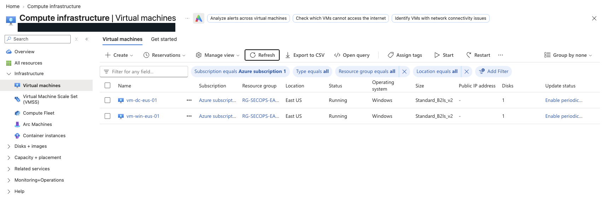

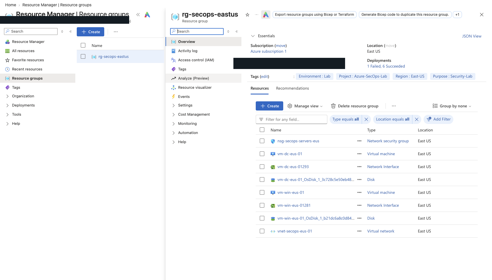

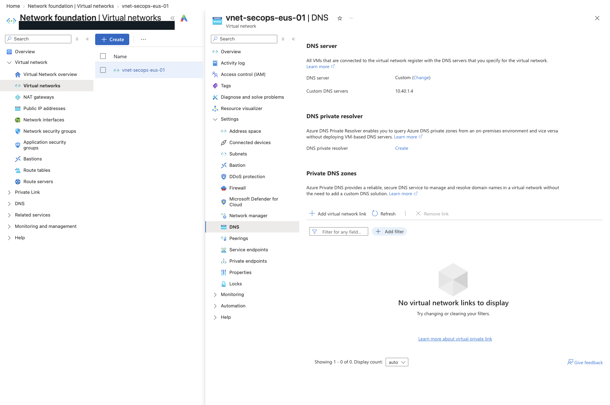

### Why custom DNS matters

Active Directory clients locate domain controllers through service (SRV) records hosted by AD-integrated DNS. A server pointed only at a generic external resolver might have network reachability yet fail domain logon, domain discovery, or Group Policy processing. In this environment, the VNet's custom DNS is `10.40.1.4`.

## 3. Validate the member-server network and domain discovery

Run from an **elevated PowerShell** session on `vm-win-eus-01`:

```powershell
hostname
ipconfig /all
Get-NetIPConfiguration
Get-DnsClientServerAddress -AddressFamily IPv4
```

**Purpose:** `hostname` identifies the actual machine; `ipconfig /all` provides primary DNS suffix, adapter address, lease and resolver; `Get-NetIPConfiguration` summarizes interface/gateway/DNS; `Get-DnsClientServerAddress` confirms the configured DNS resolver. The evidence shows `10.40.1.5` with DNS `10.40.1.4` and primary DNS suffix `corp.secops.test`.

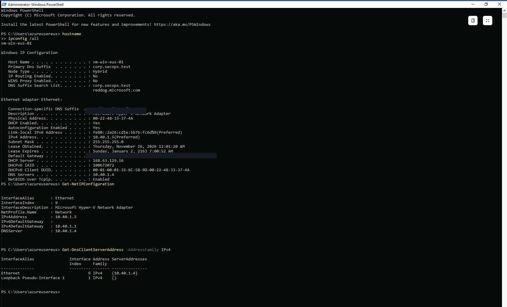

Next, query the DNS server and test domain service connectivity:

```powershell
Resolve-DnsName vm-dc-eus-01.corp.secops.test -Server 10.40.1.4 -Type A
Resolve-DnsName vm-win-eus-01.corp.secops.test -Server 10.40.1.4 -Type A
Resolve-DnsName _ldap._tcp.dc._msdcs.corp.secops.test -Server 10.40.1.4 -Type SRV

Test-NetConnection 10.40.1.4 -Port 53
Test-NetConnection 10.40.1.4 -Port 389
Test-NetConnection 10.40.1.4 -Port 88
Test-NetConnection 10.40.1.4 -Port 445
```

**Why these checks?** `A` records map hosts to IPv4 addresses; the LDAP SRV record advertises a discoverable domain controller; TCP 53/389/88/445 respectively test DNS-over-TCP, LDAP, Kerberos, and SMB reachability. **TCP success is not equivalent to complete protocol or authorization validation**, and the TCP 53 test alone does not validate UDP DNS. All four TCP probes succeeded in the screenshot.

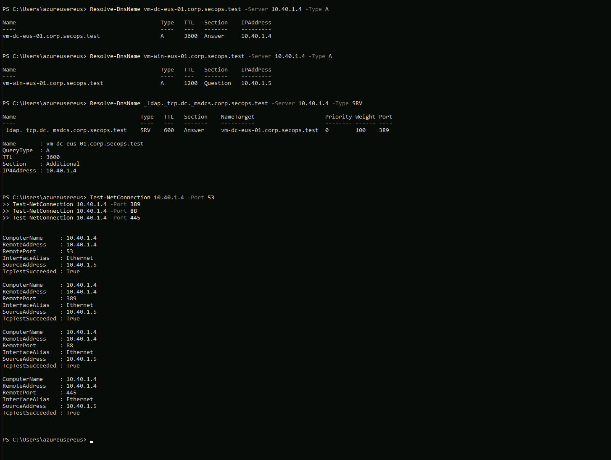

Finally, validate the domain-controller locator and machine-account trust:

```powershell
nltest /dsgetdc:corp.secops.test
Test-ComputerSecureChannel -Verbose
klist
whoami
whoami /upn
```

`nltest` uses DC locator and prints the selected DC; `Test-ComputerSecureChannel` verifies the domain member's trust relationship with AD. Both succeeded. `whoami` showed `vm-win-eus-01\azureusereus`, whereas `whoami /upn` indicated the session was not a domain user. `klist` showed zero cached tickets for that **local account**. These facts are consistent: **machine trust and user authentication are distinct security relationships**.

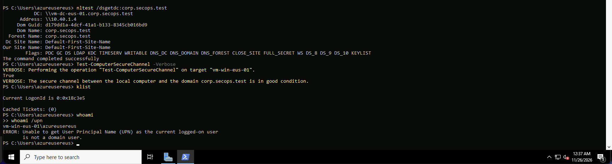

## 4. Explicit domain authentication and identity validation

Running `Get-ADDomain` as the local Azure VM account originally failed with **“The server has rejected the client credentials.”** This was an **authentication-context issue**, not proof of DNS failure or AD outage. From the same local session, explicitly pass an authorized domain credential:

```powershell
$Cred = Get-Credential   # Enter an authorized SECOPS domain account
Get-ADDomain -Server 'vm-dc-eus-01.corp.secops.test' -Credential $Cred
Get-ADUser -Identity 'bob' `
  -Server 'vm-dc-eus-01.corp.secops.test' `
  -Credential $Cred -Properties Enabled,UserPrincipalName |
  Select-Object Name,SamAccountName,Enabled,UserPrincipalName
```

`Get-Credential` prompts securely rather than embedding a password in command history or the README. `-Server` avoids ambiguity about the target DC, while `-Credential` supplies a recognized domain security principal. The domain query succeeded and `bob` was reported as enabled, UPN `bob@corp.secops.test`.

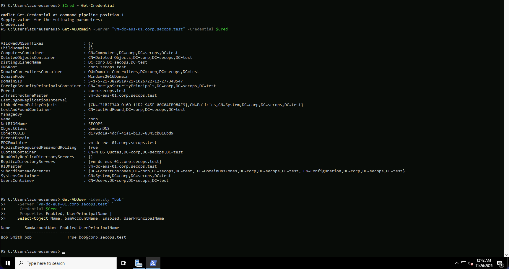

Create a **new domain-user process**, not an administrative logon:

```powershell
runas /user:SECOPS\bob powershell.exe
# In the new window:
whoami
whoami /groups
whoami /priv
```

The initial `runas` attempt failed with invalid credentials. An AD inspection subsequently showed `PasswordExpired=True`, `pwdLastSet=0`; after the password was reset/updated using an authorized identity, a fresh `runas` succeeded. The screenshot shows the PowerShell process running as `SECOPS\bob`. **No password is retained in this repository.**

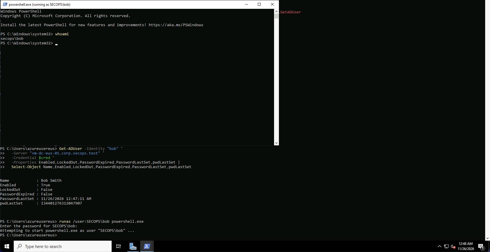

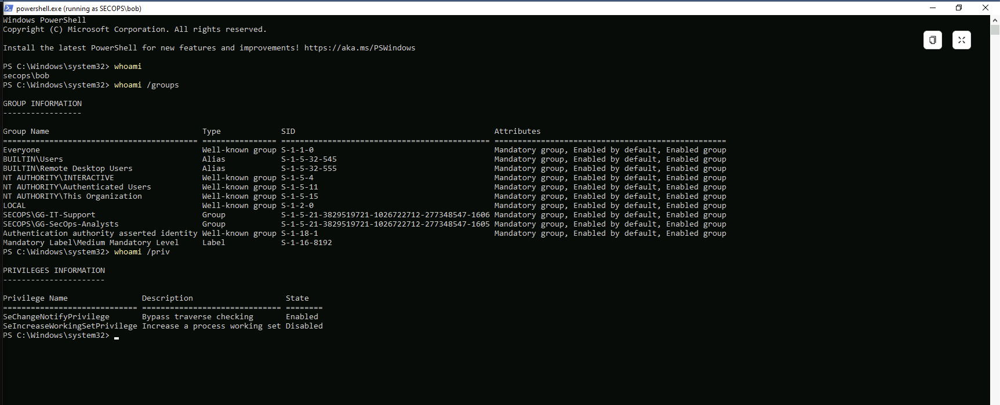

### Why this is least privilege

Bob's token includes `SECOPS\GG-IT-Support` and `SECOPS\GG-SecOps-Analysts`, but **not** `Domain Admins`, `GG-SecOps-Admins`, or the machine's local `Administrators` group. Group membership provides job-function classification and, where configured, permission to perform narrowly scoped tasks; membership in a functional group is **not inherently administrator access**.

Confirm the local administrative boundary with:

```powershell
net localgroup Administrators
whoami /all
```

The local Administrators group contained `azureusereus`, `SECOPS\Domain Admins`, and `SECOPS\GG-SecOps-Admins`, not Bob or his functional groups. `whoami /all` shows Bob's user SID, group token, and enabled/disabled privileges. Seeing the local `BUILTIN\Users` alias or Remote Desktop Users group is not evidence of administrative privilege.

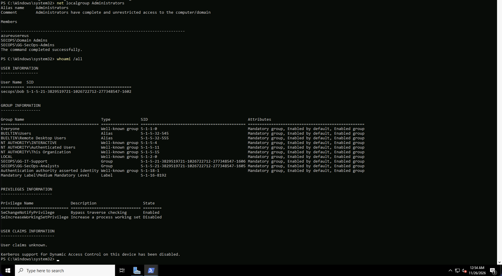

### Positive and negative filesystem controls

**Negative test — protected system directory:**

```powershell
New-Item -Path 'C:\Windows\System32\Lab20-Test' -ItemType Directory -ErrorAction Stop
```

As Bob, this returned `UnauthorizedAccessException` / **Access denied**. The check shows the present token cannot create a directory in a protected location. `-ErrorAction Stop` makes authorization failures explicit instead of allowing a script to continue silently.

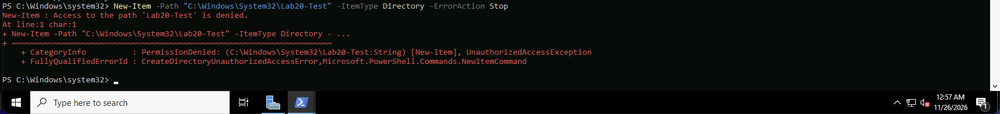

**Positive test — Bob's own user profile:**

```powershell
$TestPath = Join-Path $env:USERPROFILE 'Lab20-Authorized-Test'
New-Item -Path $TestPath -ItemType Directory -Force
New-Item -Path "$TestPath\validation.txt" -ItemType File -Force
Get-ChildItem -Path $TestPath
```

`$env:USERPROFILE` resolves to the executing user's profile, while `Join-Path` avoids hard-coding the path. The directory and file were created successfully under `C:\Users\bob`. Together, these controls demonstrate a practical permission boundary, rather than simply labeling Bob a low-privilege user.

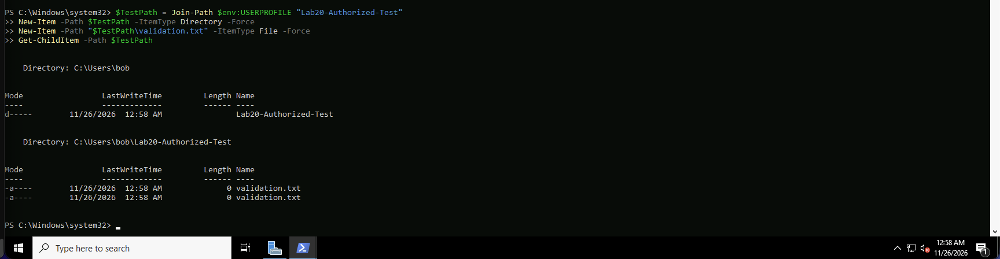

## 5. Kerberos ticket-based authentication

Inside Bob's PowerShell session:

```powershell
klist
whoami /upn
Get-ChildItem '\\vm-dc-eus-01.corp.secops.test\SYSVOL'
klist
```

`klist` lists cached Kerberos tickets: the **TGT** (`krbtgt/CORP.SECOPS.TEST`) supports obtaining service tickets, while the LDAP service ticket demonstrates access to AD-related services. After accessing the SYSVOL UNC path, the ticket cache expanded. Ticket contents and flags may depend on the actual network access path; the screenshot should be used as **evidence of Kerberos activity**, not proof that every SMB request used a particular service ticket unless that SPN is shown.

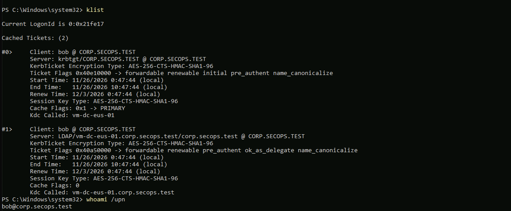

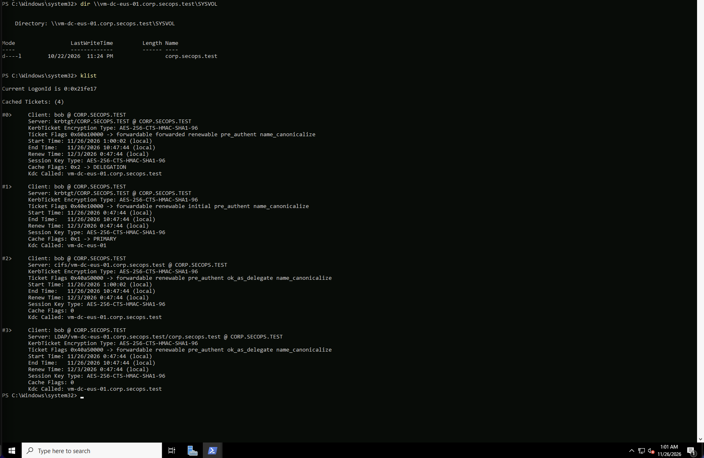

**Security significance:** Kerberos supports mutual authentication and reduces the need to transmit user passwords to each accessed service. However, possessing a valid TGT or service ticket **does not override authorization ACLs**: credentials prove identity, while ACLs determine what the identity can do.

## 6. SYSVOL and NETLOGON: share permissions versus NTFS

SYSVOL distributes Group Policy and related domain data. NETLOGON exposes the domain scripts path. They must remain readable for legitimate domain functions without becoming writable by ordinary users. The test from Bob's member-server session:

```powershell
Get-ChildItem '\\vm-dc-eus-01.corp.secops.test\SYSVOL'
New-Item -Path '\\vm-dc-eus-01.corp.secops.test\SYSVOL\Lab20-Test.txt' `
  -ItemType File -ErrorAction Stop
```

**Observed:** listing the share succeeded; writing directly into SYSVOL was rejected with `UnauthorizedAccessException`. This is a required *negative control*.

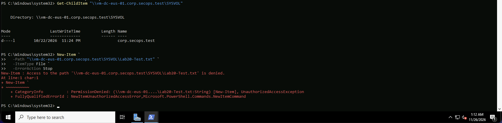

On the domain controller, inspect the effective authorization layers:

```powershell
icacls '\\vm-dc-eus-01.corp.secops.test\SYSVOL'
Get-Acl '\\vm-dc-eus-01.corp.secops.test\SYSVOL' |
  Select-Object -ExpandProperty Access |
  Format-Table IdentityReference,FileSystemRights,AccessControlType,IsInherited -AutoSize
```

`icacls` prints NTFS-style ACEs in compact form: `(RX)` indicates read/execute, `(F)` full control, `(OI)` object inheritance, and `(CI)` container inheritance. `Get-Acl` exposes the underlying access rules as structured objects. Some compound rights are presented numerically by PowerShell; **do not infer a grant merely from an unfamiliar numeric mask**. The listed ACEs include read access for Authenticated Users and stronger rights for privileged identities.

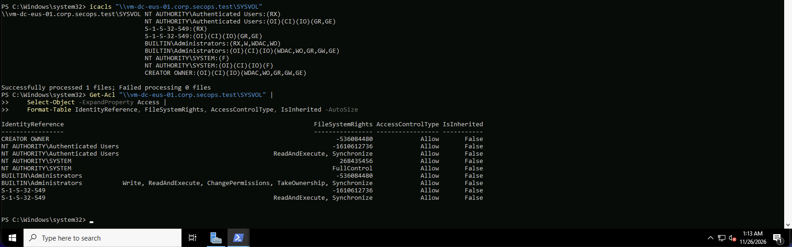

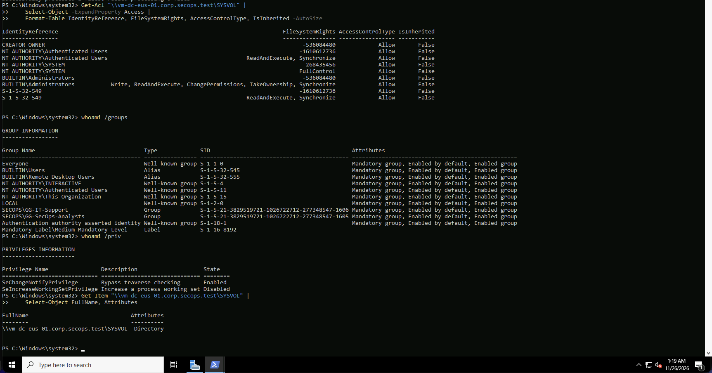

Inspect SMB share configuration directly on the DC:

```powershell
Get-SmbShare -Name SYSVOL | Select-Object Name,Path,Description
Get-SmbShareAccess -Name SYSVOL |
  Format-Table AccountName,AccessControlType,AccessRight -AutoSize

Get-SmbShare -Name NETLOGON | Select-Object Name,Path,Description
Get-SmbShareAccess -Name NETLOGON |
  Format-Table AccountName,AccessControlType,AccessRight -AutoSize
```

**Important finding:** the screenshot shows SYSVOL **share-level Full access for `NT AUTHORITY\Authenticated Users`**, although `Everyone` was listed as Read. This broad share ACE is not the same as granting those users NTFS write access. For a remote SMB operation, both layers matter; the most restrictive applicable effective permission commonly determines whether a write succeeds. A broad share permission increases reliance on correctly secured NTFS ACLs, so it should be reviewed as a **defense-in-depth configuration consideration**, not reported as a compromise or as automatically safe. NETLOGON share access showed `Everyone: Read` and `BUILTIN\Administrators: Full`.

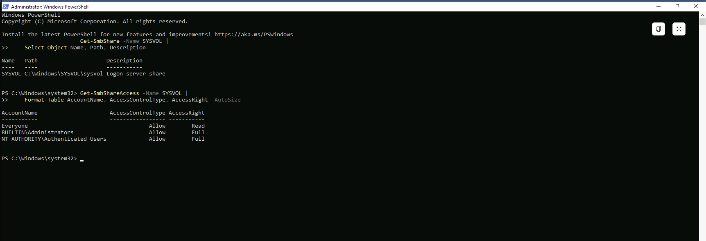

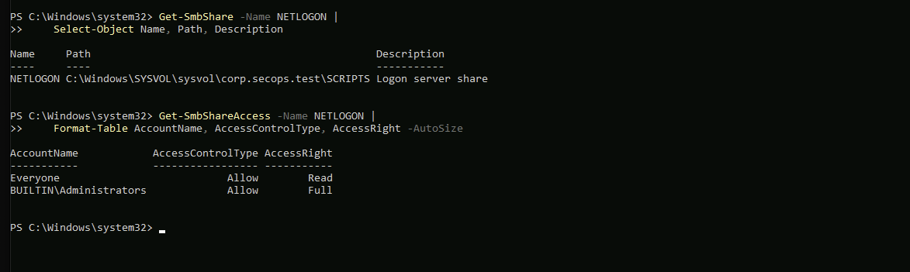

```powershell
icacls 'C:\Windows\SYSVOL\sysvol\corp.secops.test\SCRIPTS'
Get-Acl 'C:\Windows\SYSVOL\sysvol\corp.secops.test\SCRIPTS' |
  Select-Object -ExpandProperty Access |
  Format-Table IdentityReference,FileSystemRights,AccessControlType,IsInherited -AutoSize
```

The NETLOGON scripts folder's NTFS permissions show read/execute for Authenticated Users and Server Operators, with elevated permissions for system/administrative principals. The **share listing and underlying NTFS directory must both be reviewed**, because neither alone establishes end-to-end effective access.

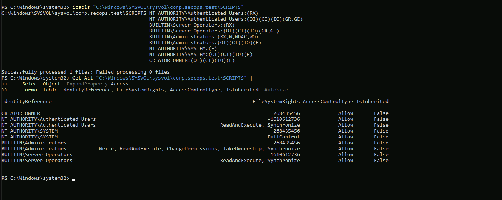

Check basic health of both AD shares:

```powershell
dcdiag /test:SysVolCheck /test:NetLogons
Get-SmbShare -Name SYSVOL,NETLOGON |
  Select-Object Name,Path,ShareState
```

`dcdiag` tests domain-controller configuration/availability of required shares; the screenshot shows **Connectivity**, **SysVolCheck**, and **NetLogons** passed, with both shares Online. These tests do **not** exhaustively prove DFS Replication health or full domain integrity.

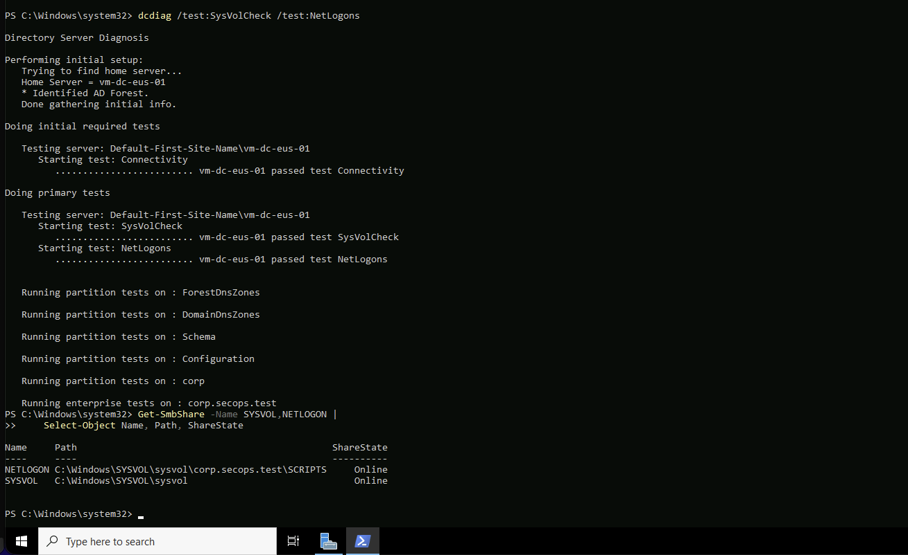

## 7. Validate privileged groups and OU security boundaries

On the DC, use AD cmdlets to review membership:

```powershell
Get-ADGroupMember -Identity 'Domain Admins' |
  Select-Object Name,SamAccountName,ObjectClass
Get-ADGroupMember -Identity 'GG-SecOps-Admins' |
  Select-Object Name,SamAccountName,ObjectClass
Get-ADPrincipalGroupMembership -Identity 'bob' |
  Select-Object Name,GroupScope,GroupCategory | Sort-Object Name
```

The direct membership output lists two domain-admin identities (`domaincontrolleruser`, `secopsadmin`) and `Alyce Johnson` in `GG-SecOps-Admins`. Bob's AD memberships are `Domain Users`, `GG-IT-Support`, and `GG-SecOps-Analysts`. This supports separation of routine IT/SOC work from broad administrative authority.

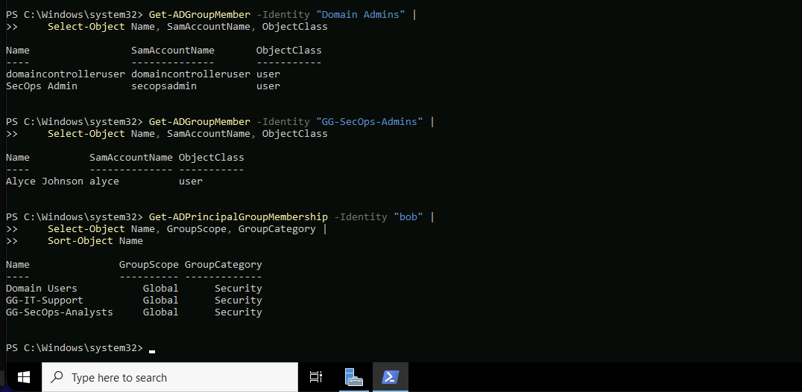

```powershell
Get-ADGroupMember -Identity 'Domain Admins' -Recursive |
  Select-Object Name,SamAccountName,ObjectClass
Get-ADGroupMember -Identity 'GG-SecOps-Admins' -Recursive |
  Select-Object Name,SamAccountName,ObjectClass
Get-ADGroupMember -Identity 'Administrators' -Recursive |
  Select-Object Name,SamAccountName,ObjectClass
```

`-Recursive` resolves nested membership instead of checking only direct members. The screenshot showed no additional nested accounts in these specific results; that is **not** a comprehensive forest-wide privilege analysis. Note that the AD `Administrators` group queried here is not identical to the local Administrators group on every domain member.

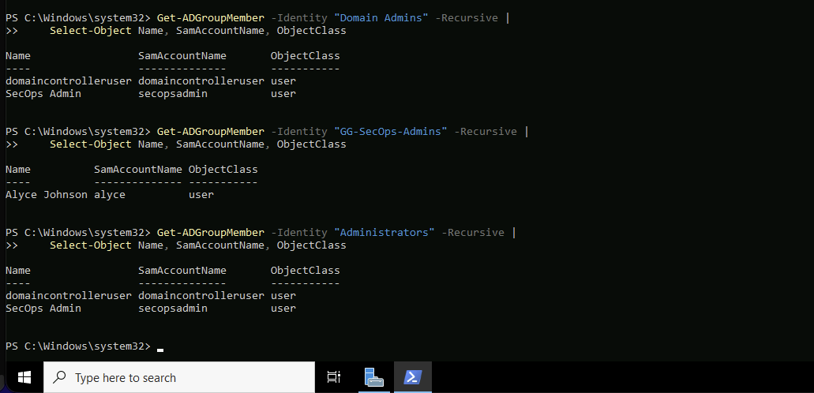

### OU access-control inspection before delegation

```powershell
$OU = Get-ADOrganizationalUnit -Identity 'OU=Corp-Users,DC=corp,DC=secops,DC=test'
$OU | Select-Object Name,DistinguishedName
$ACL = Get-Acl 'AD:\OU=Corp-Users,DC=corp,DC=secops,DC=test'
$ACL.Access |
  Select-Object IdentityReference,ActiveDirectoryRights,AccessControlType,IsInherited |
  Format-Table -AutoSize
```

An OU is an **administrative and policy boundary**, not by itself a strict security boundary against domain-wide administrators. Its ACL determines who can create/delete objects, edit attributes, or exercise particular extended rights. The initial ACL contained standard entries, including `Everyone: Deny DeleteTree, Delete`, domain administrators, system and delegated built-in operators. **ACE order, inheritance, object type and applied scope all matter** when interpreting effective permissions.

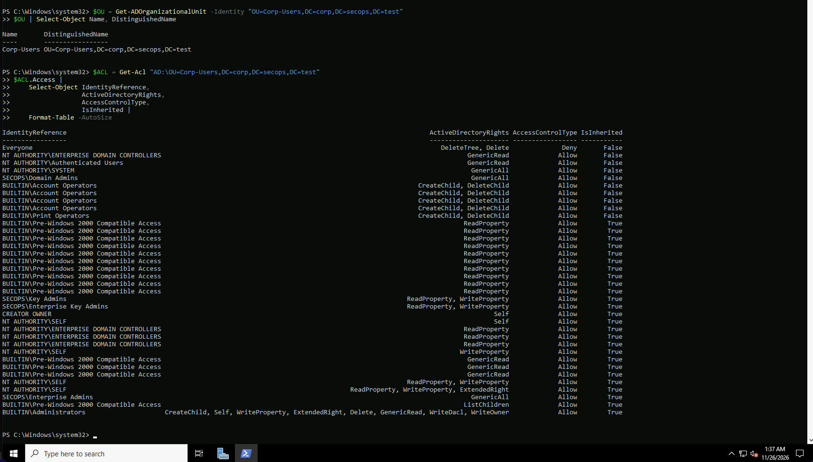

```powershell
$ACL.Access | Where-Object { -not $_.IsInherited } |
  Select-Object IdentityReference,ActiveDirectoryRights,AccessControlType,ObjectType,InheritanceType,InheritedObjectType |
  Format-List
```

Filtering non-inherited ACEs helps separate direct configuration on the OU from inherited permissions. The screenshot is a **partial console view**, not a guarantee that all ACEs are displayed within the captured area.

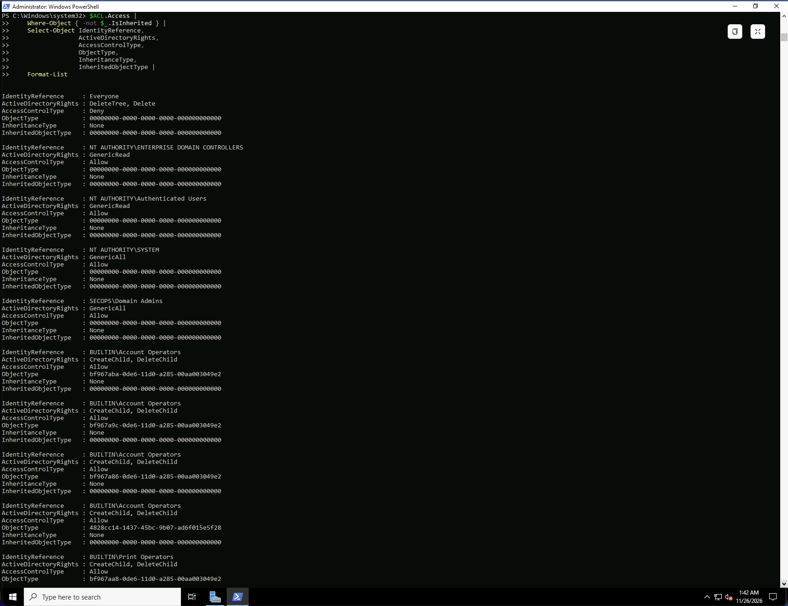

```powershell
Get-ADOrganizationalUnit -Identity 'OU=Corp-Users,DC=corp,DC=secops,DC=test' `
  -Properties ProtectedFromAccidentalDeletion |
  Select-Object Name,ProtectedFromAccidentalDeletion
```

`ProtectedFromAccidentalDeletion=True` was confirmed. **Why it matters:** an OU can contain hundreds or thousands of identities and computer objects; inadvertent deletion can disrupt authentication, policy processing, applications, and operations. This protection reduces the risk of accidental changes but is not a substitute for backups, restore testing, or privileged-access governance.

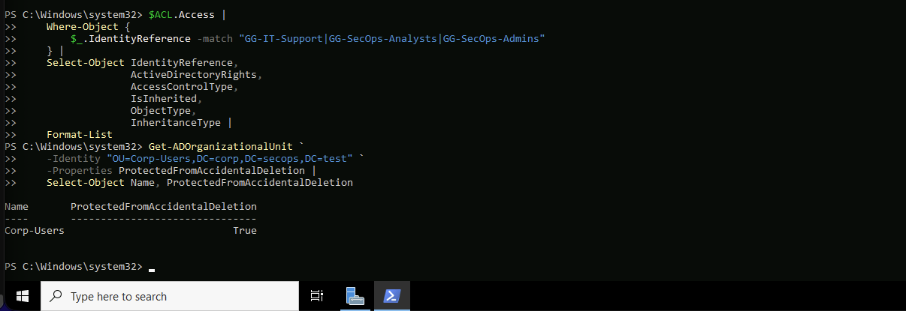

## 8. Delegate password reset to IT Support—and nothing broader

Using **Active Directory Users and Computers** on the DC:

1. Locate `corp.secops.test` → `Corp-Users` → **Delegate Control**.
2. Add the group `SECOPS\GG-IT-Support` (not Bob individually).
3. Select the delegation task **Reset user passwords and force password change at next logon**.
4. Finish the wizard and inspect resulting OU ACEs.

**Why delegate to a group?** Group-based delegation provides a repeatable, auditable role assignment and avoids granting broad rights or managing exceptions per employee. A scoped delegation can allow help-desk password resets **without placing support staff into Domain Admins**. The original wizard completion was observed during execution, but its screenshot is **not included among the 31 uploaded files**; the captured ACL below provides the persisted configuration evidence.

```powershell
Import-Module ActiveDirectory           # Loads AD cmdlets and AD: drive in this session
Get-PSDrive -Name AD                   # Confirm the AD PSProvider is mounted
$ACL = Get-Acl 'AD:\OU=Corp-Users,DC=corp,DC=secops,DC=test'
$ACL.Access |
  Where-Object { $_.IdentityReference -match 'GG-IT-Support' } |
  Select-Object IdentityReference,ActiveDirectoryRights,AccessControlType,ObjectType,InheritanceType,InheritedObjectType,IsInherited |
  Format-List
```

The first `Get-Acl AD:\...` attempt failed because the `AD:` drive did not exist in that PowerShell session. `Import-Module ActiveDirectory` initialized the provider; the retry succeeded. **No reboot or service restart was required after completing the delegation wizard.**

The later screenshot shows two **explicit** (`IsInherited=False`) ACEs for `SECOPS\GG-IT-Support`, scoped to descendant user objects. One references the *Reset Password* extended right (`00299570-246d-11d0-a768-00aa006e0529`), while the other concerns password-related property rights. This is evidence of targeted delegation; it is not evidence of unrestricted user-object modification.

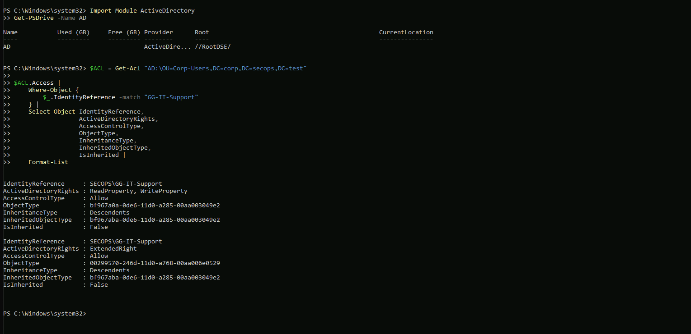

### Create a disposable target identity

From an administrator session on the DC:

```powershell
$TestOU = 'OU=Corp-Users,DC=corp,DC=secops,DC=test'
$InitialPassword = Read-Host 'Enter temporary password' -AsSecureString
New-ADUser -Name 'Lab20 Test User' `
  -SamAccountName 'lab20-testuser' `
  -UserPrincipalName 'lab20-testuser@corp.secops.test' `
  -Path $TestOU -AccountPassword $InitialPassword `
  -Enabled $true -ChangePasswordAtLogon $false `
  -Description 'Temporary account for Lab 20 delegation validation'
Get-ADUser -Identity 'lab20-testuser' -Properties Enabled,DistinguishedName |
  Select-Object Name,SamAccountName,Enabled,DistinguishedName
```

`-Path` places the user **inside the OU to which delegation applies**; `Read-Host -AsSecureString` avoids inserting plaintext credentials into saved scripts. `ChangePasswordAtLogon $false` was used for initial creation, and later changed by the delegated operator as part of the test. The account was confirmed enabled under `Corp-Users`.

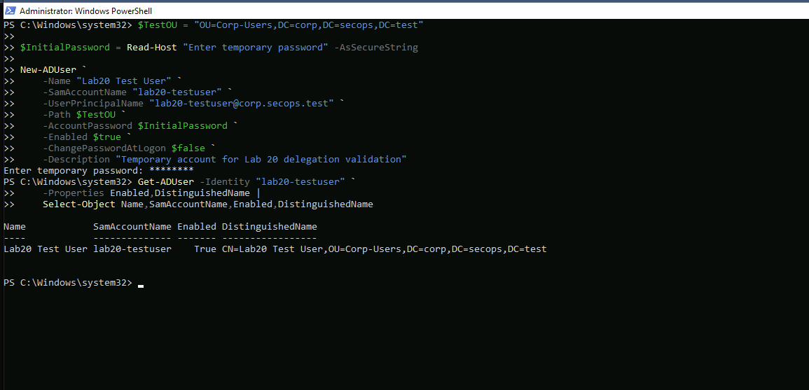

### Positive test: Bob can reset this password

In Bob's non-elevated domain PowerShell:

```powershell
whoami
whoami /groups
Import-Module ActiveDirectory
$NewPassword = Read-Host 'Enter new test password' -AsSecureString
Set-ADAccountPassword -Identity 'lab20-testuser' `
  -Server 'vm-dc-eus-01.corp.secops.test' `
  -Reset -NewPassword $NewPassword -ErrorAction Stop
Set-ADUser -Identity 'lab20-testuser' `
  -Server 'vm-dc-eus-01.corp.secops.test' `
  -ChangePasswordAtLogon $true -ErrorAction Stop
```

`Set-ADAccountPassword -Reset` performs an **administrative password reset**, not a self-service password change requiring the old password. The server authenticates Bob using his domain session. `-ChangePasswordAtLogon $true` causes the next interactive sign-in to require a password change. Both commands returned without error, followed by success messages printed by the script. **Because these messages are produced by `Write-Host`, the stronger evidence is the later directory-state inspection, not the text alone.**

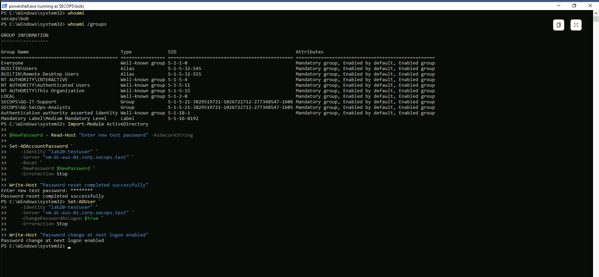

### Negative test: Bob cannot edit an unrelated user attribute

```powershell
Set-ADUser -Identity 'lab20-testuser' `
  -Server 'vm-dc-eus-01.corp.secops.test' `
  -Description 'Unauthorized Lab20 modification attempt' `
  -ErrorAction Stop
```

Expected and observed: **Insufficient access rights to perform the operation**, Active Directory error `8344`. Bob has narrowly delegated password-management capabilities, **not** blanket `WriteProperty` over arbitrary user attributes.

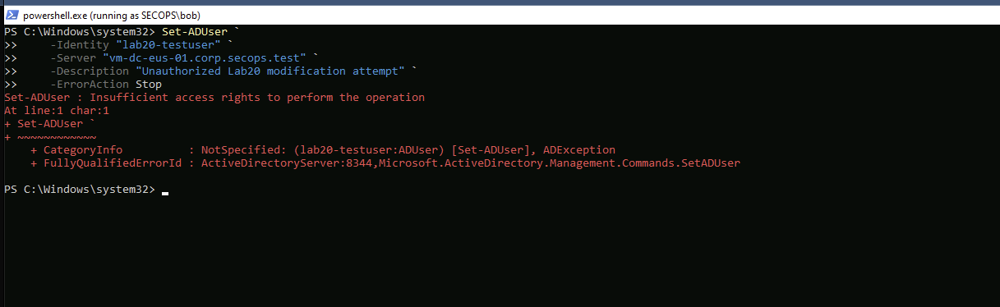

Check persistence of the original attribute:

```powershell
Get-ADUser -Identity 'lab20-testuser' `
  -Server 'vm-dc-eus-01.corp.secops.test' `
  -Properties Description,PasswordLastSet,pwdLastSet |
  Select-Object Name,Description,PasswordLastSet,pwdLastSet
```

The Description remained `Temporary account for Lab 20 delegation validation`, and `pwdLastSet=0`, consistent with **change password at next logon** being set. `PasswordLastSet` therefore displays blank in this state and should **not** be misconstrued as evidence that no password reset ever occurred. A full authentication end-to-end test for the target account was not captured.

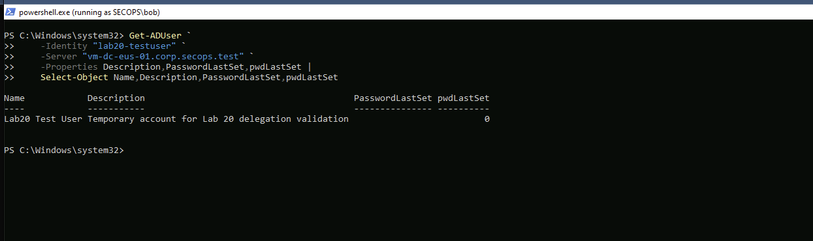

## 9. Results matrix

| Validation | Observed result | What this establishes |
|---|---|---|
| Member VNet DNS = DC IP | **Pass** | Member can query AD-integrated DNS |
| DC A/SRV records; TCP 53, 88, 389, 445 | **Pass** | Discovery records present; tested TCP endpoints reachable |
| DC locator and domain secure channel | **Pass** | Computer trust is healthy |
| AD query as local-only Azure account | **Expected failure** | Domain authorization cannot be assumed from local VM access |
| AD query with supplied domain credentials | **Pass** | Authorized user can query domain objects |
| `runas` as Bob | **Pass after credential correction** | Genuine domain-user token obtained |
| Bob in IT Support / SOC Analysts, not Administrators | **Pass** | Functional membership without observed broad admin membership |
| Write to System32 | **Expected failure** | Protected local system boundary enforced |
| Write to Bob profile | **Pass** | Authorized user-owned storage accessible |
| SYSVOL read / SYSVOL write | **Pass / expected failure** | Normal domain share use while write is blocked |
| SYSVOL/NETLOGON health | **Pass** | Shares online and specified DCDIAG tests passed |
| OU protection | **Pass** | ProtectedFromAccidentalDeletion enabled |
| Password reset and force change as Bob | **Pass** | Scoped help-desk delegation works |
| Unauthorized description modification | **Expected failure** | Nondelegated AD write permission not granted |
| Target Description persisted unchanged | **Pass** | Failed modification did not alter inspected attribute |

## 10. Troubleshooting and technical observations

| Symptom | Cause supported by evidence | Resolution or interpretation |
|---|---|---|
| `Get-ADDomain`: rejected credentials | Current logon identity was **local** `azureusereus` | Supply a legitimate domain credential with `-Credential` |
| `runas`: error 1326 | Domain test-user password invalid/expired in the attempt; state inspection showed `pwdLastSet=0` | Correct/reset credential; retest with a new process |
| `Get-Acl AD:\...`: no such drive | AD PowerShell PSProvider was not initialized in that console | `Import-Module ActiveDirectory`; verify `Get-PSDrive AD` |
| System32 creation denied | Bob lacks necessary NTFS permissions | Expected least-privilege result; no bypass required |
| SYSVOL write denied | Effective access constrained by filesystem ACL despite broad share permissions | Expected result; review both SMB and NTFS ACLs |
| `Set-ADUser -Description`: access error 8344 | Delegation covers password operations, not general attribute edits | Expected negative control; Description unchanged |
| `PasswordLastSet` blank, `pwdLastSet=0` | “Must change password at next logon” flag set | Not a contradiction with prior password reset |

### Defense-in-depth considerations

**An OU can hold critical business accounts and devices.** Deletion can interrupt services and require authoritative recovery; retain accidental-deletion protection, tested AD backups, documented recovery plans, and appropriate change control.

**Read access is not write access.** SYSVOL can be readable by authenticated employees because Group Policy distribution requires that, while NTFS should prevent unauthorized modification. Broad share-level permissions, particularly Full access for Authenticated Users as seen here, warrant periodic review; the observed blocked write confirms only the tested effective permission for the tested identity and target.

**Delegation is preferable to blanket domain administration.** Grant only the operations a role needs, scope them to the relevant OU and object class, and retest both authorized and unauthorized actions. Avoid using accounts in Domain Admins for everyday support work.

**Credential and screenshot hygiene.** Never publish passwords, password-reset values, tokens, recovery secrets, complete Azure subscription identifiers, or personal tenant emails. Internal lab hostnames and private RFC1918 addresses are retained to make the lab reproducible, but should not be interpreted as a production network map.

## 11. Cleanup, continuity and cost management

- **Confirmed in the session:** The temporary Bastion host was deleted, both virtual machines received stop commands, and the temporary Bastion public IP was subsequently deleted.
- **Preserved intentionally:** Domain controller, domain-joined member server, VNet/DNS configuration, AD OUs/groups, delegations, and the `lab20-testuser` identity for later lifecycle testing.
- **No additional AD cleanup performed:** The test account and delegated permission were intentionally retained to support future exercises. Any later removal should be performed through an explicit change-controlled cleanup lab.
- **Azure cost note:** Stopping/deallocating VMs avoids compute charges while deallocated, but managed disks and some other resources can continue billing. Do not leave a metered Bastion host or its separately billable public IP provisioned when not required.

## 12. Evidence directory

All 31 screenshots are stored under [`screenshots/`](screenshots/) and linked inline in the sequence of the lab. The source filenames were renumbered consistently; original-to-final mappings and redaction notes are in [`SCREENSHOT-MANIFEST.md`](SCREENSHOT-MANIFEST.md). Where a screenshot does not directly show a step (for example, the delegation wizard completion), this is disclosed rather than fabricated. Edited images contain **opaque redactions** and have been re-encoded with no original image metadata.

## 13. Next steps

Future exercises can examine AD event auditing for password resets (`4724`), user changes (`4738`), security-group modifications (`4728` / `4732` where applicable), Group Policy application, PowerShell/Windows event forwarding into Microsoft Sentinel, and staged removal of temporary identities. These items are **proposed follow-ups**, not completed or validated as part of Lab 20.

---

**Outcome:** Domain authentication and infrastructure connectivity were validated; Bob was shown to have *functional, non-administrative membership* plus a narrowly scoped delegated password-reset capability. Unauthorized writes to protected filesystem and AD attributes were blocked, illustrating practical least privilege with reproducible positive/negative evidence.
